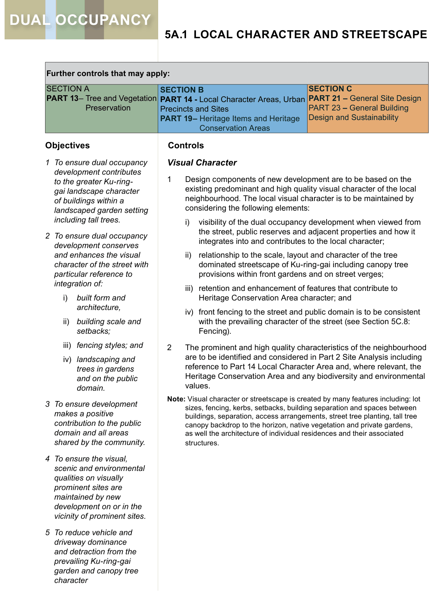

#### 5A Site Design

5A.1 Local Character and Streetscape 5A.2 Site Layout 5A.3 Building Setbacks 5A.4 Built-Upon Area 5A.5 Landscaping

### READ WITH

#### SECTION A

PART 2 – Site Analysis

PART 13 - Tree and Vegetation Preservation

#### SECTION B

PART 14 – Local Character, Urban Precincts and Sites

PART 15 – Land Contamination

PART 16 – Bushfire Risk

PART 17 – Riparian Lands

PART 18 – Biodiversity

PART 19 – Heritage and Conservation Areas

PART 20 – Development Near Road or Rail Noise

#### SECTION C

PART 21 – General Site Design

21.2: Landscape Design

PART 24 – Water Management

### SITE DESIGN

> [Picture on page 4: a map, saved as a picture (images/part-05-dual-occupancy-page-4-1.gif, 150 dpi); the street names and other small labels are on the picture.]
> [Picture text on page 4 is stored in the PDF without readable letters (no character map), so it could not be copied; see the original PDF.]
> Words printed on the picture (title and legend, copied from the PDF):
> to the greater Ku-ring-
> gai landscape character
> of buildings within a
> landscaped garden setting
> including tall trees.
> and enhances the visual
> particular reference to
> i) built form and
> ii)	 building scale and
> iii)	 fencing styles; and
> iv)	 landscaping and
> trees in gardens
> and on the public
> Note: Visual character or streetscape is created by many features including: lot
> 3	 To ensure development
> makes a positive
> contribution to the public
> domain and all areas
> shared by the community.
> sizes, fencing, kerbs, setbacks, building separation and spaces between
> buildings, separation, access arrangements, street tree planting, tall tree
> canopy backdrop to the horizon, native vegetation and private gardens,
> as well the architecture of individual residences and their associated
> scenic and environmental
> qualities on visually
> prominent sites are
> maintained by new
> vicinity of prominent sites.
> and detraction from the
> garden and canopy tree
