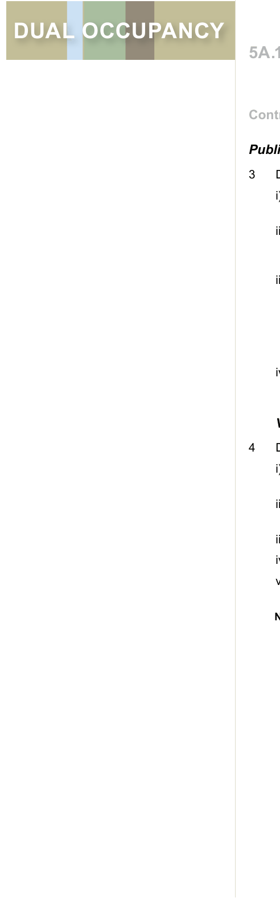
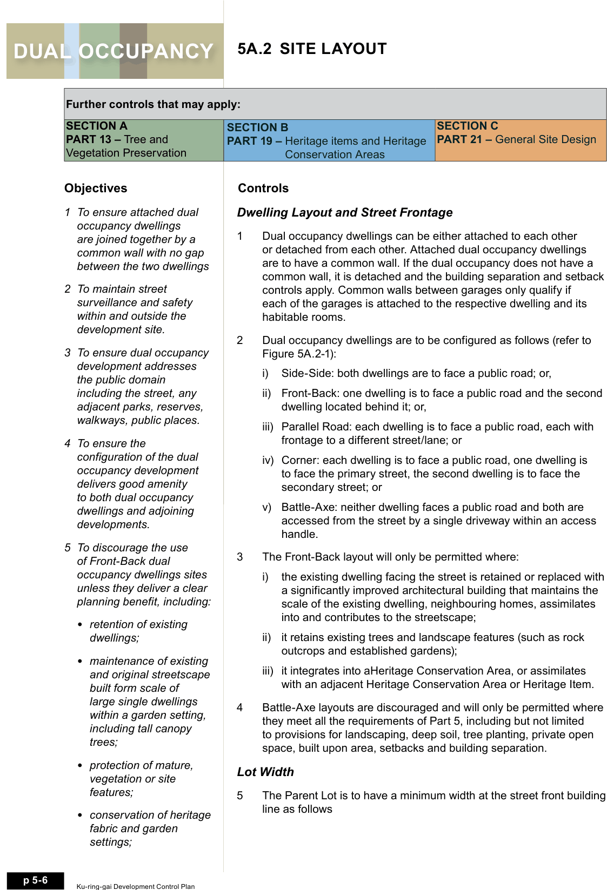

### 5A.1  LOCAL CHARACTER AND STREETSCAPE

| Further controls that may apply: |  |
|---|---|
| SECTION A SECTION B PART 13– Tree and Vegetation PART 14 - Local Character Areas, Urban Preservation Precincts and Sites PART 19– Heritage Items and Heritage Conservation Areas | SECTION C PART 21 – General Site Design PART 23 – General Building Design and Sustainability |

#### Controls

#### Objectives

#### Visual Character

1 Design components of new development are to be based on the

existing predominant and high quality visual character of the local

neighbourhood. The local visual character is to be maintained by

considering the following elements:

1	 To ensure dual occupancy

i) visibility of the dual occupancy development when viewed from

the street, public reserves and adjacent properties and how it

integrates into and contributes to the local character;

ii)	 	relationship to the scale, layout and character of the tree

dominated streetscape of Ku-ring-gai including canopy tree

provisions within front gardens and on street verges;

2	 To ensure dual occupancy

character of the street with

iii)	 retention and enhancement of features that contribute to

Heritage Conservation Area character; and

iv)	 front fencing to the street and public domain is to be consistent

with the prevailing character of the street (see Section 5C.8:

2 The prominent and high quality characteristics of the neighbourhood

are to be identified and considered in Part 2 Site Analysis including

reference to Part 14 Local Character Area and, where relevant, the

Heritage Conservation Area and any biodiversity and environmental

4	 To ensure the visual,

development on or in the

5	 To reduce vehicle and

### 5A

### 5A.1 	LOCAL CHARACTER AND STREETSCAPE

### (continued)

> [Picture on page 5: a picture, saved as a picture (images/part-05-dual-occupancy-page-5-4.gif, 150 dpi).]

#### Controls Public Domain and Urban Character

3 Development is to integrate with surrounding sites by:

i) being of a scale consistent with the neighbourhood when viewed

from the street, public domain or adjoining development;

ii)	 not exceeding a two storey appearance to the street and to all

adjacent sites including neighbouring development and public

domain;

iii)	 having a single storey presentation to the street in a Heritage

Conservation Area or adjacent to a Heritage Item in order to

be visually consistent with the height and scale of surrounding

dwellings. In a two-storey streetscape in a Heritage

Conservation Area two-storeys may be considered provided

there is demonstrated integration with the existing character.

iv)	 integrating built form and soft landscaping (gardens and trees)

with the tree canopy that links the public and private domain

throughout Ku-ring-gai.

#### Visually Prominent Sites

4 Development on visually prominent sites is to:

i) be integrated into the existing landscape through the site

analysis and design process to minimise its visual dominance;

ii)	 have a selection of external colours and finishes that are

sensitive to the site and integrate into the locality;

iii)	 retain existing landscape and vegetation elements;

iv)	 consider views to the site and from the site; and

v)	 embed the built form into the landscape by including tall trees

and shrubs that form a setting for the building. Note: Refer to dictionary for definition of visually prominent sites.

### SITE DESIGN

p 5 -5

> [Picture on page 6: a map, saved as a picture (images/part-05-dual-occupancy-page-6-1.gif, 150 dpi); the street names and other small labels are on the picture.]
> Words printed on the picture (title and legend, copied from the PDF):
> between the two dwellings
> 2	 To maintain street
> surveillance and safety
> within and outside the
> the public domain
> including the street, any
> adjacent parks, reserves,
> walkways, public places.
> secondary street; or
> 4	 To ensure the
> configuration of the dual
> delivers good amenity
> to both dual occupancy
> dwellings and adjoining
> of Front-Back dual
> occupancy dwellings sites
> planning benefit, including:
> • retention of existing
> outcrops and established gardens);
> • maintenance of existing
> and original streetscape
> built form scale of
> large single dwellings
> within a garden setting,
> including tall canopy
> • protection of mature,
> vegetation or site
> line as follows
> • conservation of heritage
> fabric and garden

Figure 5A.2-1):
