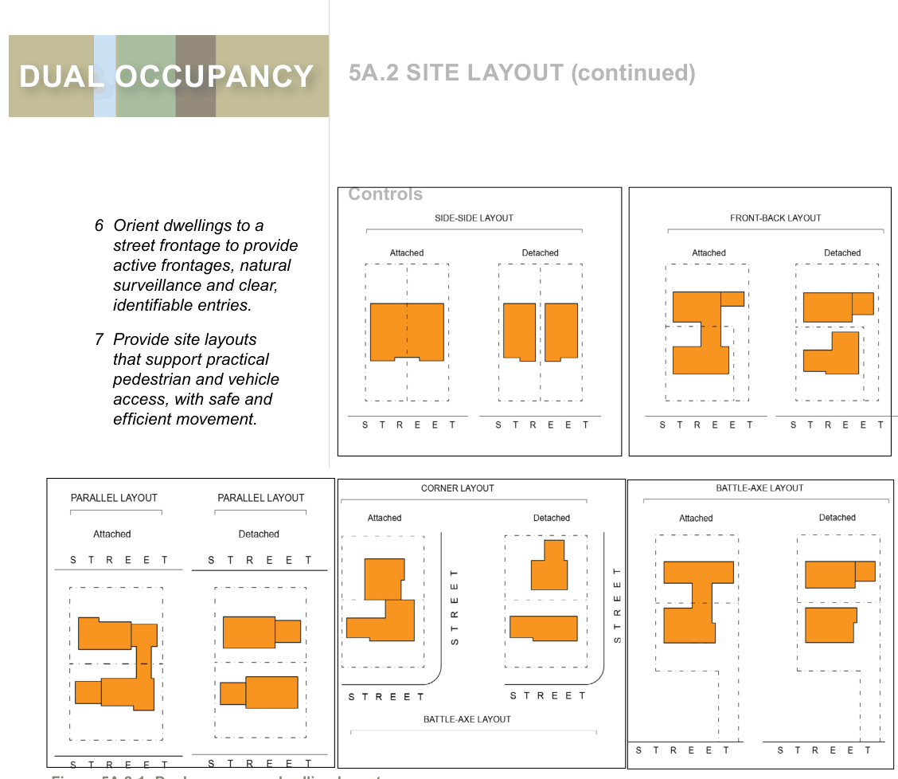
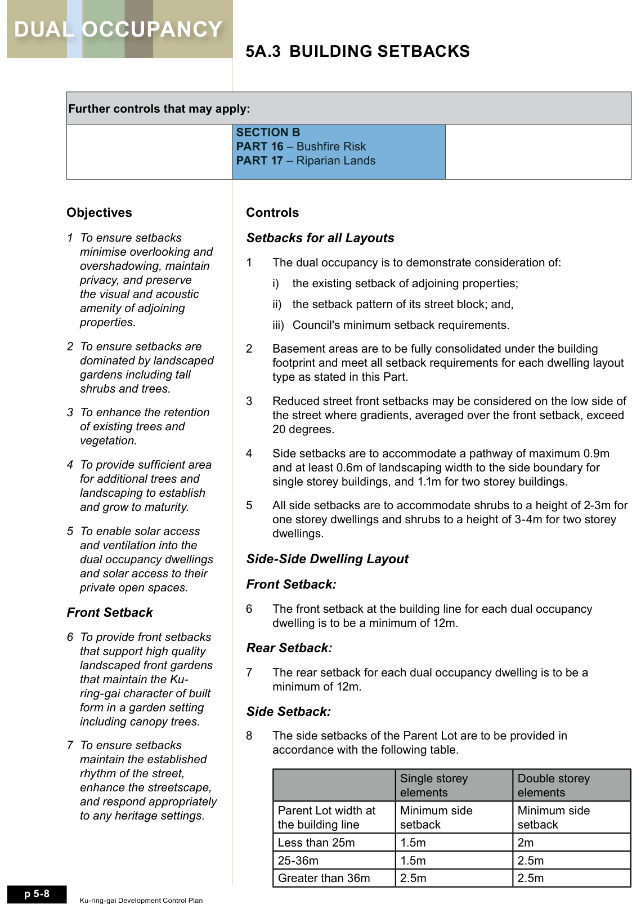

### 5A.2  SITE LAYOUT

#### Further controls that may apply:

#### SECTION C

PART 21 – General Site Design

#### SECTION B

PART 19 – Heritage items and Heritage

#### SECTION A

PART 13 – Tree and

#### Controls

#### Objectives

#### Dwelling Layout and Street Frontage

1	 To ensure attached dual

are joined together by a

common wall with no gap

1 Dual occupancy dwellings can be either attached to each other

or detached from each other. Attached dual occupancy dwellings

are to have a common wall. If the dual occupancy does not have a

common wall, it is detached and the building separation and setback

controls apply. Common walls between garages only qualify if

each of the garages is attached to the respective dwelling and its

2 Dual occupancy dwellings are to be configured as follows (refer to

i) Side-Side: both dwellings are to face a public road; or,

ii)	 Front-Back: one dwelling is to face a public road and the second

dwelling located behind it; or,

3	 To ensure dual occupancy

iii)	 Parallel Road: each dwelling is to face a public road, each with

frontage to a different street/lane; or

iv)	 Corner: each dwelling is to face a public road, one dwelling is

to face the primary street, the second dwelling is to face the

v)	 Battle-Axe: neither dwelling faces a public road and both are

accessed from the street by a single driveway within an access

3 The Front-Back layout will only be permitted where:

5	 To discourage the use

unless they deliver a clear

i) the existing dwelling facing the street is retained or replaced with

a significantly improved architectural building that maintains the

scale of the existing dwelling, neighbouring homes, assimilates

into and contributes to the streetscape;

ii)	 it retains existing trees and landscape features (such as rock

iii)	 it integrates into aHeritage Conservation Area, or assimilates

with an adjacent Heritage Conservation Area or Heritage Item.

4 Battle-Axe layouts are discouraged and will only be permitted where

they meet all the requirements of Part 5, including but not limited

to provisions for landscaping, deep soil, tree planting, private open

space, built upon area, setbacks and building separation.

#### Lot Width

5 The Parent Lot is to have a minimum width at the street front building

> [Picture on page 7: a picture, saved as a picture (images/part-05-dual-occupancy-page-7-1.gif, 150 dpi).]
> Words printed on the picture (title and legend, copied from the PDF):
> street frontage to provide
> active frontages, natural
> surveillance and clear,
> identifiable entries.
> 7	 Provide site layouts
> that support practical
> pedestrian and vehicle
> access, with safe and
> efficient movement.

### 5A.2 SITE LAYOUT (continued)

#### Controls

| Dwelling layout | Minimum lot width |
|---|---|
| Side-Side | 15m |
| Front-Back | 25m |
| Parallel Road | 12m to both frontages |
| Corner | 15m to one frontage |
| Battle-Axe | 25m |

6	 Orient dwellings to a

#### Figure 5A.2-1: Dual occupancy dwelling layouts

### SITE DESIGN

8	 Respond to the

opportunities and

constraints of each site,

including corner lots,

secondary road access,

and existing natural or

built features.

Dwelling Layout within a Heritage Conservation Area or

#### Vicinity of HCA or Heritage Item

9	 To appropriately balance

soft landscaping with

built form.

6 The Side-Side layout is not permitted within a Heritage

Conservation Area. 7 The dual occupancy layout within a Heritage Conservation Area is

to comply with the following:

10	To ensure lot widths

enable built form within

landscaped garden

settings including

tall trees, and avoid

driveway dominance.

i) Retain the existing dwelling facing the street where it is a

Contributory Item.

ii)	 Retain existing trees and landscape features (such as rock

outcrops, gardens and fencing).

iii)	 Conserve building elements and garden settings that contribute

to the character of a Heritage Conservation Area or the setting

of an adjacent Heritage Item.

> [Picture on page 8: a map, saved as a picture (images/part-05-dual-occupancy-page-8-1.gif, 150 dpi); the street names and other small labels are on the picture.]
> Words printed on the picture (title and legend, copied from the PDF):
> 1	 To ensure setbacks
> minimise overlooking and
> privacy, and preserve
> the visual and acoustic
> amenity of adjoining
> dominated by landscaped
> gardens including tall
> shrubs and trees.
> of existing trees and
> for additional trees and
> landscaping to establish
> and grow to maturity.
> and ventilation into the
> dual occupancy dwellings
> private open spaces.
> minimum of 12m.
> that support high quality
> landscaped front gardens
> that maintain the Ku-
> ring-gai character of built
> including canopy trees.
> 7	 To ensure setbacks
> maintain the established
> rhythm of the street,
> enhance the streetscape,
> and respond appropriately
> to any heritage settings.
