### 5A.3  BUILDING SETBACKS

#### Further controls that may apply:

#### SECTION B

PART 16 – Bushfire Risk

PART 17 – Riparian Lands

#### Controls

#### Objectives

#### Setbacks for all Layouts

1 The dual occupancy is to demonstrate consideration of:

i) the existing setback of adjoining properties;

ii)	 the setback pattern of its street block; and,

iii)	 Council's minimum setback requirements. 2 Basement areas are to be fully consolidated under the building

footprint and meet all setback requirements for each dwelling layout

type as stated in this Part.

2	 To ensure setbacks are

3 Reduced street front setbacks may be considered on the low side of

the street where gradients, averaged over the front setback, exceed

3	 To enhance the retention

4 Side setbacks are to accommodate a pathway of maximum 0.9m

and at least 0.6m of landscaping width to the side boundary for

single storey buildings, and 1.1m for two storey buildings.

4	 To provide sufficient area

5 All side setbacks are to accommodate shrubs to a height of 2-3m for

one storey dwellings and shrubs to a height of 3-4m for two storey

#### Side-Side Dwelling Layout Front Setback:

5	 To enable solar access

and solar access to their

#### Front Setback

6 The front setback at the building line for each dual occupancy

dwelling is to be a minimum of 12m.

#### Rear Setback:

7 The rear setback for each dual occupancy dwelling is to be a

#### Side Setback:

6	 To provide front setbacks

form in a garden setting

8 The side setbacks of the Parent Lot are to be provided in

accordance with the following table.

|  | Single storey elements | Double storey elements |
|---|---|---|
| Parent Lot width at the building line | Minimum side setback | Minimum side setback |
| Less than 25m | 1.5m | 2m |
| 25-36m | 1.5m | 2.5m |
| Greater than 36m | 2.5m | 2.5m |

### 5A.3 BUILDING SETBACKS (continued)

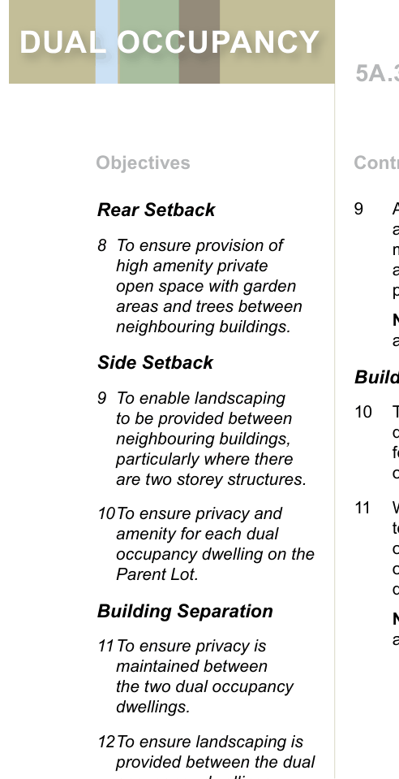

> [Picture on page 9: a map, saved as a picture (images/part-05-dual-occupancy-page-9-2.gif, 150 dpi); the street names and other small labels are on the picture.]
> Words printed on the picture (title and legend, copied from the PDF):
> high amenity private
> open space with garden
> areas and trees between
> 9	 To enable landscaping
> to be provided between
> particularly where there
> are two storey structures.
> amenity for each dual
> occupancy dwelling on the
> the two dual occupancy
> provided between the dual

#### Objectives

#### Controls

#### Rear Setback

9 All windows above the ground floor that face neighbouring properties

are to screen view lines to neighbouring properties. This includes

minimising the number of habitable rooms with a primary aspect to

a side boundary, offsetting window locations between neighbouring

properties, use of directional screens, hoods and blades.

8	 To ensure provision of

Note: solutions are not to impact on daylight and natural ventilation

amenity of habitable rooms.

#### Side Setback

#### Building Separation:

10 The minimum building separation between detached Side-Side

dual occupancy dwellings is 3m. The minimum distance with

fencing equally dividing the separation area between the two dual

occupancies.

10	To ensure privacy and

11 Windows within the building separation area are to screen view lines

to neighbouring properties. This includes minimising the number

of habitable rooms with a primary aspect to a side boundary,

offsetting window locations between neighbouring properties, use of

directional screens, hoods and blades.

#### Building Separation

Note: solutions are not to impact on daylight and natural ventilation

amenity of habitable rooms.

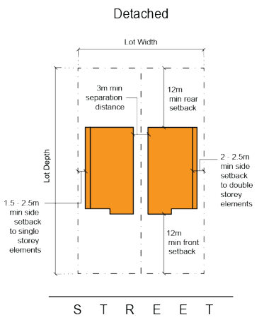

> [Picture on page 9: a picture, saved as a picture (images/part-05-dual-occupancy-page-9-29.gif, 150 dpi).]

11	To ensure privacy is

12	To ensure landscaping is

occupancy dwellings.

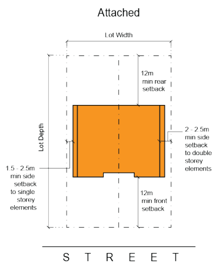

> [Picture on page 9: a picture, saved as a picture (images/part-05-dual-occupancy-page-9-33.gif, 150 dpi).]

### SITE DESIGN

#### Figure 5A.3-1: Side-Side dual occupancy dwelling indicative layout and setbacks

p 5 -9

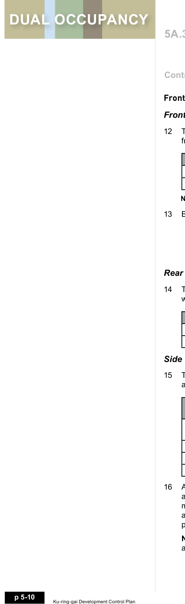

> [Picture on page 10: a picture, saved as a picture (images/part-05-dual-occupancy-page-10-1.gif, 150 dpi).]

#### Controls Front-Back Dwelling Layout Front Setback:

12 The front setback at the building line of the dwelling facing the street

frontage is to be provided in accordance with the following table

| Street | Minimum Front Setback | Average |
|---|---|---|
| Low Side | 9m | 11m |
| High Side | 12m | 14m |

Note: Refer to Part 1B Dictionary for definitions of Low Side and High Side. 13 Buildings are to be located so that:

i)	 at least 75% of the front elevation of the building is set back

not less than the specified average setbacks; and

ii)	the balance of the building frontage (not more than 25%) may

be located up to the minimum setback.

#### Rear Setback:

14 The rear setbacks of the Parent Lot are to be provided in accordance

with the following table:

| Parent Lot depth | Minimum required rear setback |
|---|---|
| 48m or less | 8m |
| Greater than 48m | 12m |

#### Side Setback:

15 The side setbacks of the Parent Lot are to be provided in

accordance with the following table:

|  | Single storey elements | Double storey elements |
|---|---|---|
| Parent Lot width at the building line | minimum side setback | minimum side setback |
| Less than 25m | 1m | 2m |
| 25-36m | 1.5m | 2.5m |
| Greater than 36m | 2.5m | 2.5m |

16 All windows above the ground floor that face neighbouring properties

are to screen view lines to neighbouring properties. This includes

minimising the number of habitable rooms with a primary aspect to

a side boundary, offsetting window locations between neighbouring

properties, the use of directional screens, hoods and blades. Note: solutions are not to impact on daylight and natural ventilation

amenity of habitable rooms.

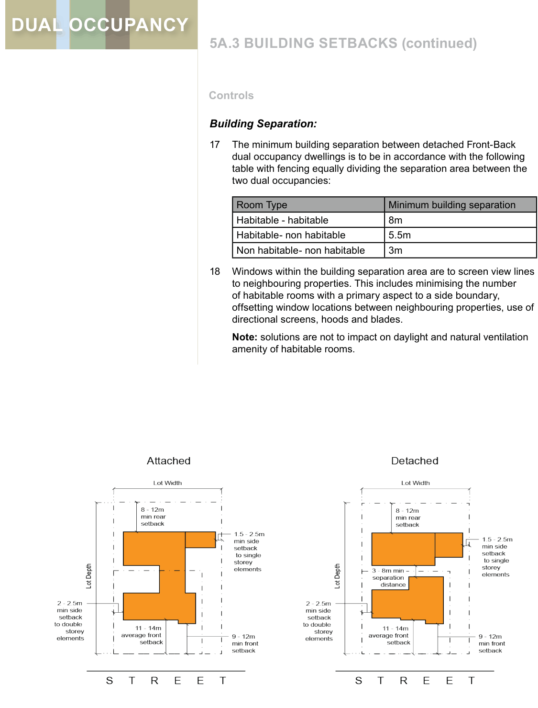

> [Picture on page 11: a picture, saved as a picture (images/part-05-dual-occupancy-page-11-1.gif, 150 dpi).]

#### Controls Building Separation:

17 The minimum building separation between detached Front-Back

dual occupancy dwellings is to be in accordance with the following

table with fencing equally dividing the separation area between the

two dual occupancies:

| Room Type | Minimum building separation |
|---|---|
| Habitable - habitable | 8m |
| Habitable- non habitable | 5.5m |
| Non habitable- non habitable | 3m |

18 Windows within the building separation area are to screen view lines

to neighbouring properties. This includes minimising the number

of habitable rooms with a primary aspect to a side boundary,

offsetting window locations between neighbouring properties, use of

directional screens, hoods and blades. Note: solutions are not to impact on daylight and natural ventilation

amenity of habitable rooms.

### SITE DESIGN

Figure 5A.3-2: Front-Back dual occupancy dwelling indicative layout and setbacks

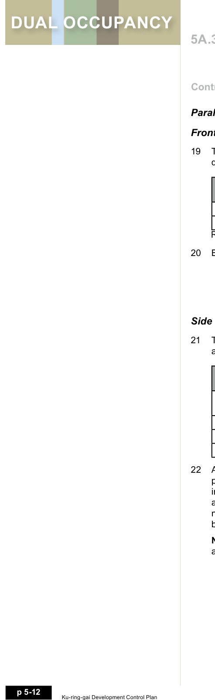

> [Picture on page 12: a picture, saved as a picture (images/part-05-dual-occupancy-page-12-1.gif, 150 dpi).]

#### Controls Parallel Road Dwelling Layout Front Setback:

19 The front setback at the building line to each dual occupancy

dwelling is to be provided in accordance with the following table:

| Street | Minimum required front setback | Average |
|---|---|---|
| Low side | 9m | 11m |
| High side | 12m | 14m |

Refer to Part 1 Dictionary for definitions of low side and high side. 20 Buildings are to be located so that:

i)	 at least 75% of the front elevation of the building is set back

not less than the specified average setbacks; and

ii)	the balance of the building frontage (not more than 25%) may

be located up to the minimum setback.

#### Side Setback:

21 The side setbacks of the Parent Lot are to be provided in

accordance with the following table

|  | Single storey elements | Double storey elements |
|---|---|---|
| Parent Lot width at the building line | Minimum side setback | Minimum side setback |
| Less than 25m | 1m | 2m |
| 25-36m | 1.5m | 2.5m |
| Greater than 36m | 2.5m | 2.5m |

22 All windows above the ground floor that face neighbouring

properties are to screen view lines to neighbouring properties. This

includes minimising the number of habitable rooms with a primary

aspect to a side boundary, offsetting window locations between

neighbouring properties, the use of directional screens, hoods and

blades. Note: solutions are not to impact on daylight and natural ventilation

amenity of habitable rooms.

#### Building Separation:

23 The minimum building separation between detached Parallel

Road Site dual occupancy dwellings is 8m, and fencing is to be

equally divided between the two dual occupancies: 24 Windows within the building separation area are to screen view

lines to neighbouring properties. This includes minimising the

number of habitable rooms with a primary aspect to a side

boundary, offsetting window locations between neighbouring

properties, use of directional screens, hoods and blades. Note: solutions are not to impact on daylight and natural

ventilation amenity of habitable rooms.

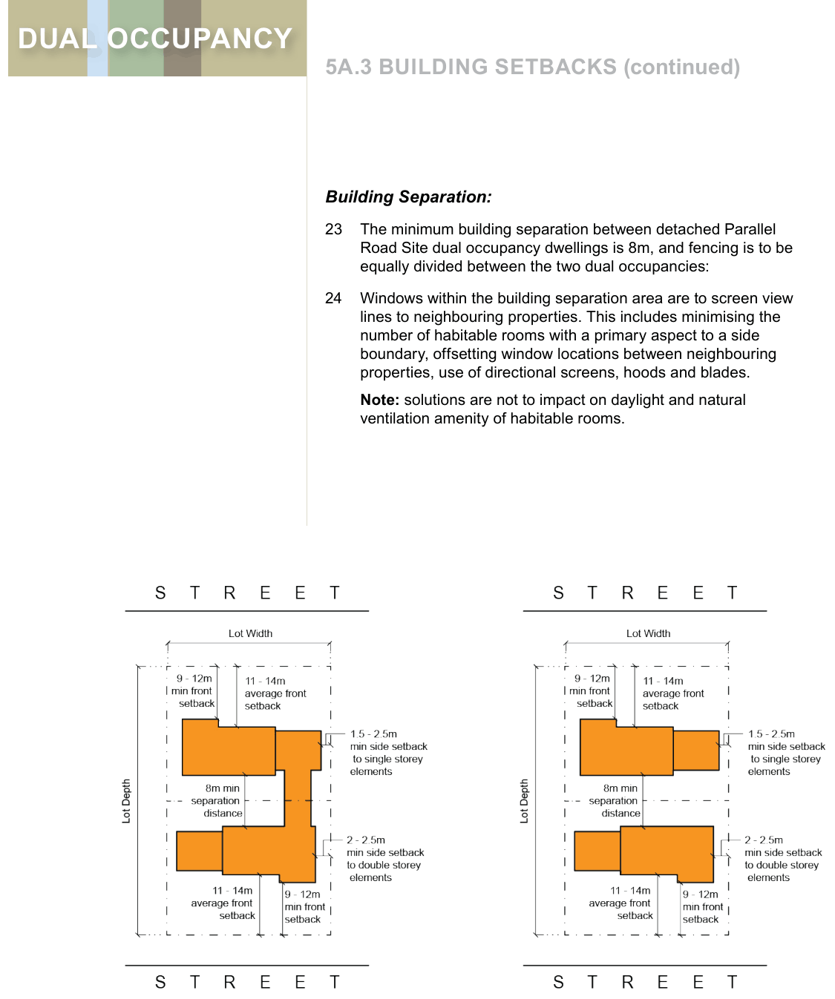

> [Picture on page 13: a picture, saved as a picture (images/part-05-dual-occupancy-page-13-12.gif, 150 dpi).]

### SITE DESIGN

#### Figure 5A.3-3: Parallel road typology indicative layout and setbacks

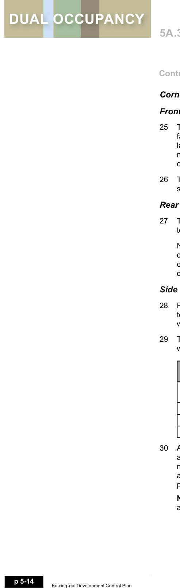

> [Picture on page 14: a picture, saved as a picture (images/part-05-dual-occupancy-page-14-1.gif, 150 dpi).]

#### Controls Corner Dwelling Layout Front Setback:

25 The front setback at the building line for the dual occupancy dwelling

facing the nominated primary street frontage is to be 12m. Where all

landscape and amenity requirements are met, merit consideration

may be given where no alternative design is possible, for example

on shallow sites. 26 The front setback for the dual occupancy dwelling facing the

secondary road is to be a minimum of 6m.

#### Rear Setback:

27 The rear setbacks for dual occupancy facing the secondary street is

to be 8m minimum. Note: The rear and side boundaries of the secondary street facing

dwelling are interchangeable and can be nominated to suit site

conditions and a site layout that achieves high amenity for the

dwelling, private open space, and landscape character.

#### Side Setback:

28 For the dwelling fronting the primary road, the minimum side setback

to the secondary road is to be a minimum of 3m, regardless of lot

width. 29 The side setbacks of the Parent Lot are to be provided in accordance

with the following table

|  | Single storey elements | Double storey elements |
|---|---|---|
| Parent Lot width at the building line | Minimum side setback | Minimum side setback |
| Less than 25m | 1.5m | 2m |
| 25-36m | 1.5m | 2.5m |
| Greater than 36m | 2.5m | 2.5m |

30 All windows above the ground floor that face neighbouring properties

are to screen view lines to neighbouring properties. This includes

minimising the number of habitable rooms with a primary aspect to

a side boundary, offsetting window locations between neighbouring

properties, the use of directional screens, hoods and blades. Note: solutions are not to impact on daylight and natural ventilation

amenity of habitable rooms.

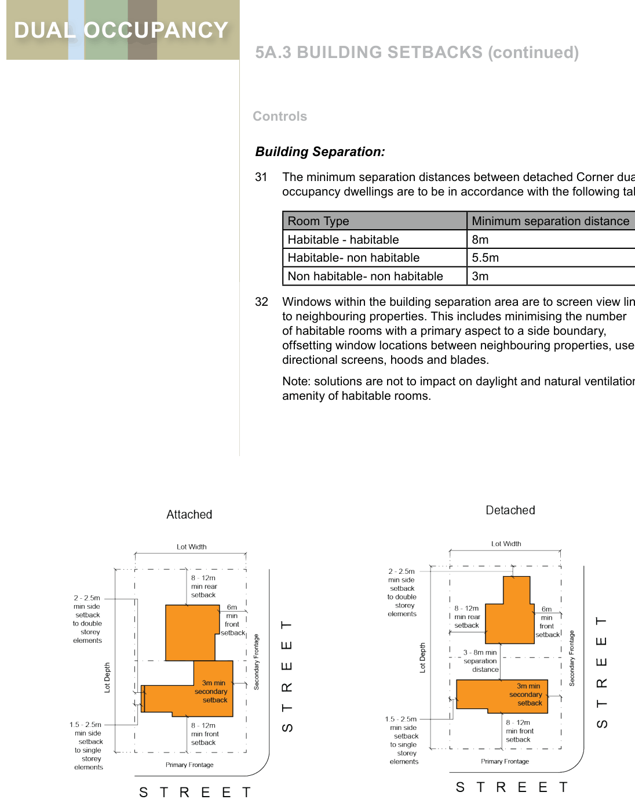

> [Picture on page 15: a picture, saved as a picture (images/part-05-dual-occupancy-page-15-1.gif, 150 dpi).]

#### Controls Building Separation:

31 The minimum separation distances between detached Corner dual

occupancy dwellings are to be in accordance with the following table

| Room Type | Minimum separation distance |
|---|---|
| Habitable - habitable | 8m |
| Habitable- non habitable | 5.5m |
| Non habitable- non habitable | 3m |

32 Windows within the building separation area are to screen view lines

to neighbouring properties. This includes minimising the number

of habitable rooms with a primary aspect to a side boundary,

offsetting window locations between neighbouring properties, use of

directional screens, hoods and blades. Note: solutions are not to impact on daylight and natural ventilation

amenity of habitable rooms.

### SITE DESIGN

Figure 5A.3-4: Front-Back dual occupancy dwelling indicative layout and

setbacks

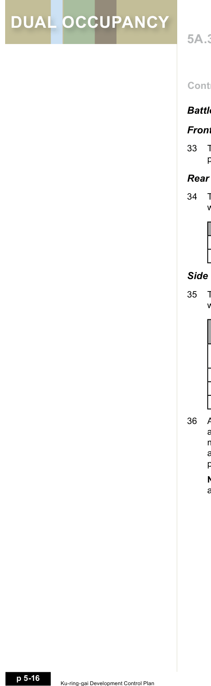

> [Picture on page 16: a picture, saved as a picture (images/part-05-dual-occupancy-page-16-1.gif, 150 dpi).]

#### Controls Battle-Axe Dwelling Layout Front Setback:

33 The front setback at the building line of the dwelling closest to the

primary street is to be 8m.

#### Rear Setback:

34 The rear setbacks of the Parent Lot are to be provided in accordance

with the following table

| Parent Lot depth | Minimum required rear setback |
|---|---|
| 48m or less | 8m |
| Greater than 48m | 12m |

#### Side Setback:

35 The side setbacks of the Parent Lot are to be provided in accordance

with the following table

|  | Single storey elements | Double storey elements |
|---|---|---|
| Parent Lot width at the building line | Minimum side setback | Minimum side setback |
| Less than 25m | 1.5m | 2m |
| 25-36m | 1.5m | 2.5m |
| Greater than 36m | 2.5m | 2.5m |

36 All windows above the ground floor that face neighbouring properties

are to screen view lines to neighbouring properties. This includes

minimising the number of habitable rooms with a primary aspect to

a side boundary, offsetting window locations between neighbouring

properties, the use of directional screens, hoods and blades. Note: solutions are not to impact on daylight and natural ventilation

amenity of habitable rooms.

#### Building Separation:

37 The minimum building separation between detached Battle-Axe

dual occupancy dwellings are to be accordance with the following

table

| Room Type | Minimum separation distance |
|---|---|
| Habitable - habitable | 8m |
| Habitable- non habitable | 5.5m |
| Non habitable- non habitable | 3m |

38 Windows within the building separation area are to screen view

lines to neighbouring properties. This includes minimising the

number of habitable rooms with a primary aspect to a side

boundary, offsetting window locations between neighbouring

properties, use of directional screens, hoods and blades. Note: solutions are not to impact on daylight and natural ventilation

amenity of habitable rooms.

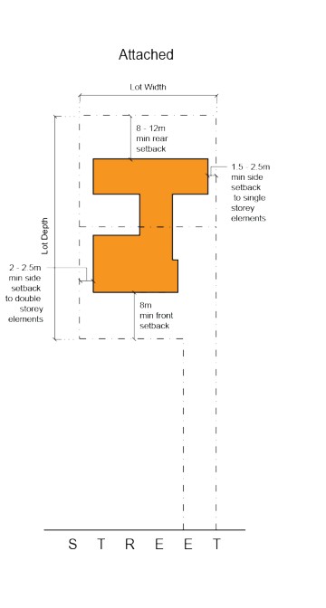

> [Picture on page 17: a picture, saved as a picture (images/part-05-dual-occupancy-page-17-13.gif, 150 dpi).]

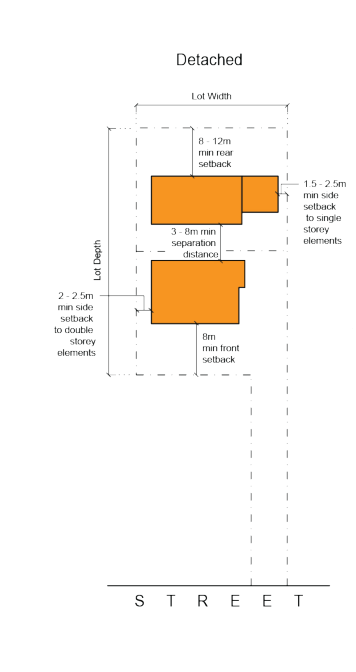

> [Picture on page 17: a picture, saved as a picture (images/part-05-dual-occupancy-page-17-14.gif, 150 dpi).]

### SITE DESIGN

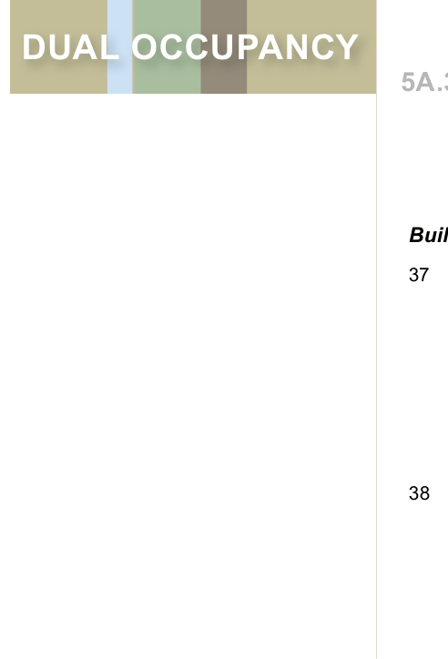

> [Picture on page 17: a picture, saved as a picture (images/part-05-dual-occupancy-page-17-16.gif, 150 dpi).]

Figure 5A.3-5: Battle-Axe dual occupancy dwelling indicative layout and setbacks

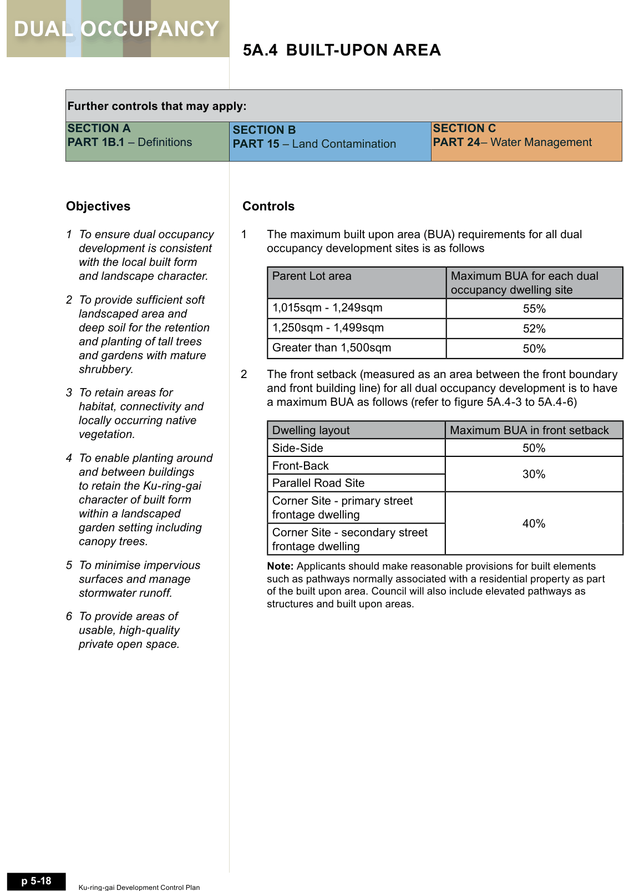

> [Picture on page 18: a map, saved as a picture (images/part-05-dual-occupancy-page-18-1.gif, 150 dpi); the street names and other small labels are on the picture.]
> Words printed on the picture (title and legend, copied from the PDF):
> PART 1B.1 – Definitions
> PART 24– Water Management
> development is consistent
> and landscape character.
> landscaped area and
> and gardens with mature
> habitat, connectivity and
> locally occurring native
> and between buildings
> to retain the Ku-ring-gai
> character of built form
> within a landscaped
> garden setting including
> 5	 To minimise impervious
> surfaces and manage
> Note: Applicants should make reasonable provisions for built elements
> such as pathways normally associated with a residential property as part
> of the built upon area. Council will also include elevated pathways as
> structures and built upon areas.
> private open space.
