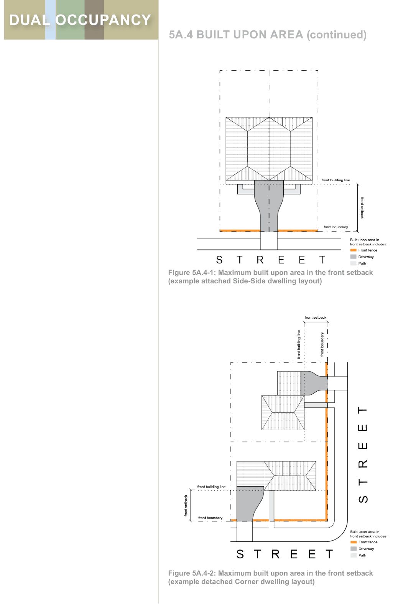
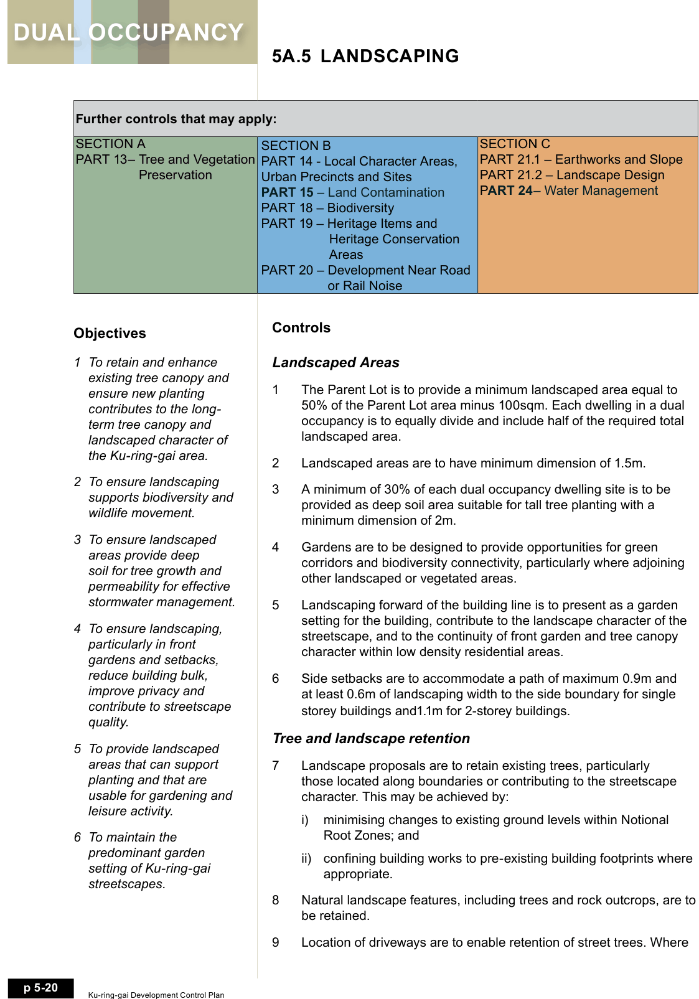

### 5A.4  BUILT-UPON AREA

#### Further controls that may apply: SECTION A

#### SECTION C

#### SECTION B

PART 15 – Land Contamination

#### Controls

#### Objectives

1 The maximum built upon area (BUA) requirements for all dual

occupancy development sites is as follows

| Parent Lot area | Maximum BUA for each dual occupancy dwelling site |
|---|---|
| 1,015sqm - 1,249sqm | 55% |
| 1,250sqm - 1,499sqm | 52% |
| Greater than 1,500sqm | 50% |

1	 To ensure dual occupancy

with the local built form

2	 To provide sufficient soft

deep soil for the retention

and planting of tall trees

2 The front setback (measured as an area between the front boundary

and front building line) for all dual occupancy development is to have

a maximum BUA as follows (refer to figure 5A.4-3 to 5A.4-6)

| Dwelling layout | Maximum BUA in front setback |
|---|---|
| Side-Side | 50% |
| Front-Back | 30% |
| Parallel Road Site |  |
| Corner Site - primary street frontage dwelling | 40% |
| Corner Site - secondary street frontage dwelling |  |

3	 To retain areas for

4	 To enable planting around

6	 To provide areas of

> [Picture on page 19: a picture, saved as a picture (images/part-05-dual-occupancy-page-19-1.gif, 150 dpi).]
> Words printed on the picture (title and legend, copied from the PDF):
> (example attached Side-Side dwelling layout)
> (example detached Corner dwelling layout)

Figure 5A.4-1: Maximum built upon area in the front setback

Figure 5A.4-2: Maximum built upon area in the front setback

### 5A.4 BUILT UPON AREA (continued)

### SITE DESIGN

> [Picture on page 20: a map, saved as a picture (images/part-05-dual-occupancy-page-20-1.gif, 150 dpi); the street names and other small labels are on the picture.]
> Words printed on the picture (title and legend, copied from the PDF):
> existing tree canopy and
> ensure new planting
> contributes to the long-
> term tree canopy and
> landscaped character of
> the Ku-ring-gai area.
> 2	 To ensure landscaping
> supports biodiversity and
> minimum dimension of 2m.
> 3	 To ensure landscaped
> areas provide deep
> permeability for effective
> 4	 To ensure landscaping,
> particularly in front
> gardens and setbacks,
> reduce building bulk,
> improve privacy and
> contribute to streetscape
> 5	 To provide landscaped
> areas that can support
> planting and that are
> usable for gardening and
> Root Zones; and
> 6	 To maintain the
> setting of Ku-ring-gai
