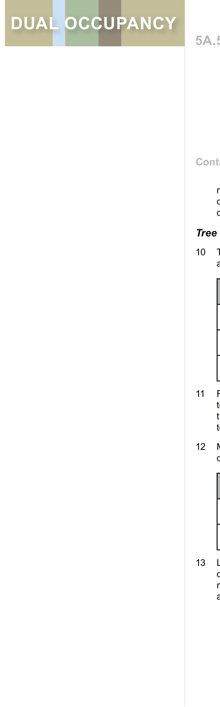
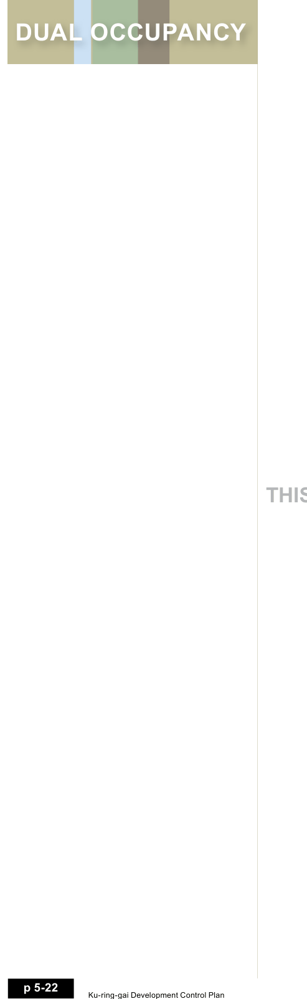

### 5A.5  LANDSCAPING

| Further controls that may apply: |  |  |
|---|---|---|
| SECTION A PART 13– Tree and Vegetation Preservation | SECTION B PART 14 - Local Character Areas, Urban Precincts and Sites PART 15 – Land Contamination PART 18 – Biodiversity PART 19 – Heritage Items and Heritage Conservation Areas PART 20 – Development Near Road or Rail Noise | SECTION C PART 21.1 – Earthworks and Slope PART 21.2 – Landscape Design PART 24– Water Management |
| Objectives | Controls |  |

#### Landscaped Areas

1 The Parent Lot is to provide a minimum landscaped area equal to

50% of the Parent Lot area minus 100sqm. Each dwelling in a dual

occupancy is to equally divide and include half of the required total

1	 To retain and enhance

2 Landscaped areas are to have minimum dimension of 1.5m. 3 A minimum of 30% of each dual occupancy dwelling site is to be

provided as deep soil area suitable for tall tree planting with a

4 Gardens are to be designed to provide opportunities for green

corridors and biodiversity connectivity, particularly where adjoining

other landscaped or vegetated areas.

soil for tree growth and

stormwater management. 5 Landscaping forward of the building line is to present as a garden

setting for the building, contribute to the landscape character of the

streetscape, and to the continuity of front garden and tree canopy

character within low density residential areas. 6 Side setbacks are to accommodate a path of maximum 0.9m and

at least 0.6m of landscaping width to the side boundary for single storey buildings and1.1m for 2-storey buildings.

#### Tree and landscape retention

7 Landscape proposals are to retain existing trees, particularly

those located along boundaries or contributing to the streetscape

character. This may be achieved by:

i) minimising changes to existing ground levels within Notional

ii)	 confining building works to pre-existing building footprints where

8 Natural landscape features, including trees and rock outcrops, are to

9 Location of driveways are to enable retention of street trees. Where

### 5A.5 LANDSCAPING (continued)

> [Picture on page 21: a picture, saved as a picture (images/part-05-dual-occupancy-page-21-2.gif, 150 dpi).]

#### Controls

no trees are currently placed on the road verge directly in front of the

development site, the site planning is to provide a minimum 6m area

on the verge for street tree planting.

#### Tree replenishment and planting

10 Tree planting to each dual occupancy dwelling is to be provided in

accordance with the following table

|  | Parent Lot | Each resulting dual occupancy dwelling |
|---|---|---|
| Either: | 4 Medium 2 Small | 2 Medium 1 Small |
| Or: | 2 Medium 6 Small For every additional 150m² (or part thereof) above 1,015m², provide 1 additional Medium tree. | 1 Medium 3 Small |

11 For each dual occupancy dwelling, at least one Medium sized tree is

to be located in front of the building line in the front setback. Where

the dwelling has more than one street frontage, one Medium tree is

to be located within each street frontage setback. 12 Minimum deep soil areas and volumes for each dual occupancy

dwelling are to be provided in accordance with the following table

| Tree Size | Height | Spread | Min soil area | Min Soil Volume |
|---|---|---|---|---|
| Medium Trees | 8-12m | 4-8m | 6x6m | 35m3 |
| Small Trees | 5-8m | less than 4m | 3.5x3.5m | 9m3 |

### SITE DESIGN

13 Landscaping to each dual occupancy dwelling is to include a mix

of tall trees, small trees, shrubs and groundcovers. Continuous

monoculture planting and high boundary hedging are discouraged

as substitutes for canopy trees.

### THIS PAGE IS INTENTIONALLY LEFT BLANK

> [Picture on page 22: a picture, saved as a picture (images/part-05-dual-occupancy-page-22-2.gif, 150 dpi).]

### B
