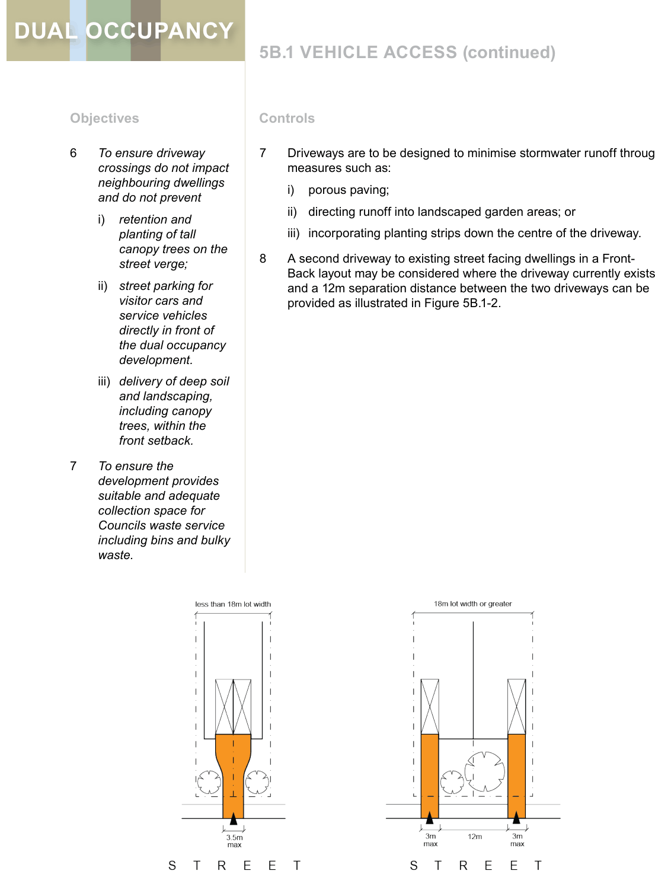

#### 5B Access and Parking

5B.1 Vehicle Access 5B.2 Car Parking Provision 5B.3 Carports and Garages

### READ WITH

#### SECTION A

PART 13 - Tree and Vegetation Preservation

#### SECTION B

PART 19 – Heritage Items and Heritage Conservation Areas

#### SECTION C

PART 22 - General Access and Parking

PART 24 – Water Management

### ACCESS AND PARKING

| DUAL OCCUPANCY 5B.1  VEHICLE ACCESS Further controls that may apply: SECTION B SECTION C SECTION A PART 19 - Heritage Items and PART 22.2 - General Vehicle Access PART 1B.1 – Definitions Heritage Conservation PART 24 - Water Management Areas Objectives Controls 1 To reduce conflict with Vehicular Access street and pedestrian traffic and optimise 1 Driveways are to be located to ensure clear sight lines for both safety of both vehicular drivers and pedestrians. and pedestrian 2 The driveway is to be designed so that vehicles exit the property in a movement. forward direction only where 2 To create driveways that i) the access is located on a major roadway; i) minimise hard ii) sight lines are restricted (such as at curves or crests); surface runoff from the site; iii) the driveways are steep; or ii) are not visually iv) driveways include access handles. intrusive on the Driveways existing streetscape; iii) have minimal impact 3 Driveway location and construction are to avoid adverse impacts on existing trees on on existing trees within the site and on the street verge, including to site and the public their Notional Root Zones. domain; 4 The maximum crossing width for any driveway, as measured at the iv) do not dominate front site boundary, is to be the street frontage i) 3.0m for all driveways into all dwelling layouts; or nor have adverse impacts on street ii) 3.5m where a single driveway on the Parent Lot is provided to trees and on-site Side-Side dual occupancies as illustrated in Figure 5B.1-1. landscaping; 5 A narrower width may be considered where trees are adversely v) are screened affected. from neighbouring properties. 6 The number of driveway crossings to the street are to be as follows i) Not more than one driveway is to be provided on any Parent Lot 3 To avoid excavation and with a street frontage width of less than 18m. alteration of existing ground levels. ii) A maximum of two driveways may be provided on Parent Lots with a street frontage wider than 18m, subject to site layout and 4 To reduce hard surfaces tree protection. that contribute to urban heat island effects. iii) The distance between the two driveway crossings at the street is to be a minimum 12m as illustrated in Figure 5B.1-1. 5 To ensure the number of iv) Where the minimum 12m distance cannot be achieved, the driveway crossovers are driveways are to be consolidated into a shared crossover, to minimised to prevent the reduce hard surfaces and visual dominance of driveways. cumulative visual and environmental impact of v) A maximum of two driveways one per street frontage, are to be multiple dual occupancy provided on Parent Lots on Corner Sites. developments within the street. p p 5-24 5-24 Ku-ring-gai Development Control Plan |
|---|

### 5B

> [Picture on page 25: a map, saved as a picture (images/part-05-dual-occupancy-page-25-2.gif, 150 dpi); the street names and other small labels are on the picture.]
> Words printed on the picture (title and legend, copied from the PDF):
> 6 To ensure driveway
> crossings do not impact
> and do not prevent
> i) retention and
> planting of tall
> canopy trees on the
> ii)	 street parking for
> visitor cars and
> directly in front of
> the dual occupancy
> trees, within the
> 7 To ensure the
> suitable and adequate
> collection space for
> Councils waste service
> including bins and bulky
