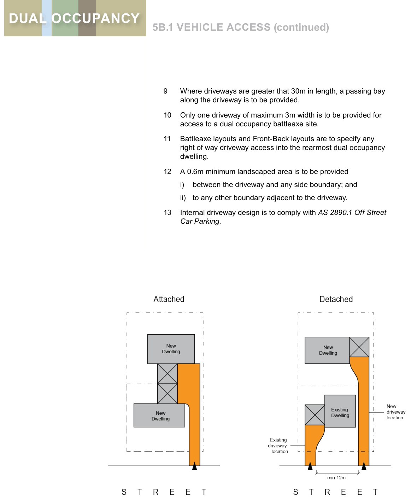
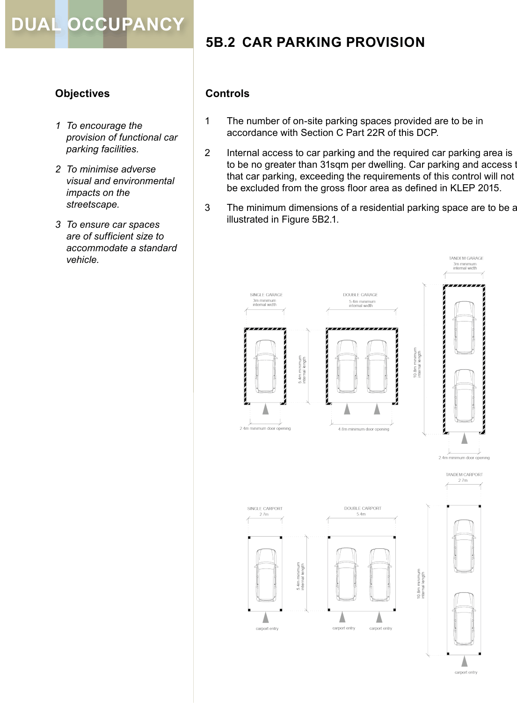

### 5B.1 VEHICLE ACCESS (continued)

#### Objectives

#### Controls

7 Driveways are to be designed to minimise stormwater runoff through

measures such as:

i) porous paving;

ii)	 directing runoff into landscaped garden areas; or

iii)	 incorporating planting strips down the centre of the driveway. 8 A second driveway to existing street facing dwellings in a Front-

Back layout may be considered where the driveway currently exists,

and a 12m separation distance between the two driveways can be

provided as illustrated in Figure 5B.1-2.

iii)	 delivery of deep soil

### ACCESS AND PARKING

#### Figure 5B.1-1: Number of driveways on Parent Lots and distance between

driveways

### 5B.1 VEHICLE ACCESS (continued)

9 Where driveways are greater that 30m in length, a passing bay

along the driveway is to be provided. 10 Only one driveway of maximum 3m width is to be provided for

access to a dual occupancy battleaxe site. 11 Battleaxe layouts and Front-Back layouts are to specify any

right of way driveway access into the rearmost dual occupancy

dwelling. 12 A 0.6m minimum landscaped area is to be provided

i) between the driveway and any side boundary; and

ii)	 to any other boundary adjacent to the driveway. 13 Internal driveway design is to comply with AS 2890.1 Off Street

Car Parking.

> [Picture on page 26: a picture, saved as a picture (images/part-05-dual-occupancy-page-26-14.gif, 150 dpi).]

#### Figure 5B.1-2: Driveway arrangement for Front-Back layout

> [Picture on page 27: a picture, saved as a picture (images/part-05-dual-occupancy-page-27-1.gif, 150 dpi).]
> Words printed on the picture (title and legend, copied from the PDF):
> 1	 To encourage the
> provision of functional car
> parking facilities.
> 2	 To minimise adverse
> visual and environmental
> impacts on the
> streetscape.
> illustrated in Figure 5B2.1.
> accommodate a standard
> vehicle.
