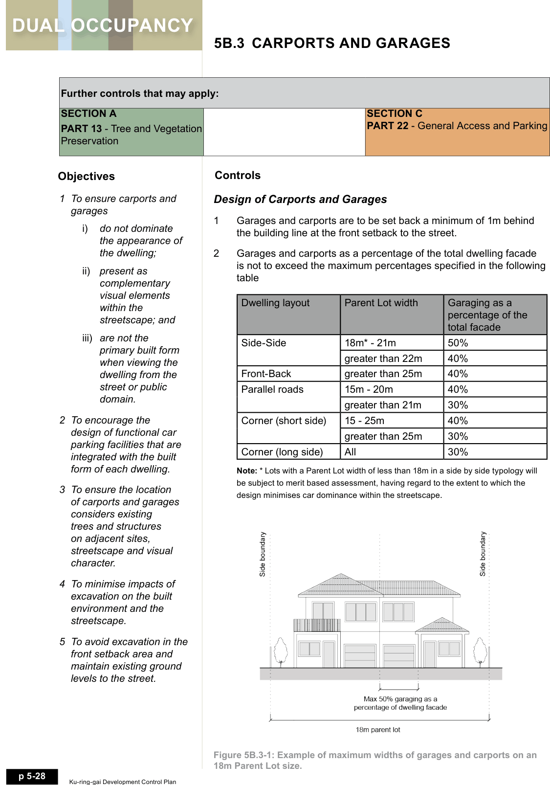

### 5B.2  CAR PARKING PROVISION

#### Objectives

#### Controls

1 The number of on-site parking spaces provided are to be in

accordance with Section C Part 22R of this DCP. 2 Internal access to car parking and the required car parking area is

to be no greater than 31sqm per dwelling. Car parking and access to

that car parking, exceeding the requirements of this control will not

be excluded from the gross floor area as defined in KLEP 2015. 3 The minimum dimensions of a residential parking space are to be as

3	 To ensure car spaces

are of sufficient size to

#### Figure 5B.2-1 Minimum dimensions for garages

and open carport (AS 2890.1)

> [Picture on page 28: a map, saved as a picture (images/part-05-dual-occupancy-page-28-1.gif, 150 dpi); the street names and other small labels are on the picture.]
> Words printed on the picture (title and legend, copied from the PDF):
> i) do not dominate
> the appearance of
> ii)	 present as
> iii)	 are not the
> primary built form
> when viewing the
> dwelling from the
> street or public
> 2	 To encourage the
> design of functional car
> parking facilities that are
> integrated with the built
> form of each dwelling.
> Note: * Lots with a Parent Lot width of less than 18m in a side by side typology will
> be subject to merit based assessment, having regard to the extent to which the
> design minimises car dominance within the streetscape.
> of carports and garages
> trees and structures
> on adjacent sites,
> streetscape and visual
> excavation on the built
> environment and the
> front setback area and
> maintain existing ground
> levels to the street.
> 18m Parent Lot size.

Figure 5B.3-1: Example of maximum widths of garages and carports on an
