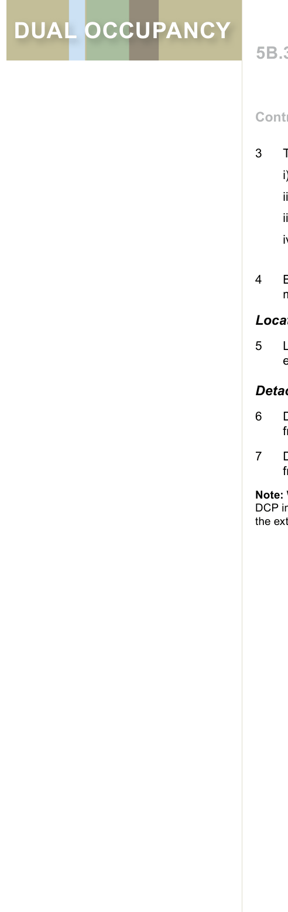
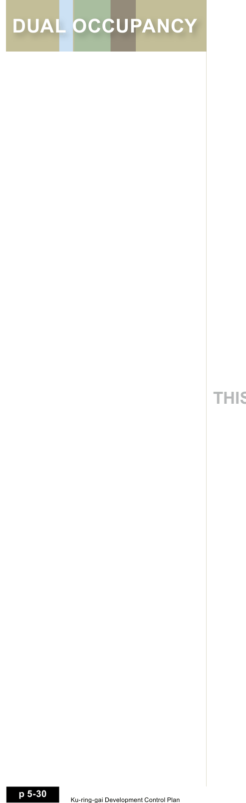

### 5B.3  CARPORTS AND GARAGES

#### Further controls that may apply:

#### SECTION C

PART 22 - General Access and Parking

#### SECTION A

PART 13 - Tree and Vegetation

#### Objectives

#### Controls Design of Carports and Garages

1	 To ensure carports and

1 Garages and carports are to be set back a minimum of 1m behind

the building line at the front setback to the street. 2 Garages and carports as a percentage of the total dwelling facade

is not to exceed the maximum percentages specified in the following

| Dwelling layout | Parent Lot width | Garaging as a percentage of the total facade |
|---|---|---|
| Side-Side | 18m* - 21m greater than 22m | 50% 40% |
| Front-Back | greater than 25m | 40% |
| Parallel roads | 15m - 20m greater than 21m | 40% 30% |
| Corner (short side) | 15 - 25m greater than 25m | 40% 30% |
| Corner (long side) | All | 30% |

3	 To ensure the location

4	 To minimise impacts of

5	 To avoid excavation in the

### 5B.3 CARPORTS AND GARAGES (continued)

> [Picture on page 29: a picture, saved as a picture (images/part-05-dual-occupancy-page-29-2.gif, 150 dpi).]

#### Controls

3 The scale and design of carport and garage structures are:

i) to be sympathetic to existing development on-site;

ii)	 to consider adjacent buildings;

iii)	 to be integrated into the building design; and

iv)	 not to dominate the site, dwelling elevation, landscape, or the

streetscape.

4 Basement garages are only permitted on sloping land and where no

more than 1m excavation is required for driveway access.

#### Location of Parking Structures

5 Location of all garages and driveways are to enable preservation of

existing site and street trees.

#### Detached Carports and Garages

6 Detached garages are to be single storey and set back 1.5m minimum

from side and rear boundaries. 7 Detached carports are to be single storey and set back 0.6m minimum

from side and rear boundaries. Note: Where there is any inconsistency between this Part and Part 22 of this

DCP in relation to vehicular access, car parking or garages, this section prevails to

the extent of the inconsistency.

### THIS PAGE IS INTENTIONALLY LEFT BLANK

> [Picture on page 30: a picture, saved as a picture (images/part-05-dual-occupancy-page-30-2.gif, 150 dpi).]

### C
