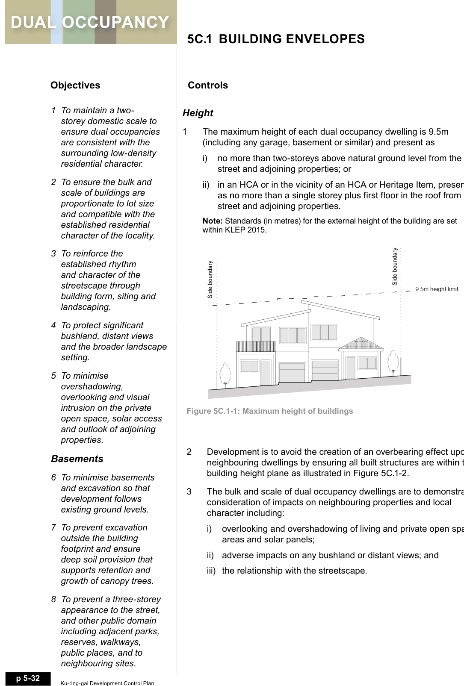

#### 5C Building Design and Sustainability

5C.1 Building Envelopes 5C.2 Building Facades 5C.3 First Floor Design and Roof Forms 5C.4 Dwelling Design and Layout 5C.5 Private Open Space 5C.6 Solar Access 5C.7 Natural Ventilation 5C.8 Ancillary Facilities 5C.9 Fencing 5C.9 Waste Management 5C.10 	 Materials and Finishes

### READ WITH

SECTION B

PART 20 - Development Near Road or Rail Noise SECTION C

PART 21 – General Site Design

21.1: Earthworks and Slope

21.2: Landscape Design

PART 23 – General Building Design and Sustainability

23.7: Acoustic Privacy

23.8: Visual Privacy

23.3: Sustainability of Building Materials

PART 24 – Water Management

24C: On-site Stormwater Management

24D.5: Tennis Courts and Other Sporting Surfaces

24D.7: Swimming Pools and Spas

24F: Onsite Wastewater Management

### BUILDING DESIGN AND SUSTAINABILITY

p 5 -31

> [Picture on page 32: a map, saved as a picture (images/part-05-dual-occupancy-page-32-1.gif, 150 dpi); the street names and other small labels are on the picture.]
> Words printed on the picture (title and legend, copied from the PDF):
> storey domestic scale to
> ensure dual occupancies
> are consistent with the
> street and adjoining properties.
> Note: Standards (in metres) for the external height of the building are set
> within KLEP 2015.
> scale of buildings are
> proportionate to lot size
> and compatible with the
> character of the locality.
> 3	 To reinforce the
> and character of the
> building form, siting and
> 4	 To protect significant
> bushland, distant views
> and the broader landscape
> 5	 To minimise
> overlooking and visual
> intrusion on the private
> open space, solar access
> and outlook of adjoining
> 6	 To minimise basements
> and excavation so that
> existing ground levels.
> areas and solar panels;
> 7	 To prevent excavation
> outside the building
> footprint and ensure
> deep soil provision that
> supports retention and
> growth of canopy trees.
> appearance to the street,
> and other public domain
> including adjacent parks,
> public places, and to

Figure 5C.1-1: Maximum height of buildings
