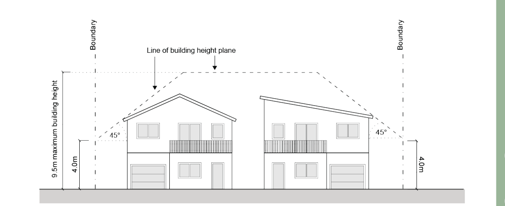
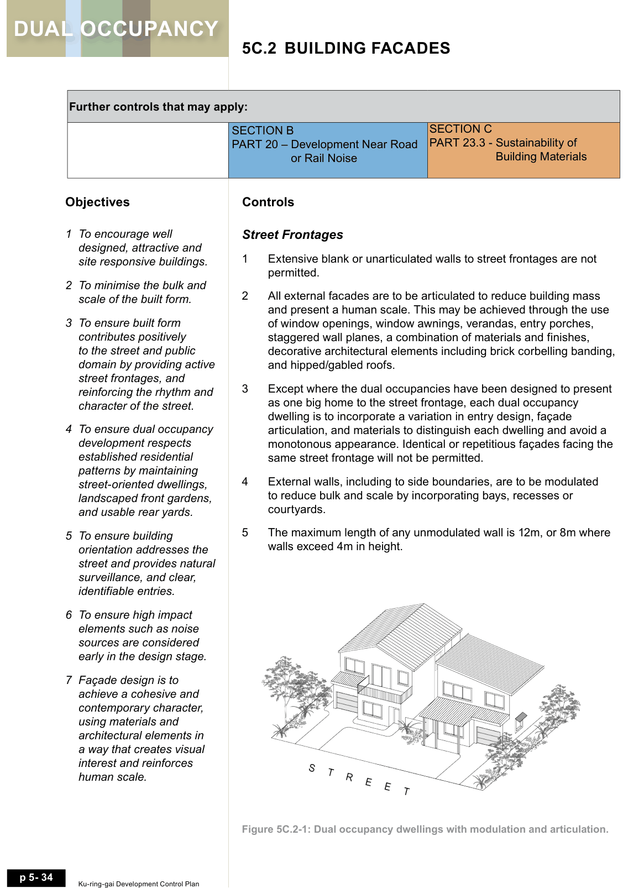

### 5C.1  BUILDING ENVELOPES

#### Objectives

#### Controls

#### Height

1 The maximum height of each dual occupancy dwelling is 9.5m

(including any garage, basement or similar) and present as

1	 To maintain a two-

i) no more than two-storeys above natural ground level from the

street and adjoining properties; or

ii)	 in an HCA or in the vicinity of an HCA or Heritage Item, present

as no more than a single storey plus first floor in the roof from the

2	 To ensure the bulk and

#### Basements

2 Development is to avoid the creation of an overbearing effect upon

neighbouring dwellings by ensuring all built structures are within the

building height plane as illustrated in Figure 5C.1-2. 3 The bulk and scale of dual occupancy dwellings are to demonstrate

consideration of impacts on neighbouring properties and local

character including:

i) overlooking and overshadowing of living and private open space

ii)	 adverse impacts on any bushland or distant views; and

iii)	 the relationship with the streetscape.

8	 To prevent a three-storey

### 5C

### 5C.1 BUILDING ENVELOPES (continued)

#### Controls

> [Picture on page 33: a picture, saved as a picture (images/part-05-dual-occupancy-page-33-4.gif, 150 dpi).]

#### Figure 5C.1-2: Building height plane

#### Basements

4 Basements are not permitted. Only basement garages on steeply

sloping sites may be considered. 5 Where basement parking demonstrates a maximum 1m excavation,

it is to be

i) consolidated directly under the building footprint;

ii)	 limited to garage area only, no habitable nor other spaces are

permitted;

iii)	 include a maximum ceiling height of 2.2m. 6 With the exception of steeply sloping sites, avoid excavation in the

front setback area and maintain existing ground levels to the street.

#### Slope and Topography

7 Site planning and dwelling design is to minimise cut and fill

excavation works. Development is to follow the natural groundline

and dwellings are to be stepped to accommodate steep sites.

### BUILDING DESIGN AND SUSTAINABILITY

> [Picture on page 34: a map, saved as a picture (images/part-05-dual-occupancy-page-34-1.gif, 150 dpi); the street names and other small labels are on the picture.]
> Words printed on the picture (title and legend, copied from the PDF):
> or Rail Noise
> 1	 To encourage well
> designed, attractive and
> site responsive buildings.
> and hipped/gabled roofs.
> domain by providing active
> street frontages, and
> reinforcing the rhythm and
> character of the street.
> patterns by maintaining
> landscaped front gardens,
> and usable rear yards.
> 5	 To ensure building
> orientation addresses the
> street and provides natural
> surveillance, and clear,
> elements such as noise
> sources are considered
> achieve a cohesive and
> using materials and
> architectural elements in
> interest and reinforces
> p 5- 34

Figure 5C.2-1: Dual occupancy dwellings with modulation and articulation.
