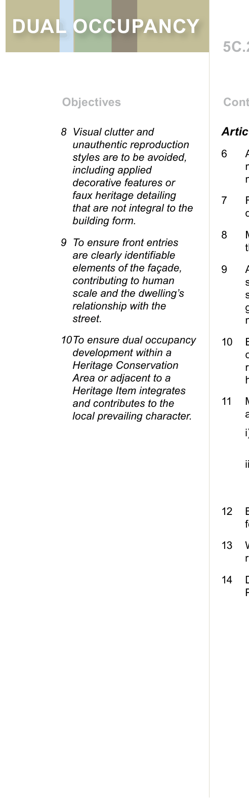
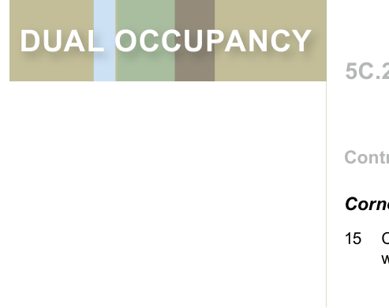
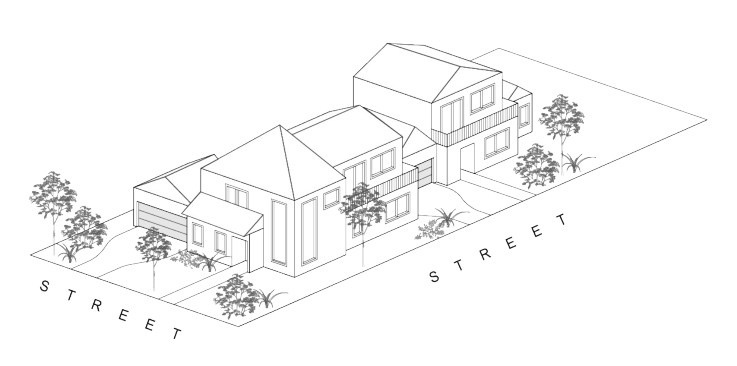

### 5C.2  BUILDING FACADES

#### Further controls that may apply:

PART 23.3 - Sustainability of

PART 20 – Development Near Road

#### Controls

#### Objectives

#### Street Frontages

1 Extensive blank or unarticulated walls to street frontages are not

2	 To minimise the bulk and

scale of the built form.

2 All external facades are to be articulated to reduce building mass

and present a human scale. This may be achieved through the use

of window openings, window awnings, verandas, entry porches,

staggered wall planes, a combination of materials and finishes,

decorative architectural elements including brick corbelling banding,

3	 To ensure built form

to the street and public

3 Except where the dual occupancies have been designed to present

as one big home to the street frontage, each dual occupancy

dwelling is to incorporate a variation in entry design, façade

articulation, and materials to distinguish each dwelling and avoid a

monotonous appearance. Identical or repetitious façades facing the

same street frontage will not be permitted. 4 External walls, including to side boundaries, are to be modulated

to reduce bulk and scale by incorporating bays, recesses or

4	 To ensure dual occupancy

5 The maximum length of any unmodulated wall is 12m, or 8m where

walls exceed 4m in height.

6	 To ensure high impact

early in the design stage. 7	 Façade design is to

a way that creates visual

### 5C.2 BUILDING FACADES (continued)

> [Picture on page 35: a map, saved as a picture (images/part-05-dual-occupancy-page-35-2.gif, 150 dpi); the street names and other small labels are on the picture.]
> Words printed on the picture (title and legend, copied from the PDF):
> 8	 Visual clutter and
> decorative features or
> faux heritage detailing
> are clearly identifiable
> elements of the façade,
> contributing to human
> scale and the dwelling’s
> relationship with the
> development within a
> Heritage Item integrates
> and contributes to the
> local prevailing character.

#### Objectives

#### Controls Articulation

6 Articulation of building facades is to complement modulation and

may include windows, porches, verandahs, shading devices, and

materials/finishes. 7 Façades are to be articulated to provide interest but avoid excessive

detailing that results in a cluttered or disorderly appearance.

styles are to be avoided,

that are not integral to the

8 Materials and colours are to be simple and cohesive, with no more

than four used on any elevation.

9	 To ensure front entries

9 Applied or decorative features that are not integral to the building’s

structure (such as screens, trims or panels) may be used as

secondary elements but are not a substitute for modulation or

genuine articulation of the building form. Where used, such features

must be integrated into the overall design. 10 Building facades are to be designed in a contemporary manner

consistent with the established residential character. Pastiche or

reproduction styles (such as applied heritage detailing or faux

historic features) are not permitted. 11 Modifications to an existing street facing dwelling being altered to

accommodate two dual occupancy dwellings are to be:

10	To ensure dual occupancy

Area or adjacent to a

i) designed so that they are integrated into and improve the

existing building appearance;

ii)	 result in the new and old structures appearing as one building

from the street. This may be achieved through the choice of

materials, detailing, building proportion and configuration.

12 Building design is to integrate soft landscaping and natural site

features and make provision for tall shrub planting. 13 Where dwellings are located near a busy road or railway line, the

requirements of Part 20.1 of this DCP are to be included. 14 Dwellings facing the street are to have clearly visible front doors.

Porticos to front doors are to be single storey.

### BUILDING DESIGN AND SUSTAINABILITY

### 5C.2 BUILDING FACADES (continued)

> [Picture on page 36: a picture, saved as a picture (images/part-05-dual-occupancy-page-36-2.gif, 150 dpi).]

#### Controls Corner Sites

15 Corner sites must address both street frontages with appropriate

windows, articulation and landscaping as illustrated in Figure 5C.2-2.

> [Picture on page 36: a picture, saved as a picture (images/part-05-dual-occupancy-page-36-7.gif, 150 dpi).]

#### Figure 5C.2-2: Corner site dual occupancy with modulation and articulation

to both street frontages.
