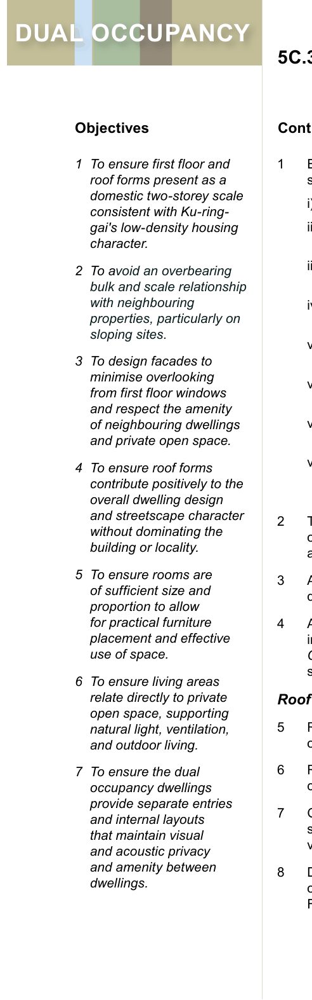
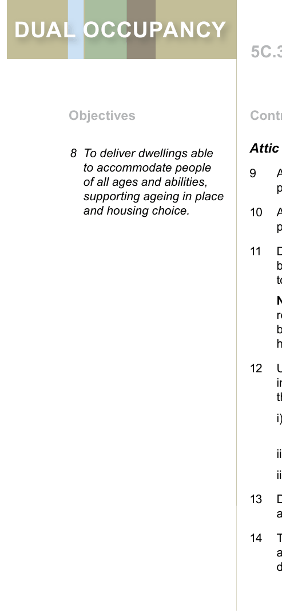
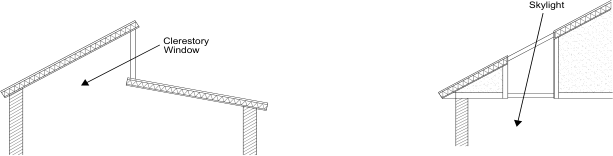
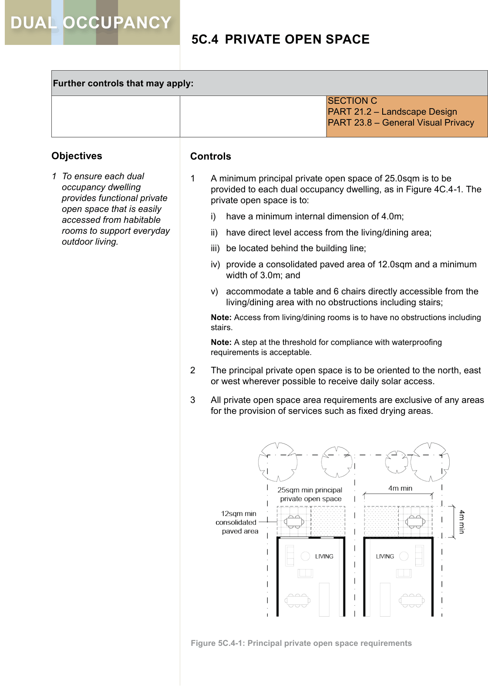

### 5C.3  DWELLING DESIGN AND LAYOUT

> [Picture on page 37: a map, saved as a picture (images/part-05-dual-occupancy-page-37-2.gif, 150 dpi); the street names and other small labels are on the picture.]
> Words printed on the picture (title and legend, copied from the PDF):
> domestic two-storey scale
> consistent with Ku-ring-
> gai's low-density housing
> bulk and scale relationship
> properties, particularly on
> from first floor windows
> and respect the amenity
> of neighbouring dwellings
> and private open space.
> contribute positively to the
> overall dwelling design
> and streetscape character
> without dominating the
> building or locality.
> of sufficient size and
> proportion to allow
> for practical furniture
> placement and effective
> use of space.
> relate directly to private
> open space, supporting
> natural light, ventilation,
> and outdoor living.
> provide separate entries
> and internal layouts
> that maintain visual
> and acoustic privacy
> and amenity between

#### Controls

#### Objectives

1 Each dual occupancy dwelling is to meet all of the following

standards

i) minimum width of 6.5m;

ii)	 the kitchen is not to form part of a circulation space such as a

hallway;

1	 To ensure first floor and

roof forms present as a

iii)	 the principal living room is to have a minimum internal dimension

of 4m;

iv)	 bedrooms are to have a minimum dimension of 3m, excluding

space for wardrobes;

2	 To avoid an overbearing

v)	 windows and doors to habitable rooms are preferably to be

oriented to the front and rear of the site;

vi)	 each dwelling is to be provided with a clearly identifiable and

separate entry with clear and safe access;

vii)	 windows from habitable rooms are to overlook the public domain

to provide passive surveillance; and

3	 To design facades to

viii)	where the side of a dwelling faces a secondary street, the

façade is to incorporate windows and other articulation to

positively address the street.

4	 To ensure roof forms

2 The dwelling orientation and internal layout is to avoid direct

overlooking between the two dual occupancy dwellings (e.g. living

areas facing each other at close range). 3 All detached dual occupancies are to provide fencing between the

dwellings in line with setback requirements and subdivision plans.

5	 To ensure rooms are

4 All dual occupancy dwellings are to be of Silver Level as indicated

in the Livable Housing Design Guidelines and the National

Construction Code accessibility requirements regardless of site

steepness.

#### Roof Form

5 Roof forms are to be designed to minimise bulk and overshadowing

of neighbouring buildings and open spaces.

6	 To ensure living areas

6 Roof forms are to be integrated into the dwelling design and be

consistent with the established streetscape character. 7 Gables, dormers, clerestories and other roof elements are to remain

subordinate to the overall roof form and not add excessive bulk or

visual dominance.

7	 To ensure the dual

8 Dual Occupancies in Heritage Conservation Areas or in the vicinity

of HCAs or Heritage Items are to provide hip and gabled roof forms.

Flat roofs are not permitted.

### BUILDING DESIGN AND SUSTAINABILITY

### 5C.3 DWELLING DESIGN AND LAYOUT

### (continued)

> [Picture on page 38: a picture, saved as a picture (images/part-05-dual-occupancy-page-38-3.gif, 150 dpi).]
> Words printed on the picture (title and legend, copied from the PDF):
> to accommodate people
> supporting ageing in place
> and housing choice.

#### Objectives

#### Controls Attic Rooms and Dormer Windows

9 Attic rooms above the ground floor are encouraged in areas with a

predominantly single storey character above the ground floor level.

8	 To deliver dwellings able

of all ages and abilities,

10 Attic rooms within the roof space above the first floor level will not be

permitted. 11 Dormer windows to attic rooms are to be located and have a size,

bulk and scale that do not dominate the roof form or add excessively

to the bulk of the building. Note: Where a dormer window provides the primary source for

required solar access and/or daylight to a habitable room, it is to

be of a size that provides adequate natural daylight to all parts of a

habitable room, and the required solar access if for a living room. 12 Unless otherwise consistent with the form of development within the

immediate locality, the configuration of dormer windows must satisfy

the following:

i) be positioned a minimum of 0.2m below the main roof ridge

height;

ii)	 not to extend beyond the external wall of the dwelling; and

iii)	 be set back from the sides of the roof by a minimum of 0.5m. 13 Dormers occurring in the same roof plane must be similarly sized

and configured, and arranged symmetrically. 14 The location, size, configuration and layout of clerestory windows

and skylights must be sympathetic to the overall design of the

dwelling and the streetscape.

> [Picture on page 38: a picture, saved as a picture (images/part-05-dual-occupancy-page-38-32.gif, 150 dpi).]
> Words printed on the picture (title and legend, copied from the PDF):
> Skylight
> Skylight
> Clerestory
> Window
> Clerestory
> Window

#### Figure 5C.3-1: Clerestory

window and skylight

> [Picture on page 39: a picture, saved as a picture (images/part-05-dual-occupancy-page-39-1.gif, 150 dpi).]
> Words printed on the picture (title and legend, copied from the PDF):
> SECTION C
> occupancy dwelling
> provides functional private
> accessed from habitable
> rooms to support everyday
> outdoor living.
> width of 3.0m; and
> Note: Access from living/dining rooms is to have no obstructions including
> stairs.
> Note: A step at the threshold for compliance with waterproofing
> requirements is acceptable.

Figure 5C.4-1: Principal private open space requirements
