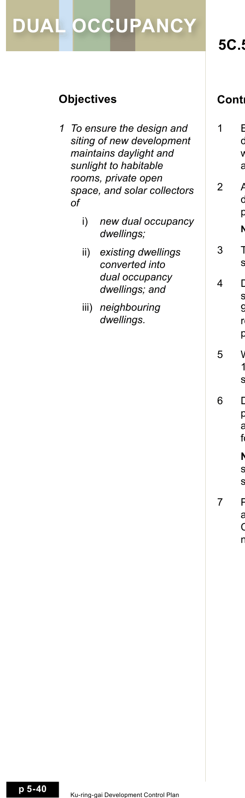

### 5C.5  SOLAR ACCESS

> [Picture on page 40: a map, saved as a picture (images/part-05-dual-occupancy-page-40-2.gif, 150 dpi); the street names and other small labels are on the picture.]
> Words printed on the picture (title and legend, copied from the PDF):
> siting of new development
> maintains daylight and
> sunlight to habitable
> rooms, private open
> space, and solar collectors
> i) new dual occupancy

#### Controls

#### Objectives

1 Each dual occupancy dwelling is to receive a minimum 3 hours of

direct sunlight between 9am and 3pm on 21 June to a north-facing

window to a main living area (living room, rumpus, lounge, dining),

and to the principal private open space.

1	 To ensure the design and

2 All habitable rooms are to have a window in an external wall that is

directly visible from every part of the room. Snorkel windows are not

permitted. Note: Refer to Part 1B.1 for definition of snorkel window.

ii)	 existing dwellings 3 The use of lightwells, skylight, or high level windows as a primary

source of daylight in habitable rooms is not permitted. 4 Dual occupancy development is to be designed and sited to maintain

solar access to adjoining properties for at least 3 hours between

9am and 3pm on 21 June to north facing windows of habitable

rooms (excluding windows facing side boundaries) and to the

principal private open space. 5 Where existing overshadowing from buildings or topography makes

1 and 2 above unachievable, development must not further reduce

sunlight by more than 20% in time or area. 6 Development is to consider the use of sun protection devices that

preserve internal amenity. These can include window shades and

awnings, roof and eave overhangs, use of pergolas and landscaping

for shading of openings. Note: Avoid the use of dark tinted glazing as this impacts on

streetscape character and internal amenity for daylight., beneficial

solar access and outlook. 7 Professionally prepared shadow diagrams must accompany all

applications for dual occupancies exceeding one storey. Refer to

Council's DA guide available on Council's website. https://www.krg.

nsw.gov.au.
