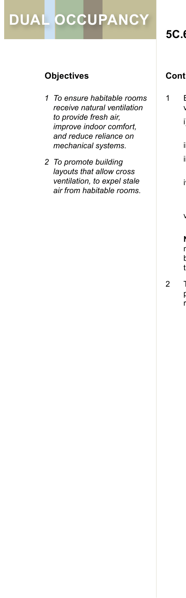
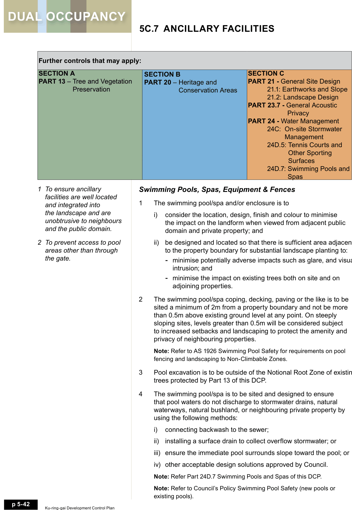

### 5C.6  NATURAL VENTILATION

> [Picture on page 41: a picture, saved as a picture (images/part-05-dual-occupancy-page-41-2.gif, 150 dpi).]
> Words printed on the picture (title and legend, copied from the PDF):
> receive natural ventilation
> to provide fresh air,
> improve indoor comfort,
> and reduce reliance on
> mechanical systems.
> 2	 To promote building
> layouts that allow cross
> ventilation, to expel stale
> air from habitable rooms.

#### Controls

#### Objectives

1 Building design is to incorporate measures for natural cross

ventilation. This may be achieved by:

i) locating openings such as windows, sky lights and doors on

opposite walls;

ii)	 including open plan living areas;

1	 To ensure habitable rooms

iii)	 include vents above or in internal doors to facilitate cross

ventilation;

iv)	 positioning of openings to control air flow, for example, use

clerestory windows, roof ventilators and vents in ridges, eaves

and ceilings to create convection currents; and

v)	 carports and garages should be placed so that they do not block

ventilation into the house. Note: Where a dormer window provides the primary source for

natural ventilation to a habitable room, the openable component is to

be of a size that provides adequate natural ventilation to all parts of

the room. 2 The building layout is to be designed to capture prevailing breezes,

particularly summer winds, to enhance natural cross-ventilation and

reduce reliance on mechanical cooling.

### BUILDING DESIGN AND SUSTAINABILITY

> [Picture on page 42: a map, saved as a picture (images/part-05-dual-occupancy-page-42-1.gif, 150 dpi); the street names and other small labels are on the picture.]
> Words printed on the picture (title and legend, copied from the PDF):
> 1	 To ensure ancillary
> facilities are well located
> and integrated into
> the landscape and are
> unobtrusive to neighbours
> and the public domain.
> areas other than through
> privacy of neighbouring properties.
> Note: Refer to AS 1926 Swimming Pool Safety for requirements on pool
> fencing and landscaping to Non-Climbable Zones.
> Note: Refer Part 24D.7 Swimming Pools and Spas of this DCP.
> Note: Refer to Council’s Policy Swimming Pool Safety (new pools or
