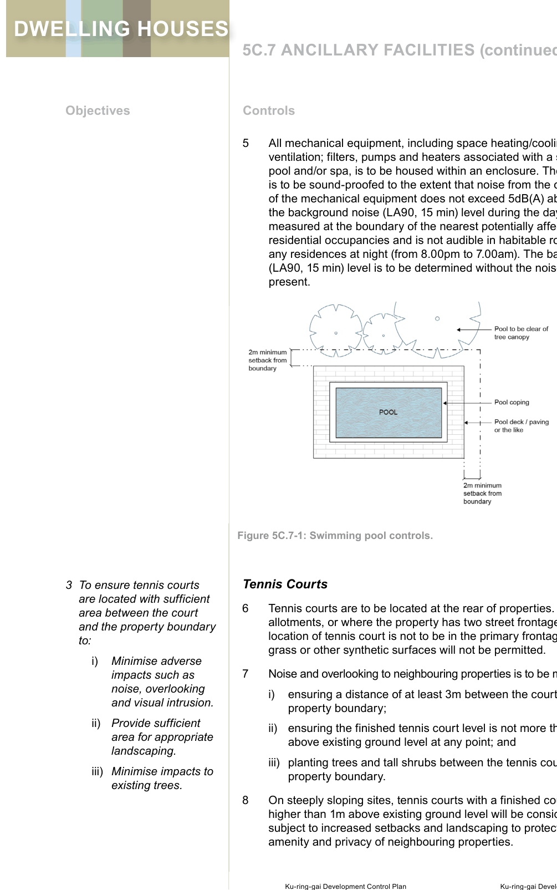
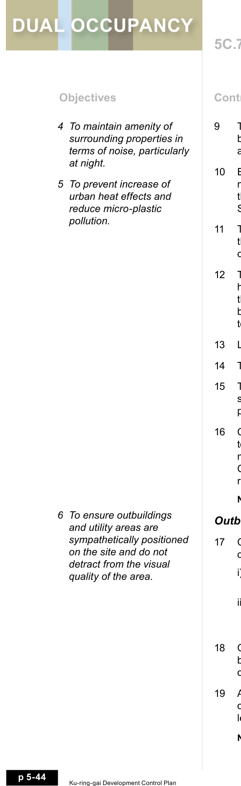
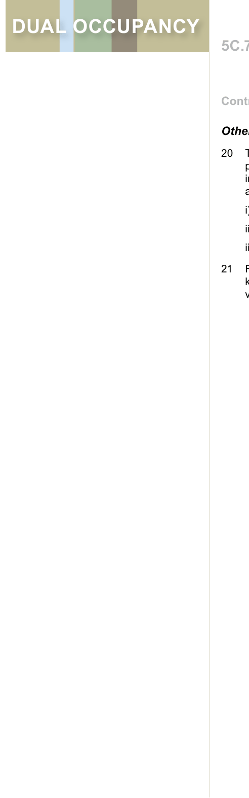
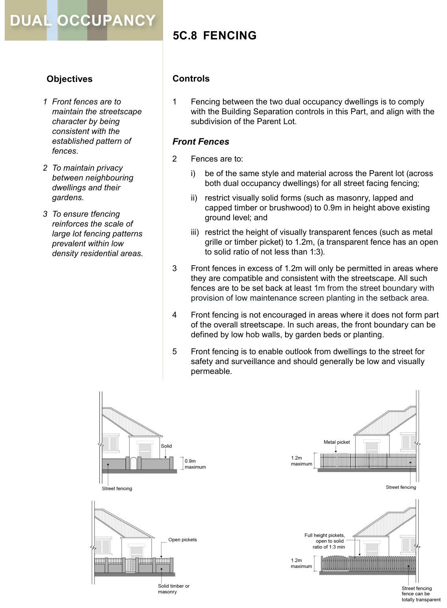

### 5C.7  ANCILLARY FACILITIES

| Further controls that may | apply: |  |
|---|---|---|
| SECTION A PART 13 – Tree and Vegetation Preservation Objectives | SECTION B PART 20 – Heritage and Conservation Areas Controls | SECTION C PART 21 - General Site Design 21.1: Earthworks and Slope 21.2: Landscape Design PART 23.7 - General Acoustic Privacy PART 24 - Water Management 24C: On-site Stormwater Management 24D.5: Tennis Courts and Other Sporting Surfaces 24D.7: Swimming Pools and Spas |

#### Swimming Pools, Spas, Equipment & Fences

1 The swimming pool/spa and/or enclosure is to

i) consider the location, design, finish and colour to minimise

the impact on the landform when viewed from adjacent public

domain and private property; and

ii)	 be designed and located so that there is sufficient area adjacent

to the property boundary for substantial landscape planting to:

2	 To prevent access to pool

- minimise potentially adverse impacts such as glare, and visual

- minimise the impact on existing trees both on site and on

2 The swimming pool/spa coping, decking, paving or the like is to be

sited a minimum of 2m from a property boundary and not be more

than 0.5m above existing ground level at any point. On steeply

sloping sites, levels greater than 0.5m will be considered subject

to increased setbacks and landscaping to protect the amenity and

3 Pool excavation is to be outside of the Notional Root Zone of existing

trees protected by Part 13 of this DCP. 4 The swimming pool/spa is to be sited and designed to ensure

that pool waters do not discharge to stormwater drains, natural

waterways, natural bushland, or neighbouring private property by

using the following methods:

i) connecting backwash to the sewer;

ii)	 installing a surface drain to collect overflow stormwater; or

iii)	 ensure the immediate pool surrounds slope toward the pool; or

iv)	 other acceptable design solutions approved by Council.

> [Picture on page 43: a map, saved as a picture (images/part-05-dual-occupancy-page-43-1.gif, 150 dpi); the street names and other small labels are on the picture.]
> Words printed on the picture (title and legend, copied from the PDF):
> are located with sufficient
> area between the court
> and the property boundary
> i) Minimise adverse
> impacts such as
> and visual intrusion.
> ii)	 Provide sufficient
> area for appropriate
> iii)	 Minimise impacts to

Figure 5C.7-1: Swimming pool controls.

### DWELLING HOUSES

### 5C.7 ANCILLARY FACILITIES (continued)

#### Objectives

#### Controls

5 All mechanical equipment, including space heating/cooling/

ventilation; filters, pumps and heaters associated with a swimming

pool and/or spa, is to be housed within an enclosure. The enclosure

is to be sound-proofed to the extent that noise from the operation

of the mechanical equipment does not exceed 5dB(A) above

the background noise (LA90, 15 min) level during the day when

measured at the boundary of the nearest potentially affected

residential occupancies and is not audible in habitable rooms of

any residences at night (from 8.00pm to 7.00am). The background

(LA90, 15 min) level is to be determined without the noise source

#### Tennis Courts

3	 To ensure tennis courts

6 Tennis courts are to be located at the rear of properties. For corner

allotments, or where the property has two street frontages, the

location of tennis court is not to be in the primary frontage. Synthetic

grass or other synthetic surfaces will not be permitted. 7 Noise and overlooking to neighbouring properties is to be minimised by:

i) ensuring a distance of at least 3m between the court and the

ii)	 ensuring the finished tennis court level is not more than 1m

above existing ground level at any point; and

iii)	 planting trees and tall shrubs between the tennis court and the

8 On steeply sloping sites, tennis courts with a finished court level

higher than 1m above existing ground level will be considered

subject to increased setbacks and landscaping to protect the

amenity and privacy of neighbouring properties.

### BUILDING DESIGN AND SUSTAINABILITY

> [Picture on page 44: a picture, saved as a picture (images/part-05-dual-occupancy-page-44-1.gif, 150 dpi).]
> Words printed on the picture (title and legend, copied from the PDF):
> surrounding properties in
> terms of noise, particularly
> at night.
> urban heat effects and
> reduce micro-plastic
> pollution.
> 6	 To ensure outbuildings
> and utility areas are
> sympathetically positioned
> detract from the visual
> quality of the area.

#### Objectives

#### Controls

9 The increase of runoff associated with tennis courts is to be avoided

by ensuring that an on-site stormwater detention system is provided,

and utilising WSUD and filtration pits.

4	 To maintain amenity of

10 Earthworks associated with the construction of a tennis court are

not to unreasonably alter the natural topography of the land or alter

the natural groundwater table. (Refer to Part 21.1 Earthworks and

Slope of this DCP.)

5	 To prevent increase of

11 The materials used in the construction of a tennis court, including

the type and colour of court surfaces, are to be carefully selected to

complement natural bushlands and any adjacent Heritage Item. 12 Tennis courts are to be sited having regard to the location of

habitable rooms both on-site and on adjoining properties, and to

the maintenance of appropriate private open space areas. This is to

be achieved by maintaining a minimum distance of 5m between the

tennis court fence boundary and habitable rooms of any dwelling. 13 Lighting of tennis courts for night tennis will not be permitted. 14 Tennis hit-up walls will not be permitted. 15 The tennis court is to be sited to minimise the visual impact of the

structure when viewed from the adjacent public domain and private

property, and minimise the impact on the landform. 16 Conversions of grass tennis courts to impervious surfaces are

to demonstrate consideration of impact to built-upon area, water

management and existing trees. Grass tennis courts in Heritage

Conservation Areas that are part of a contributory item are to be

retained. Note: Refer to Council’s Tennis Court Policy

#### Outbuildings

17 Outbuildings including studios, hobby rooms, storage structures,

cubby houses or cabanas, are to be located as follows:

on the site and do not

i) On the site having regard to the relationship with existing

development on-site and on adjoining properties;

ii)	 with consideration of the position of windows associated with

habitable rooms and the potential impact of noise, fumes, loss of

light, and ventilation.

18 Outbuildings are not to exceed a single storey. All outbuildings will

be included in both floor space ratio calculations and built upon area

calculations. 19 A minimum setback of 2m from boundaries is to apply for any

outbuilding with a wall height exceeding 2m relative to the ground

level at the boundary. Note: For garages see part 5B.2.

> [Picture on page 45: a picture, saved as a picture (images/part-05-dual-occupancy-page-45-1.gif, 150 dpi).]

#### Controls Other Site Facilities

20 The location and design of facilities such as mail boxes, utility

poles, bin storage and enclosures, clothes drying areas are to be an

integrated and sympathetically designed as part of the site design

and development. This may be achieved by:

i) the undergrounding of utilities;

ii)	 ensuring that clothes lines are not visible from the street; and

iii)	 provision of landscaping and bin enclosures. 21 For requirements on noise levels associated with air conditioning,

kitchen, bathroom, laundry ventilation, or other mechanical

ventilation systems and other plant refer to Part 23.8 of this DCP.

### BUILDING DESIGN AND SUSTAINABILITY

> [Picture on page 46: a map, saved as a picture (images/part-05-dual-occupancy-page-46-1.gif, 150 dpi); the street names and other small labels are on the picture.]
> Words printed on the picture (title and legend, copied from the PDF):
> maintain the streetscape
> character by being
> consistent with the
> established pattern of
> 2 Fences are to:
> 2	 To maintain privacy
> dwellings and their
> ground level; and
> 3	 To ensure tfencing
> reinforces the scale of
> large lot fencing patterns
> prevalent within low
> density residential areas.
