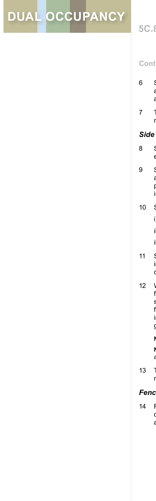
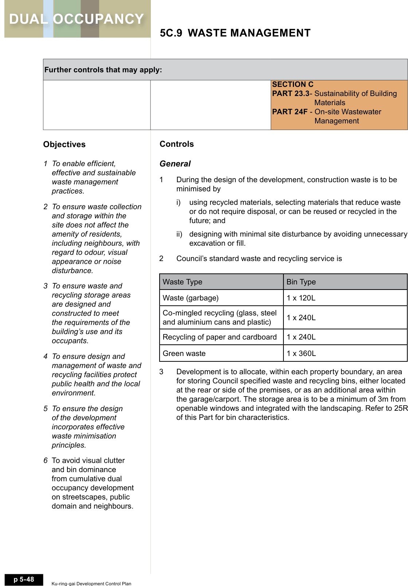

### 5C.8  FENCING

#### Controls

#### Objectives

1 Fencing between the two dual occupancy dwellings is to comply

with the Building Separation controls in this Part, and align with the

subdivision of the Parent Lot.

#### Front Fences

1	 Front fences are to

i) be of the same style and material across the Parent lot (across

both dual occupancy dwellings) for all street facing fencing;

ii)	 restrict visually solid forms (such as masonry, lapped and

capped timber or brushwood) to 0.9m in height above existing

iii)	 restrict the height of visually transparent fences (such as metal

grille or timber picket) to 1.2m, (a transparent fence has an open

to solid ratio of not less than 1:3).

3 Front fences in excess of 1.2m will only be permitted in areas where

they are compatible and consistent with the streetscape. All such

fences are to be set back at least 1m from the street boundary with

provision of low maintenance screen planting in the setback area. 4 Front fencing is not encouraged in areas where it does not form part

of the overall streetscape. In such areas, the front boundary can be

defined by low hob walls, by garden beds or planting. 5 Front fencing is to enable outlook from dwellings to the street for

safety and surveillance and should generally be low and visually

#### Figure 5C.8-1: Types of street fencing

### 5C.8 FENCING (continued)

> [Picture on page 47: a picture, saved as a picture (images/part-05-dual-occupancy-page-47-2.gif, 150 dpi).]

#### Controls

6 Shrub plantings on boundaries are desirable; however, hedges

along the entire front boundary are to be no higher than the

allowable fence height. 7 The footings of a fence within the Notional Root Zone of a tree are

not to adversely affect the health of the tree.

#### Side and rear fences

8 Side and rear fences are be a maximum 1.8m in height above the

existing ground level. 9 Side fences forward of the front building line are to be unobtrusive

and allow for continuity of landscape vista between adjoining

properties. Where this character predominates it must be respected

in new developments. 10 Side fences on corner sites are to be designed and located so as to:

i) maintain the streetscape character;

ii)	 be consistent with the established pattern of fences;

iii)	 ensure an adequate amount of useable private open space; and 11 Side fences within front setbacks are to be no more than 1m

in height. Fences forward of the front building line should be

compatible with the established front fencing in the street. 12 Where building front setbacks vary, the 1m side fence within the

front boundary commences from the building line closest to the

street. Side fences of 1.8m forward of a neighbouring dwelling set

further back from the street is to demonstrate it does not negatively

impact either dwelling particularly where there isa difference in

ground level between neighbouring sites. Note: The provisions of the Dividing Fences Act 1991 also apply. Note: Common boundary fencing proposals require the consent of the

adjoining land owner. 13 The footings of a fence within the structural root zone of a tree are

not to adversely affect the health of the tree.

#### Fences adjoining bushland

14 Fences adjoining bushland are to protect the bushland from

domestic animals, blend harmoniously with the bushland setting,

and allow movement of small fauna species where appropriate.

### BUILDING DESIGN AND SUSTAINABILITY

> [Picture on page 48: a map, saved as a picture (images/part-05-dual-occupancy-page-48-1.gif, 150 dpi); the street names and other small labels are on the picture.]
> Words printed on the picture (title and legend, copied from the PDF):
> 1	 To enable efficient,
> effective and sustainable
> excavation or fill.
> and storage within the
> amenity of residents,
> including neighbours, with
> regard to odour, visual
> appearance or noise
> recycling storage areas
> are designed and
> constructed to meet
> the requirements of the
> building’s use and its
> management of waste and
> recycling facilities protect
> of the development
> and bin dominance
> from cumulative dual
> on streetscapes, public
> domain and neighbours.
