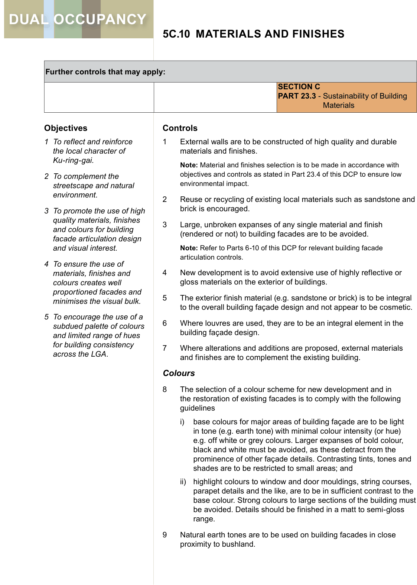

### 5C.9  WASTE MANAGEMENT

#### Further controls that may apply:

#### SECTION C

PART 23.3- Sustainability of Building

PART 24F - On-site Wastewater

#### Controls

#### Objectives

#### General

1 During the design of the development, construction waste is to be

minimised by

i) using recycled materials, selecting materials that reduce waste

or do not require disposal, or can be reused or recycled in the

ii)	 designing with minimal site disturbance by avoiding unnecessary

2 Council’s standard waste and recycling service is

| Waste Type | Bin Type |
|---|---|
| Waste (garbage) | 1 x 120L |
| Co-mingled recycling (glass, steel and aluminium cans and plastic) | 1 x 240L |
| Recycling of paper and cardboard | 1 x 240L |
| Green waste | 1 x 360L |

2	 To ensure waste collection

site does not affect the

3	 To ensure waste and

4	 To ensure design and

public health and the local

3 Development is to allocate, within each property boundary, an area

for storing Council specified waste and recycling bins, either located

at the rear or side of the premises, or as an additional area within

the garage/carport. The storage area is to be a minimum of 3m from

openable windows and integrated with the landscaping. Refer to 25R

of this Part for bin characteristics.

5	 To ensure the design

6	 To avoid visual clutter

> [Picture on page 49: a map, saved as a picture (images/part-05-dual-occupancy-page-49-1.gif, 150 dpi); the street names and other small labels are on the picture.]
> Words printed on the picture (title and legend, copied from the PDF):
> materials and finishes.
> the local character of
> Note: Material and finishes selection is to be made in accordance with
> objectives and controls as stated in Part 23.4 of this DCP to ensure low
> 2	 To complement the
> streetscape and natural
> brick is encouraged.
> quality materials, finishes
> and colours for building
> facade articulation design
> and visual interest.
> Note: Refer to Parts 6-10 of this DCP for relevant building facade
> materials, finishes and
> colours creates well
> proportioned facades and
> minimises the visual bulk.
> building façade design.
> subdued palette of colours
> for building consistency
> across the LGA.
> proximity to bushland.
