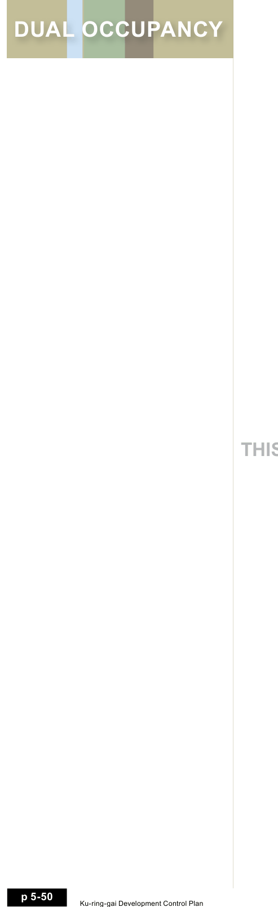

### 5C.10  MATERIALS AND FINISHES

#### Further controls that may apply:

#### SECTION C

PART 23.3 - Sustainability of Building

#### Controls

#### Objectives

1 External walls are to be constructed of high quality and durable

1	 To reflect and reinforce

2 Reuse or recycling of existing local materials such as sandstone and

3 Large, unbroken expanses of any single material and finish

(rendered or not) to building facades are to be avoided.

3	 To promote the use of high

4 New development is to avoid extensive use of highly reflective or

gloss materials on the exterior of buildings.

4	 To ensure the use of

5 The exterior finish material (e.g. sandstone or brick) is to be integral

to the overall building façade design and not appear to be cosmetic. 6 Where louvres are used, they are to be an integral element in the

5	 To encourage the use of a

and limited range of hues

7 Where alterations and additions are proposed, external materials

and finishes are to complement the existing building.

#### Colours

8 The selection of a colour scheme for new development and in

the restoration of existing facades is to comply with the following

guidelines

i) base colours for major areas of building façade are to be light

in tone (e.g. earth tone) with minimal colour intensity (or hue)

e.g. off white or grey colours. Larger expanses of bold colour,

black and white must be avoided, as these detract from the

prominence of other façade details. Contrasting tints, tones and

shades are to be restricted to small areas; and

ii)	 highlight colours to window and door mouldings, string courses,

parapet details and the like, are to be in sufficient contrast to the

base colour. Strong colours to large sections of the building must

be avoided. Details should be finished in a matt to semi-gloss

9 Natural earth tones are to be used on building facades in close

### BUILDING DESIGN AND SUSTAINABILITY

### THIS PAGE IS INTENTIONALLY LEFT BLANK

> [Picture on page 50: a picture, saved as a picture (images/part-05-dual-occupancy-page-50-2.gif, 150 dpi).]
