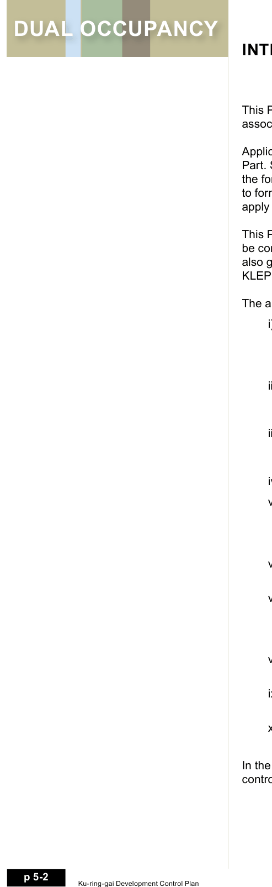

# Ku-ring-gai Development Control Plan - Part 5 Dual Occupancy

> This chapter is split into 21 section file(s), one per numbered heading, in the order they appear in the PDF.

Source PDF: [kdcp-section-a-part-5-dual-occupancy.pdf](kdcp-section-a-part-5-dual-occupancy.pdf)

### PART

### DUAL OCCUPANCY AND

### SEMI-DETACHED DWELLINGS

Introduction

#### 5A Site Design

5A.1 Local Character and Streetscape 5A.2 	 Site Layout 5A.3 	 Building Setbacks 5A.4 	 Built-Upon Area 5A.5 	 Landscaping

#### 5B Access and Parking

5B.1 	 Vehicle Access 5B.2 	 Car Parking Provision 5B.3 	 Carports and Garages

#### 5C Building Design and Sustainability

5C.1 	 Building Envelopes 5C.2 	 Building Facades 5C.3	 Dwelling Design and Layout 5C.4 	 Private Open Space 5C.5 	 Solar Access 5C.6 	 Natural Ventilation 5C.7 	 Ancillary Facilities 5C.8 	 Fencing 5C.9 	 Waste Management 5C.10 	Materials and Finishes

### DUAL OCCUPANCY

### INTRODUCTION

This Part applies to development for dual occupancy dwellings and

associated ancillary development.

Applications for semi-detached dwellings are to be considered under this

Part. Semi-detached dwellings are largely similar to a dual occupancy in

the form of two dwellings attached by a party wall and then subdivided

to form two separate lots. All references to dual occupancy in this Part

apply to semi-detached dwellings where relevant.

This Part guides dual occupancy and semi-detached development to

be consistent with the aims and objectives of the KLEP 2015. This Part

also guides dual occupancy development permitted under Schedule 1 of

> [Picture on page 2: a picture, saved as a picture (images/part-05-dual-occupancy-page-2-12.gif, 150 dpi).]

KLEP 2015.

The aims of this Part are as follows:

i) Ensure development is in keeping with the prevailing Ku-ring-

gai character of buildings within a landscaped garden setting,

including tall canopy trees, and is consistent with the built form

and streetscape of the area.

ii)	 	Ensure each development has sufficient landscaping to

contribute to the conservation and replenishment of Ku-ring-

gai's tree canopy, including locally occurring native tree species.

iii)	 Ensure development within a Heritage Conservation Area or

in the vicinity of a Heritage item conserves, protects and is

consistent with the heritage character and values.

iv)	 Minimise the impact of development on adjoining properties.

v)	 Protect and minimise the impact of development on the natural

environment, including impacts on soil structure, water table

and erosion from water runoff and limited water infiltration

opportunities.

vi)	 Minimise the depletion of raw materials and non-renewable

resources.

vii)	 Ensure development addresses the needs of the current

community without compromising the ability to meet the needs

of future generations, including management of heat island

effects.

viii)	Encourage housing of the highest architectural, environmental

and amenity standards.

ix)	 Manage residential development in a way that embraces

innovative design and contemporary lifestyles.

x)	 Ensure more certain outcomes for applicants, neighbours and

the community.

In the case of any inconsistency between the controls in Part 5, the

controls in Section B will prevail to the extent of the inconsistency.

### A

<!-- sections -->
## Sections

1. [5A Site Design](01-5a-site-design.md)
2. [5A.1 LOCAL CHARACTER AND STREETSCAPE](02-5a-1-local-character-and-streetscape.md)
3. [5A.2 SITE LAYOUT](03-5a-2-site-layout.md)
4. [5A.3 BUILDING SETBACKS](04-5a-3-building-setbacks.md)
5. [5A.4 BUILT-UPON AREA](05-5a-4-built-upon-area.md)
6. [5A.5 LANDSCAPING](06-5a-5-landscaping.md)
7. [5B Access and Parking](07-5b-access-and-parking.md)
8. [5B.1 VEHICLE ACCESS (continued)](08-5b-1-vehicle-access-continued.md)
9. [5B.2 CAR PARKING PROVISION](09-5b-2-car-parking-provision.md)
10. [5B.3 CARPORTS AND GARAGES](10-5b-3-carports-and-garages.md)
11. [5C Building Design and Sustainability](11-5c-building-design-and-sustainability.md)
12. [5C.1 BUILDING ENVELOPES](12-5c-1-building-envelopes.md)
13. [5C.2 BUILDING FACADES](13-5c-2-building-facades.md)
14. [5C.3 DWELLING DESIGN AND LAYOUT](14-5c-3-dwelling-design-and-layout.md)
15. [5C.4 PRIVATE OPEN SPACE](15-5c-4-private-open-space.md)
16. [5C.5 SOLAR ACCESS](16-5c-5-solar-access.md)
17. [5C.6 NATURAL VENTILATION](17-5c-6-natural-ventilation.md)
18. [5C.7 ANCILLARY FACILITIES](18-5c-7-ancillary-facilities.md)
19. [5C.8 FENCING](19-5c-8-fencing.md)
20. [5C.9 WASTE MANAGEMENT](20-5c-9-waste-management.md)
21. [5C.10 MATERIALS AND FINISHES](21-5c-10-materials-and-finishes.md)
