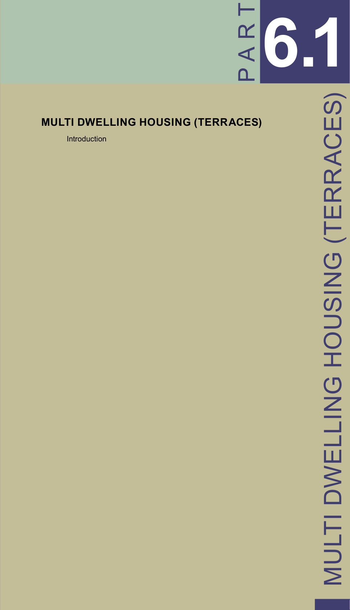
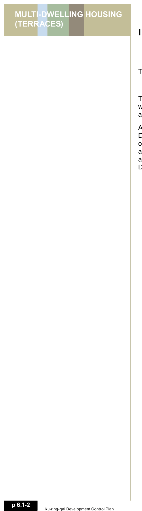

# Ku-ring-gai Development Control Plan - Part 6.1 Multi Dwelling Housing (terraces)

Source PDF: [kdcp-section-a-part-6.1-multi-dwelling-housing-terraces.pdf](https://planfortomorrow.sharepoint.com/sites/Planfortomorrow/Shared%20Documents/00%20NSW-Planning-Resources/dcp/ku-ring-gai-development-control-plan/part-06-1-multi-dwelling-housing-terraces/kdcp-section-a-part-6.1-multi-dwelling-housing-terraces.pdf)

> [Picture on page 1: a picture, saved as a picture (images/part-06-1-multi-dwelling-housing-terraces-page-1-1.gif, 150 dpi).]
> Words printed on the picture (title and legend, copied from the PDF):
> Introduction
> p 7-1
> Ku-ring-gai Development Control Plan

### PART

### 6.1

### MULTI DWELLING HOUSING (TERRACES)

### MULTI DWELLING HOUSING (TERRACES)

> [Picture on page 2: a picture, saved as a picture (images/part-06-1-multi-dwelling-housing-terraces-page-2-1.gif, 150 dpi).]
> Words printed on the picture (title and legend, copied from the PDF):
> p 6.1-2
> p 7-2
> Ku-ring-gai Development Control Plan

#### MULTI-DWELLING HOUSING

#### (TERRACES)

#### RESIDENTIAL FLAT

#### BUILDINGS

### INTRODUCTION

This Part provides standards for multi dwelling housing in the form of:

• terraces. Terraces are a type of multi dwelling housing with 3 or more dwellings,

where all dwellings are attached and face, and are generally aligned

along, one or more public roads All development applications are to comply with the ‘Low Rise Housing

Diversity Design Guide for Development Applications, 2020 (Department

of Planning, Housing and Infrastructure)’; and, applications are to be

accompanied by a Design Verification Statement that provides an

assessment against the Low Rise Housing Diversity Design Guide for

Development Applications, 2020. Note: Once prepared, LGA specific controls will be inserted into this Part.

### 6.1

### THIS PAGE IS INTENTIONALLY BLANK

p 6.1-3

p 7-3

Ku-ring-gai Development Control Plan
