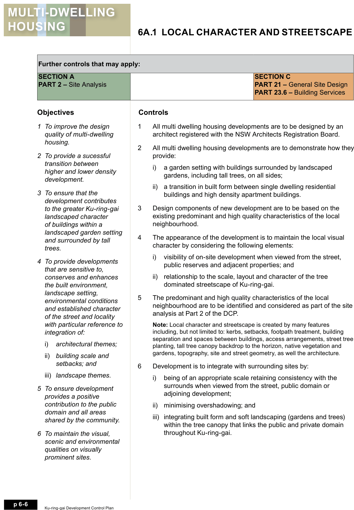

#### 6A Site Design

6A.1 Local Character and Streetscape 6A.2 Site Layout 6A.3 Building Setback 6A.4 Building Separation 6A.5 Site Coverage 6A.6 Deep Soil Landscaping

### READ WITH

#### SECTION A

PART 2 - Site Analysis

#### SECTION B

PART 20 - Development Near Road or Rail Noise

#### SECTION C

PART 21  - General Site Design

21.2: Landscape Design

PART 23 - General Building Design and Sustainability

23.6: Building Services

### REFER TO

• ABCB LIVABLE HOUSING DESIGN STANDARD

• LIVABLE HOUSING DESIGN GUIDELINES

### SITE DESIGN

> [Picture on page 6: a map, saved as a picture (images/part-06-multi-dwelling-housing-excluding-terrraces-page-6-1.gif, 150 dpi); the street names and other small labels are on the picture.]
> Words printed on the picture (title and legend, copied from the PDF):
> quality of multi-dwelling
> higher and lower density
> to the greater Ku-ring-gai
> of buildings within a
> landscaped garden setting
> and surrounded by tall
> dominated streetscape of Ku-ring-gai.
> 4	 To provide developments
> that are sensitive to,
> conserves and enhances
> the built environment,
> and established character
> with particular reference to
> i) architectural themes;
> Note: Local character and streetscape is created by many features
> including, but not limited to: kerbs, setbacks, footpath treatment, building
> separation and spaces between buildings, access arrangements, street tree
> planting, tall tree canopy backdrop to the horizon, native vegetation and
> gardens, topography, site and street geometry, as well the architecture.
> ii) building scale and
> iii) landscape themes.
> 5	 To ensure development
> provides a positive
> contribution to the public
> domain and all areas
> shared by the community.
> scenic and environmental
> qualities on visually
