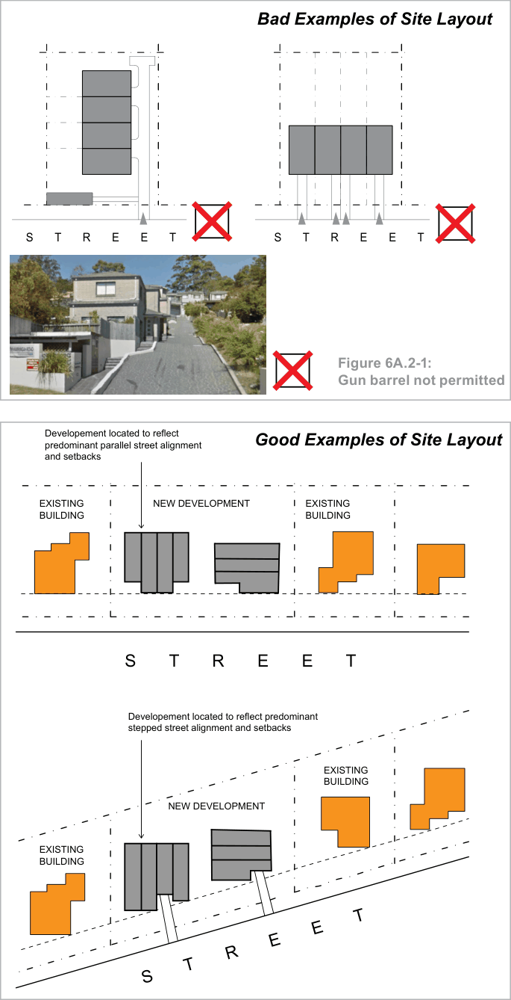
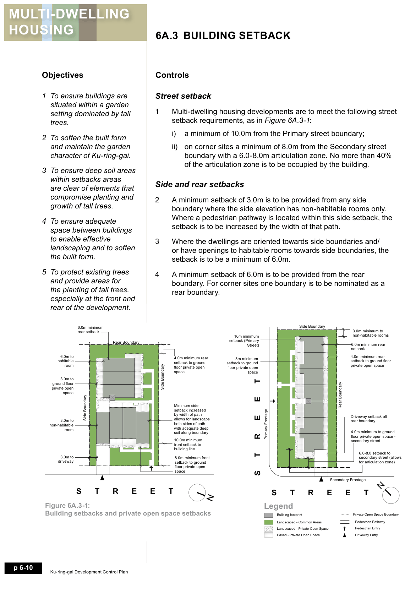

### 6A.2  SITE LAYOUT

#### Further controls that may apply SECTION A

PART 2 - Site Analysis

#### SECTION B

PART 20 - Development Near Road

#### SECTION C

PART 21 - General Site Design

PART 23.7 - General Acoustic

#### Controls

#### Objectives

1 The site layout is to demonstrate a clear and appropriate design

strategy and arrangement of building mass in response to the Site

Analysis in Part 2 Site Analysis of this DCP. Demonstration of design

strategies to address opportunities and constraints based on a Site

Analysis are to include:

i) building location and orientation on the site optimising

northern aspect; relationship with neighbouring developments;

geographical aspect; views; access etc;

2	 To ensure detailed design

ii)	 response of building development in maintaining site

characteristics within the subject site, such as topography,

vegetation, significant trees, any special features, etc;

iii)	 building separations and internal layouts of buildings that

respond to (i) above and be consistent with the requirements of

2 A drawing and supporting written information is to demonstrate how

the building and its layout has applied and responded to the site

analysis conducted in Part 2 of this DCP.

3	 To ensure that site

3 For requirements on development near noise sources refer to Part

20 Development Near Rail Corridors and Busy Roads in this DCP.

4	 To ensure high impact

early in the design stage.

4 Any dwelling with a frontage to the street is to address that street

with entry doors, windows, verandas and such like. 5 Where a site has two or more frontages, the buildings are to address

and provide dwelling door entry points from all street frontages.

5	 To ensure provision of a

6 Soft landscaping, including tall trees, is to be provided between

onsite buildings, fences and courtyard walls.

6	 To soften built form with

7 Hard landscaping is to be minimised to maximise opportunities for

7	 To achieve a high

8 Long straight driveways are not permitted except where necessary

for battle-axe sites. Driveways are to be designed to be of minimal

9 Provide a single pedestrian entry point into the development from

the street. Other entries may be permitted where several dwellings

address the street along an extended street or dual frontage sites.

9	 To reduce the appearance

10 All development is to have a building alignment parallel to the street,

or in alignment with existing setback patterns where the pattern is

not likely to change, as in Figure 6A.2-2.

10	To ensure driveways are

not a dominant feature of

11 Stair lifts, open platforms and inclinators are not permitted. This

includes any setback area and/or elsewhere within the site.

constructed lift shaft. Their location must satisfy setback requirements.

#### Objectives

11	To provide a safe and

continuous pathway from

the street to the entry

point of each dwelling. 12	To ensure buildings

address the public domain

and give direct access

from both primary and

secondary streets and

any other street on the

property boundary. 13	To maintain the alignment

and rhythm of the built

form on the street. 14	To ensure high quality

site design with

integrated methods of

pedestrian and vehicular

access that support the

visual character of the

streetscape and locality. 15	To ensure visual and

acoustic amenity is

preserved to neighbouring

developments.

#### Figure 6A.2-2:

Development sites with

parallel prevailing building

line to address front garden

and street.

Building Footprint

Building Footprint Landscaped Common Areas

Landscaped Common Areas Landscaped Communal Open Space

Landscaped Communal Open Space Landscaped Private Open Space

Landscaped Private Open Space Paved Private Open Space

Paved Private Open Space Private Open Space Boundary

Private Open Space Boundary Pedestrian Pathway

Pedestrian Pathway

### 6A.2 SITE LAYOUT (continued)

Pedestrian Entry

Pedestrian Entry

Driveway

Driveway

> [Picture on page 9: a picture, saved as a picture (images/part-06-multi-dwelling-housing-excluding-terrraces-page-9-51.gif, 150 dpi).]
> Words printed on the picture (title and legend, copied from the PDF):
> STREET
> STREET
> STREET
> STREET
> STREET
> STREET
> Gun barrel not permitted

Figure 6A.2-1:

#### Bad Examples of Site Layout

> Words printed on the picture (title and legend, copied from the PDF):
> Developement located to reflect
> predominant parallel street alignment
> NEW DEVELOPMENT EXISTING
> Developement located to reflect predominant
> stepped street alignment and setbacks

#### Good Examples of Site Layout

### SITE DESIGN

> [Picture on page 10: a map, saved as a picture (images/part-06-multi-dwelling-housing-excluding-terrraces-page-10-1.gif, 150 dpi); the street names and other small labels are on the picture.]
> Words printed on the picture (title and legend, copied from the PDF):
> situated within a garden
> setting dominated by tall
> and maintain the garden
> character of Ku-ring-gai.
> within setbacks areas
> compromise planting and
> growth of tall trees.
> 4	 To ensure adequate
> space between buildings
> to enable effective
> landscaping and to soften
> the built form.
> and provide areas for
> rear of the development.
> 4.0m minimum rear
> setback to ground
> floor private open
> 4.0m minimum rear
> setback to ground
> floor private open
> 4.0m minimum rear
> setback to ground
> floor private open
> 4.0m minimum rear
> setback to ground
> floor private open
> by width of path
> allows for landscape
> both sides of path
> with adequate deep
> soil along boundary
> by width of path
> allows for landscape
> both sides of path
> with adequate deep
> soil along boundary
> front setback to
> front setback to
> by width of path
> allows for landscape
> both sides of path
> with adequate deep
> soil along boundary
> by width of path
> allows for landscape
> both sides of path
> with adequate deep
> soil along boundary
> 8.0m minimum front
> setback to ground
> floor private open
> 8.0m minimum front
> setback to ground
> floor private open
> front setback to
> front setback to
> 8.0m minimum front
> setback to ground
> floor private open
> 8.0m minimum front
> setback to ground
> floor private open
> Building setbacks and private open space setbacks
> 16/11/23 Draft - For consultant information
> B 20/11/23 For Council consideration
> C 5/12/23 For Council consideration
> 16/11/23 Draft - For consultant information
> B 20/11/23 For Council consideration
> C 5/12/23 For Council consideration
> h the Building Code of Australia
> h the relevant Australian Standards
> h relevant Authorities' requirements
> ed dimensions only
> with the Building Code of Australia
> with the relevant Australian Standards
> with relevant Authorities' requirements
> any work executed from
> on creation vest in Hill Thalis
> in any work executed from
> r on creation vest in Hill Thalis
> 16/11/23 Draft - For consultant information
> B 20/11/23 For Council consideration
> C 5/12/23 For Council consideration
> 16/11/23 Draft - For consultant information
> B 20/11/23 For Council consideration
> C 5/12/23 For Council consideration
> – Use figured dimensions only
> – Do not scale
> – Comply with the Building Code of Australia
> – Use figured dimensions only
> – Do not scale

Figure 6A.3-1:

Figure 6A.3-1

Figure 6A.3-1

Figure 6A.3-1

Figure 6A.3-1
