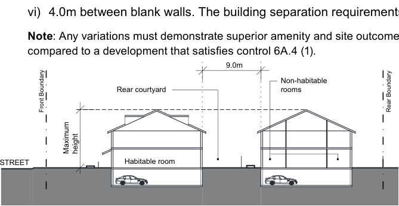
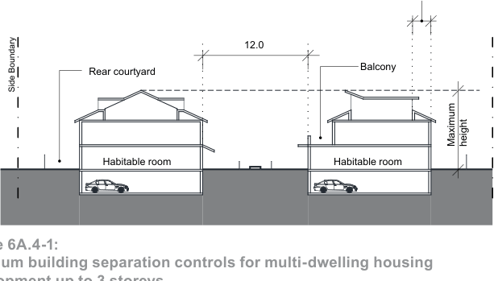

### 6A.4  BUILDING SEPARATION

#### Controls

The minimum separation between residential buildings on the same

1

development site is to comply with the following controls, as in

Figure 6A.4-1:

12.0m between habitable rooms/balconies;

i)

9.0m between habitable room/balcony and non-habitable room;

ii)

iii) 6.0m between a habitable room and a blank wall;

iv) 6.0m between non-habitable rooms; 6.0m between a blank wall and a non-habitable room;

v)

> [Picture on page 12: a map, saved as a picture (images/part-06-multi-dwelling-housing-excluding-terrraces-page-12-45.gif, 150 dpi); the street names and other small labels are on the picture.]
> Words printed on the picture (title and legend, copied from the PDF):
> Note: Any variations must demonstrate superior amenity and site outcomes
> compared to a development that satisfies control 6A.4 (1).

vi)	 4.0m between blank walls. The building separation requirements

#### Figure 6A.4-1:

2.0m minimum setback from building line to upper level

> [Picture on page 12: a map, saved as a picture (images/part-06-multi-dwelling-housing-excluding-terrraces-page-12-50.gif, 150 dpi); the street names and other small labels are on the picture.]
> Words printed on the picture (title and legend, copied from the PDF):
> 2.0m minimum setback from
> building line to upper level
> Minimum building separation controls for multi-dwelling housing

Side Boundary

Side Boundary

development up to 3 storeys.

#### Objectives

1	 To ensure development

is consistent with the

landscape character of the

area.

2	 To protect and improve the

tree canopy within Ku-

ring-gai.

3	 To provide adequate

space for the planting

of tall trees and other

landscaping. 4	 To provide a balance

of built form and soft

landscaped area. 5	 To minimise impervious

surfaces that generate

storm water runoff.
