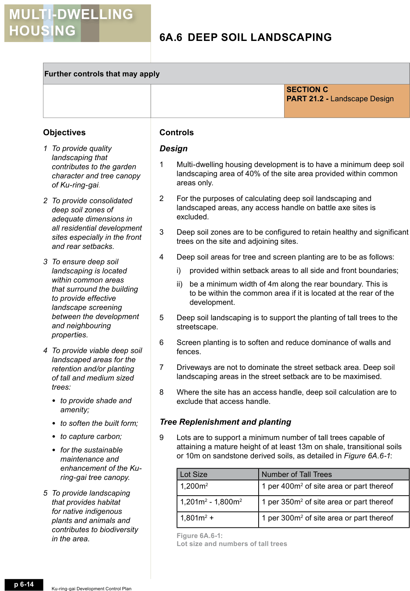

### 6A.5  SITE COVERAGE

#### Controls

1 The site coverage for multi dwelling housing may be up to a

maximum site coverage as outlined in Figure 6A.5-1 and 6A.5-2,

provided that the deep soil landscaping requirements in Part 6A.5

can be met.

| Basement Parking |  |
|---|---|
| Maximum site coverage for standard site | Maximum site coverage for site with access handle |
| 40% | 40% less 40% of any access handle |

#### Figure 6A.5-1:

#### Maximum site coverage controls.

#### A

street

#### B

Maximum site coverage for townhouses

= [(A+B) x 40%]m2 - (B x 40%)m2

#### Figure 6A.5-2:

#### Maximum site coverage controls.

### SITE DESIGN

Note: Site coverage is not the inverse of deep soil landscaping. Refer to

Part 1B Dictionary for clarification of site coverage.

> [Picture on page 14: a map, saved as a picture (images/part-06-multi-dwelling-housing-excluding-terrraces-page-14-1.gif, 150 dpi); the street names and other small labels are on the picture.]
> Words printed on the picture (title and legend, copied from the PDF):
> 1	 To provide quality
> contributes to the garden
> character and tree canopy
> 2	 To provide consolidated
> deep soil zones of
> adequate dimensions in
> all residential development
> and rear setbacks.
> landscaping is located
> within common areas
> that surround the building
> to provide effective
> between the development
> landscaped areas for the
> retention and/or planting
> exclude that access handle.
> enhancement of the Ku-
> ring-gai tree canopy.
> 5	 To provide landscaping
> that provides habitat
> for native indigenous
> plants and animals and
> contributes to biodiversity
> in the area.
> Lot size and numbers of tall trees

Figure 6A.6-1:
