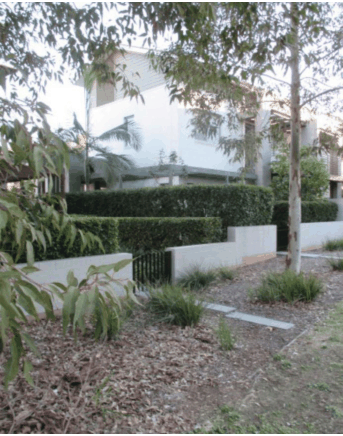
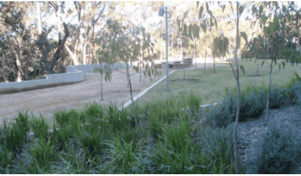

### 6A.6  DEEP SOIL LANDSCAPING

#### Further controls that may apply

#### SECTION C

PART 21.2 - Landscape Design

#### Objectives

#### Controls Design

1 Multi-dwelling housing development is to have a minimum deep soil

landscaping area of 40% of the site area provided within common

2 For the purposes of calculating deep soil landscaping and

landscaped areas, any access handle on battle axe sites is

3 Deep soil zones are to be configured to retain healthy and significant

trees on the site and adjoining sites.

sites especially in the front

4 Deep soil areas for tree and screen planting are to be as follows:

i) provided within setback areas to all side and front boundaries;

ii)	 be a minimum width of 4m along the rear boundary. This is

to be within the common area if it is located at the rear of the

5 Deep soil landscaping is to support the planting of tall trees to the

3	 To ensure deep soil

6 Screen planting is to soften and reduce dominance of walls and

7 Driveways are not to dominate the street setback area. Deep soil

landscaping areas in the street setback are to be maximised.

4	 To provide viable deep soil

of tall and medium sized

trees:

8 Where the site has an access handle, deep soil calculation are to

• to provide shade and

#### Tree Replenishment and planting

• to soften the built form;

• to capture carbon;

9 Lots are to support a minimum number of tall trees capable of

attaining a mature height of at least 13m on shale, transitional soils

or 10m on sandstone derived soils, as detailed in Figure 6A.6-1:

| Lot Size | Number of Tall Trees |
|---|---|
| 1,200m2 | 1 per 400m2 of site area or part thereof |
| 1,201m2 - 1,800m2 | 1 per 350m2 of site area or part thereof |
| 1,801m2 + | 1 per 300m2 of site area or part thereof |

• for the sustainable

#### Objectives

6	 To ensure that deep

soil is provided to allow

infiltration of rain water

to the water table and to

reduce stormwater runoff.

### 6A.6 DEEP SOIL LANDSCAPING (continued)

#### Controls

10 In addition to the tall trees, a range of medium trees, small trees and

shrubs are to be selected to ensure:

i) that the streetscape presents as buildings within a tall tree

canopy setting;

ii) that vegetation creates a garden setting and can be viewed from

the buildings onsite.

11 On sites within areas mapped under Council’s Green web

categories, the percentage of all tree planting is to be as per the

biodiversity controls in Part 19 of this DCP. On all other sites, at least

30% of all tree planting are to be locally occurring species.

> [Picture on page 15: a picture, saved as a picture (images/part-06-multi-dwelling-housing-excluding-terrraces-page-15-19.gif, 150 dpi).]

> [Picture on page 15: a picture, saved as a picture (images/part-06-multi-dwelling-housing-excluding-terrraces-page-15-20.gif, 150 dpi).]

### SITE DESIGN

#### Figure 6A.6-2:

#### Deep soil landscaping

### 6B
