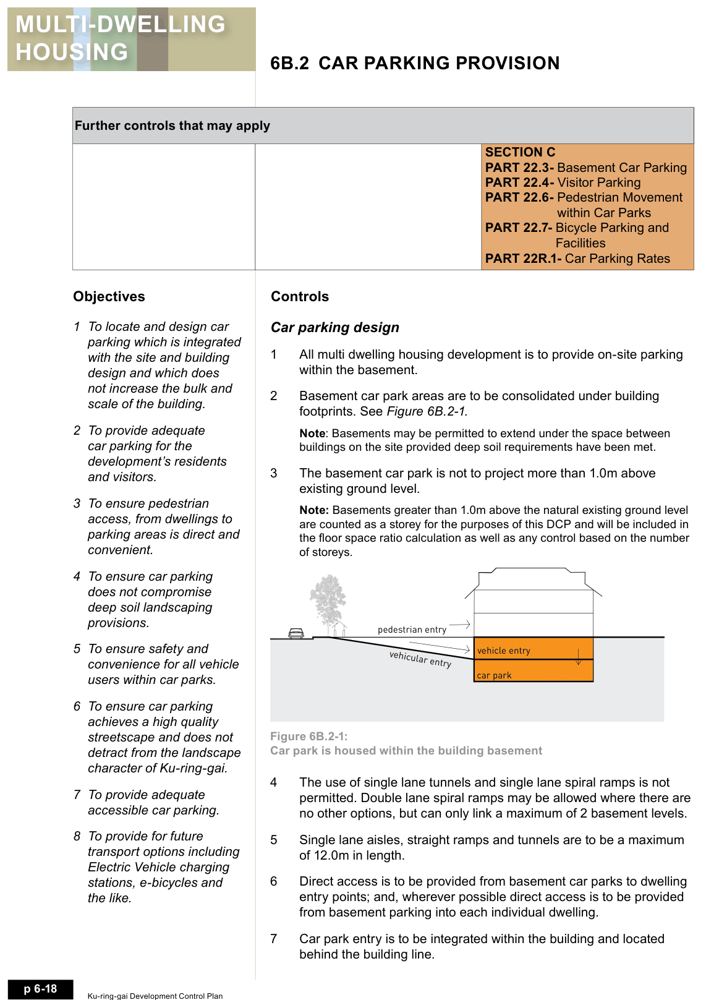

### 6B.1  VEHICLE ACCESS

#### Further controls that may apply SECTION A

PART 6A.1 - Site Layout

#### SECTION C

PART 22.2 - General Vehicle

Access

PART 25 - Waste Management

#### Objectives

#### Controls

1 Driveways are to be located at least 3m from any side boundary and

be separated from the boundary by a continuous landscaped verge

and screen planting to the neighbouring development.

1	 To ensure landscaping

adequately separates

driveways from

neighbouring properties.

2 Not more than one driveway is to be established on any property. 3 On sites with dual street frontage, one additional driveway may be

considered.

2	 To provide well located

and designed vehicle

entrances. 3	 To facilitate pedestrian

amenity and safety.

4 Driveways are to be designed to avoid a straight at grade, gun barrel

appearance by using appropriate landscaping and variations in

alignment. 5 On-site vehicle turning areas are to be located within the basement.

4	 To ensure that driveways

do not dominate the

streetscape.

6 On-site vehicle turning areas are to be designed to permit turning in

a single reversing movement.

5	 To ensure vehicular

and service access do

not detract from the

visual character of the

streetscape. 6	 To minimise hard surfaces

on the site. 7	 To provide convenient and

safe vehicular movements

onsite.

### ACCESS AND PARKING

> [Picture on page 18: a map, saved as a picture (images/part-06-multi-dwelling-housing-excluding-terrraces-page-18-1.gif, 150 dpi); the street names and other small labels are on the picture.]
> Words printed on the picture (title and legend, copied from the PDF):
> PART 22.4- Visitor Parking
> within Car Parks
> within the basement.
> parking which is integrated
> design and which does
> scale of the building.
> footprints. See Figure 6B.2-1.
> Note: Basements may be permitted to extend under the space between
> buildings on the site provided deep soil requirements have been met.
> 2	 To provide adequate
> car parking for the
> existing ground level.
> 3	 To ensure pedestrian
> access, from dwellings to
> Note: Basements greater than 1.0m above the natural existing ground level
> are counted as a storey for the purposes of this DCP and will be included in
> the floor space ratio calculation as well as any control based on the number
> does not compromise
> deep soil landscaping
> convenience for all vehicle
> users within car parks.
> Car park is housed within the building basement
> achieves a high quality
> streetscape and does not
> detract from the landscape
> character of Ku-ring-gai.
> 7	 To provide adequate
> accessible car parking.
> of 12.0m in length.
> transport options including
> Electric Vehicle charging
> stations, e-bicycles and
> behind the building line.

Figure 6B.2-1:
