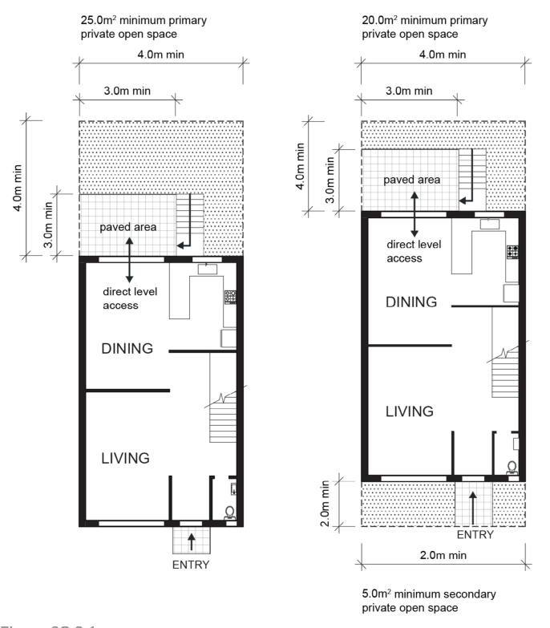

### 6C.2  PRIVATE OPEN SPACE

#### Controls

1 A minimum private open space of 25.0sqm internal dimension is

to be provided to each dwelling within the multi-dwelling housing

development, as in Figure 6C.2-1. The private open space is to:

i) have a minimum internal dimension of 4.0m;

ii) have direct level access from the living/dining area;

iii) provide a consolidated paved area of 12.0sqm and a minimum

width of 3.0m;

iv) accommodate a table and 6 chairs directly accessible from the

living/dining area with no obstructions including stairs; and

v) provide a 4.0sqm minimum landscaped area/planter bed for

gardening.

Note: Variations must demonstrate superior amenity and site outcomes

compared to a development that satisfies 6C.2 (2).

Note: Access from living/dining rooms is to have no obstructions including

stairs.

Note: A step at the threshold for compliance with waterproofing

requirements is acceptable.

Note: However, thresholds to the primary private open space are to be accessible for all Platinum Level dwellings.

2 The private open space to each dwelling may be provided as a

maximum of two separate spaces only if the Primary private open

space is a minimum 20sqm in area, and meets all the criteria in

6C.2(1)i-iv. The remaining Secondary private open space is to have

a minimum internal dimension of 2m and be clear of obstructions

including stairs.

3 All private open space area requirements are exclusive of any areas

for the provision of services such as fixed drying areas. Note: Pull out lines are acceptable within the private open space. 4 Ground level private open space (outdoor) is to be differentiated from

common areas by:

i) a change in level; and/or

ii) screen planting, such as hedges and low shrubs; and/or

iii) a fence/wall to a maximum height of 1.8m. Any solid wall

component is to be a maximum height of 1.2m with at least 30%

transparent component above.

5 Where practical, a gate is to be provided between the private open

space and common areas to allow access into common areas.

### BUILDING DESIGN AND SUSTAINABILITY

### BUILDING DESIGN AND SUSTAINABILITY

### BUILDING DESIGN AND SUSTAINABILITY

#### 6C.2 PRIVATE OPEN SPACE (continued)

#### Controls

6 Private open space, courtyard and terrace wall and fence heights

are not to exceed:

i) 1.2m to any street frontage;

ii) 1.8m to any side or rear boundary, with a maximum 1.2m high

solid component and a minimum 30% transparent component

above. Note: Changes in ground levels between private open spaces and common

areas and paths provide alternative opportunities to achieve required visual

privacy that minimise reliance on fencing to maximise landscape and site

character outcomes. 7 A water outlet is to be provided within the Primary private open

space.

> [Picture on page 26: a picture, saved as a picture (images/part-06-multi-dwelling-housing-excluding-terrraces-page-26-15.gif, 150 dpi).]

#### Figure 6C.2-1:

#### Private open space.

#### Objectives

1	 To provide adequate

sunlight to all dwellings. 2	 To ensure a high level

of internal amenity for

occupants.

3	 To provide adequate

access to daylight in all

habitable rooms. 4	 To minimise

overshadowing of living

areas and private and

communal open space

areas within neighbouring

developments.

5	 To minimise the impact of

development on existing

solar collection devices. 6	 To provide adequate

shading in summer.
