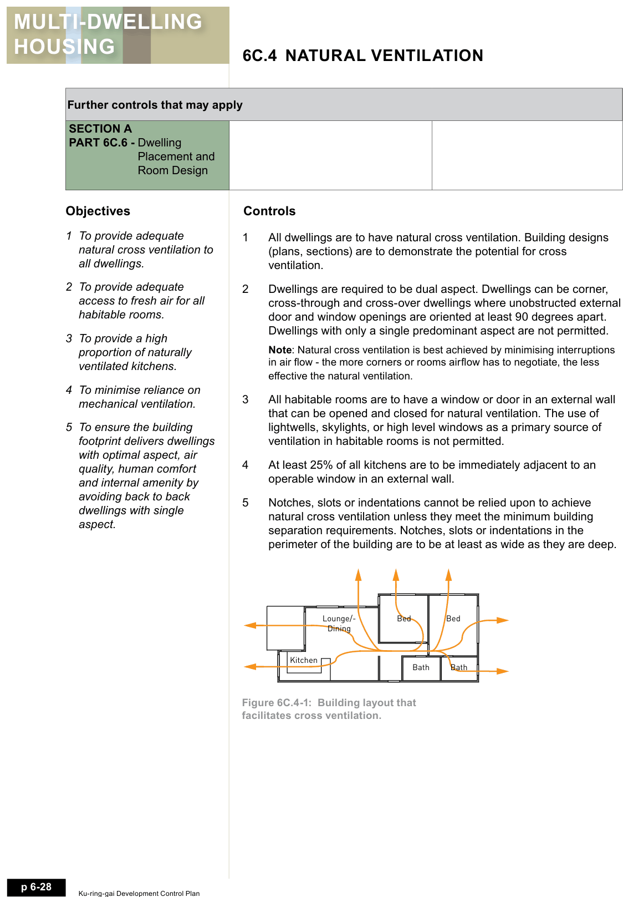

### 6C.3  SOLAR ACCESS AND DAYLIGHT

#### Controls

1 Buildings are to be oriented to optimise the northern aspect. 2 All dwellings are to receive a minimum of three hours direct sunlight

to the living room and/or dining room, and to the Primary private

open space between 9am and 3pm on 21st June. Note: Shadows cast by trees and fences are excluded from this calculation. Note: Shadows cast by adjacent buildings or those in the vicinity likely to

impact the development site are to be included. Where future development

is anticipated under existing land-use zones, building envelopes under the

relevant controls are to be included.

3 All habitable rooms are to have a window in an external wall that is

directly visible from every part of the room. Snorkel windows are not

permitted.

Note: Refer to Part 1B.1 for definition of snorkel window. 4 The use of lightwells, skylight, or high level windows as a primary

source of daylight in habitable rooms is not permitted. 5 Notches, slots or indents in the perimeter of the building are to be at

least as wide as they are deep.

6 All developments are to allow the retention of at least three hours

of sunlight between 9am and 3pm on 21st June to the living areas

and the private open spaces and communal open spaces of multi-

dwelling housing and any low density residential development on

adjoining lots.

7 If the proposal will significantly reduce the solar access of existing

dwellings on a neighbouring site, building setbacks are to be

increased beyond the minimums to reasonably alleviate the impact. Note: Overshadowing is not to compromise the development potential of the adjoining yet-to-be-developed site(s).

8 Developments are to allow the retention of a minimum of 4 hours

direct sunlight between 9am to 3pm on 21st June to all existing

neighbouring solar collectors and solar hot water services.

#### Sun Shading

9 All developments are to utilise shading and glare control. Design

solutions include:

i) providing external horizontal shading to north-facing windows,

such as eaves, overhangs, pergolas, awnings, colonnades,

upper floor balconies, deciduous vegetation;

ii) providing vertical shading to east and west windows, such as

sliding screens, adjustable louvres, blinds and shutters;

iii) providing shading to glazed and transparent roofs. 10 All shading devices are to be integrated into the building facade

design.

### BUILDING DESIGN AND SUSTAINABILITY

### BUILDING DESIGN AND SUSTAINABILITY

### BUILDING DESIGN AND SUSTAINABILITY

> [Picture on page 28: a map, saved as a picture (images/part-06-multi-dwelling-housing-excluding-terrraces-page-28-1.gif, 150 dpi); the street names and other small labels are on the picture.]
> Words printed on the picture (title and legend, copied from the PDF):
> PART 6C.6 - Dwelling
> 1	 To provide adequate
> natural cross ventilation to
> 2	 To provide adequate
> proportion of naturally
> Note: Natural cross ventilation is best achieved by minimising interruptions
> in air flow - the more corners or rooms airflow has to negotiate, the less
> effective the natural ventilation.
> basement car park
> footprint delivers dwellings
> with optimal aspect, air
> quality, human comfort
> and internal amenity by
> avoiding back to back
> dwellings with single
> facilitates cross ventilation.
> distance between kitchen
> and external opening

Figure 6C.4-1:  Building layout that
