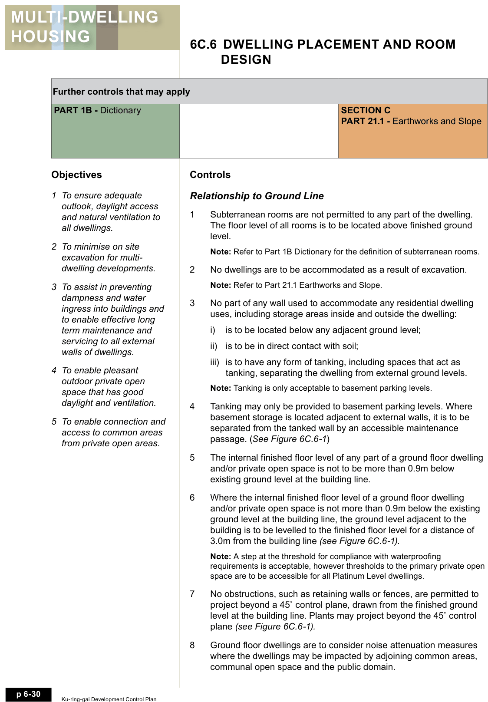

### 6C.5  DWELLING MIX AND ACCESSIBILITY

#### Controls

1 A range of dwelling sizes and a mix of types which includes two,

three and four bedroom dwellings are to be provided within the

development

#### Accessible Housing

2 All units in the multi-dwelling housing development are to be of Silver

Level, and 15% of those are to be of Platinum Level, with standards

as indicated in the Livable Housing Design Guideline. Note: For details on the Liveable Housing Design Guideline refer to www.

livablehousingaustralia.org.au

3 All developments are required to meet the Livable Housing Design

Guideline provisions and National Construction Code accessibility

requirements regardless of steepness of site.

Note: This control applies to development on all sites including those that are steeper than 1:14.

4 All development is to provide an accessible path of travel:

i) from the street entry to the front door of each dwelling; and

ii) from the basement carparking to the dwelling entry; and

iii) from the dwelling to the primary communal open space and each

type of room or space for use in common by the residents. Note: Provision is to be made for wheelchair turning circles where required. Note: The control above applies to all development regardless of the

steepness of the site.

5 For Platinum level units with more than one level, an internal lift is to

be provided to allow access to all levels.

Note: Provision of a lift is not in lieu of accommodating Platinum Level provisions required at the dwelling entry level.

6 Chair lifts, platform lifts and the like are not permitted on internal

and external communal/shared paths and circulation areas. Where

lifts are required, they are to be constructed within lift shafts with full

weather protection for users.

### BUILDING DESIGN AND SUSTAINABILITY

### BUILDING DESIGN AND SUSTAINABILITY

> [Picture on page 30: a map, saved as a picture (images/part-06-multi-dwelling-housing-excluding-terrraces-page-30-1.gif, 150 dpi); the street names and other small labels are on the picture.]
> Words printed on the picture (title and legend, copied from the PDF):
> 1	 To ensure adequate
> outlook, daylight access
> and natural ventilation to
> Note: Refer to Part 1B Dictionary for the definition of subterranean rooms.
> excavation for multi-
> Note: Refer to Part 21.1 Earthworks and Slope.
> dampness and water
> ingress into buildings and
> to enable effective long
> term maintenance and
> servicing to all external
> walls of dwellings.
> Note: Tanking is only acceptable to basement parking levels.
> 4	 To enable pleasant
> outdoor private open
> space that has good
> daylight and ventilation.
> passage. (See Figure 6C.6-1)
> access to common areas
> from private open areas.
> Note: A step at the threshold for compliance with waterproofing
> requirements is acceptable, however thresholds to the primary private open
> space are to be accessible for all Platinum Level dwellings.
> plane (see Figure 6C.6-1).
