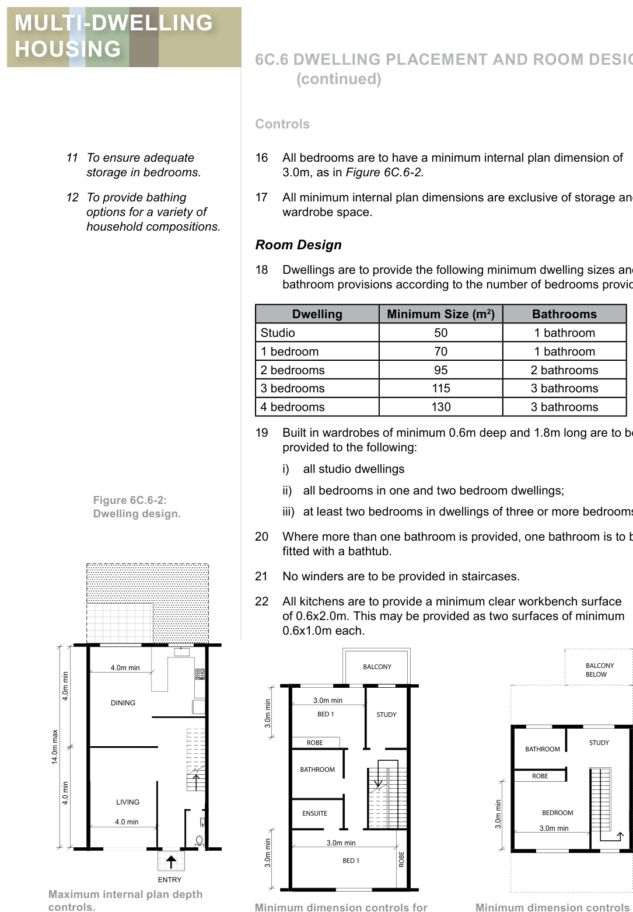
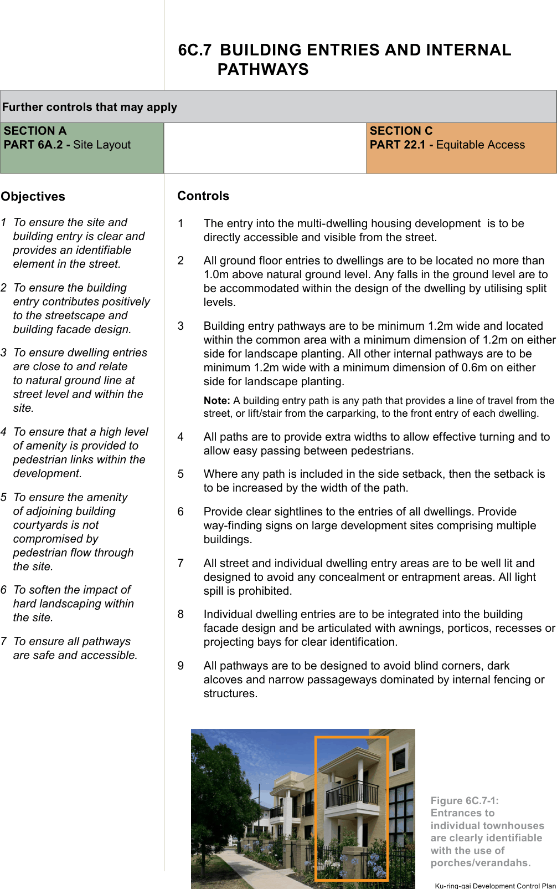

### 6C.6  DWELLING PLACEMENT AND ROOM

### DESIGN

#### Further controls that may apply

PART 1B - Dictionary

#### SECTION C

PART 21.1 - Earthworks and Slope

#### Controls

#### Objectives

#### Relationship to Ground Line

1 Subterranean rooms are not permitted to any part of the dwelling.

The floor level of all rooms is to be located above finished ground

2	 To minimise on site

dwelling developments. 2 No dwellings are to be accommodated as a result of excavation.

3 No part of any wall used to accommodate any residential dwelling

uses, including storage areas inside and outside the dwelling:

i) is to be located below any adjacent ground level;

ii) is to be in direct contact with soil;

3	 To assist in preventing

iii) is to have any form of tanking, including spaces that act as

tanking, separating the dwelling from external ground levels.

4 Tanking may only be provided to basement parking levels. Where

basement storage is located adjacent to external walls, it is to be

separated from the tanked wall by an accessible maintenance

5	 To enable connection and

5 The internal finished floor level of any part of a ground floor dwelling

and/or private open space is not to be more than 0.9m below

existing ground level at the building line. 6 Where the internal finished floor level of a ground floor dwelling

and/or private open space is not more than 0.9m below the existing

ground level at the building line, the ground level adjacent to the

building is to be levelled to the finished floor level for a distance of

3.0m from the building line (see Figure 6C.6-1).

7 No obstructions, such as retaining walls or fences, are permitted to

project beyond a 45˚ control plane, drawn from the finished ground

level at the building line. Plants may project beyond the 45˚ control

8 Ground floor dwellings are to consider noise attenuation measures

where the dwellings may be impacted by adjoining common areas,

communal open space and the public domain.

#### 6C.6 DWELLING PLACEMENT AND ROOM DESIGN

#### (continued)

#### Controls

#### Figure 6C.6-1:

#### Dwelling relationship to ground line

SIDE BOUNDARY

6.0m min side setback

3.0m min setback to courtyard/ terrace

HABITABLE ROOM

building line

HABITABLE ROOM

no obstruction within 45° control plane from ground level at building line

existing ground level

existing ground level

LIVING AREA

courtyard wall

no more than 0.9m below existing ground level at building line

45°

0.9m

max

0.9m

max

finished ground level

min 3.0m level

private courtyard

STORAGE

tanking to basement wall

BASEMENT PARKING

accessible maintainance passage to separate basement storage from tanked wall

6 To provide dwellings

with well proportioned

and functional rooms of

adequate dimension.

9 Ground and podium level dwellings are to have private outdoor areas

differentiated from communal areas. A gate is to be provided from

the private open space of each dwelling into common areas where

possible.

#### Dwelling and Room Design

7 To ensure safety of

movement on stairs for

all age groups.

10 The maximum habitable room depth is 8.0m from a window in an

external wall. 11 The maximum internal plan depth of a dwelling is to be 14.0m from

glass line to glass line, as in Figure 6C.6-2. 12 The living area is to have a minimum internal plan dimension of

4.0m, as in Figure 6C.6-2.

8 To ensure the provision

of separate living, dining

and kitchen areas

within each dwelling,

and generous areas

where open plan living is

provided.

13 The dining area is to have a minimum internal plan dimension of

4.0m, as in Figure 6C.6-2.

9 To ensure kitchens

have adequate areas to

facilitate food preparation

for the entire household.

14 Where living and dining rooms are combined in an open plan, a

minimum internal plan dimension of 8.0m is to be provided across

both areas, with the secondary plan dimension remaining at 4.0m as

in Figure 6C.6-2.

10	 To ensure adequate

daylight access and

natural ventilation.

### BUILDING DESIGN AND SUSTAINABILITY

15 Where kitchen areas are included within open plan dining and living

areas, the kitchen area and the circulation area for the kitchen is to

be separate and excluded from the measurement of living room and

dining room area dimensions in 6C.6(14).

> [Picture on page 32: a map, saved as a picture (images/part-06-multi-dwelling-housing-excluding-terrraces-page-32-1.gif, 150 dpi); the street names and other small labels are on the picture.]
> Words printed on the picture (title and legend, copied from the PDF):
> 11	 To ensure adequate
> storage in bedrooms.
> 12	 To provide bathing
> Maximum internal plan depth

Figure 6C.6-2:

options for a variety of

ENTRY

ENTRY

#### 6C.6 DWELLING PLACEMENT AND ROOM DESIGN

#### (continued)

#### Controls

16 All bedrooms are to have a minimum internal plan dimension of

3.0m, as in Figure 6C.6-2.

17 All minimum internal plan dimensions are exclusive of storage and

wardrobe space.

#### Room Design

18 Dwellings are to provide the following minimum dwelling sizes and

bathroom provisions according to the number of bedrooms provided:

| Dwelling | Minimum Size (m2) | Bathrooms |
|---|---|---|
| Studio | 50 | 1 bathroom |
| 1 bedroom | 70 | 1 bathroom |
| 2 bedrooms | 95 | 2 bathrooms |
| 3 bedrooms | 115 | 3 bathrooms |
| 4 bedrooms | 130 | 3 bathrooms |

19 Built in wardrobes of minimum 0.6m deep and 1.8m long are to be

provided to the following:

i) all studio dwellings

ii) all bedrooms in one and two bedroom dwellings;

iii) at least two bedrooms in dwellings of three or more bedrooms. 20 Where more than one bathroom is provided, one bathroom is to be

fitted with a bathtub.

21 No winders are to be provided in staircases.

BALCONY

BALCONY BELOW

22 All kitchens are to provide a minimum clear workbench surface

of 0.6x2.0m. This may be provided as two surfaces of minimum

0.6x1.0m each.

> Words printed on the picture (title and legend, copied from the PDF):
> BED 1 STUDY
> BED 1 ROBE

3.0m min

STUDY

BATHROOM

ROBE

3.0m min

3.0m min

3.0m min

3.0m min

ROBE

2.0m

setback

2.0m

setback

Minimum dimension controls for

bedrooms - Level 2

Minimum dimension controls for

bedrooms - Level 1

> [Picture on page 33: a map, saved as a picture (images/part-06-multi-dwelling-housing-excluding-terrraces-page-33-1.gif, 150 dpi); the street names and other small labels are on the picture.]
> Words printed on the picture (title and legend, copied from the PDF):
> provides an identifiable
> element in the street.
> entry contributes positively
> to the streetscape and
> building facade design.
> side for landscape planting.
> Note: A building entry path is any path that provides a line of travel from the
> street, or lift/stair from the carparking, to the front entry of each dwelling.
> pedestrian links within the
> of adjoining building
> courtyards is not
> pedestrian flow through
> spill is prohibited.
> hard landscaping within
> are safe and accessible.
> are clearly identifiable
> with the use of

Figure 6C.7-1:
