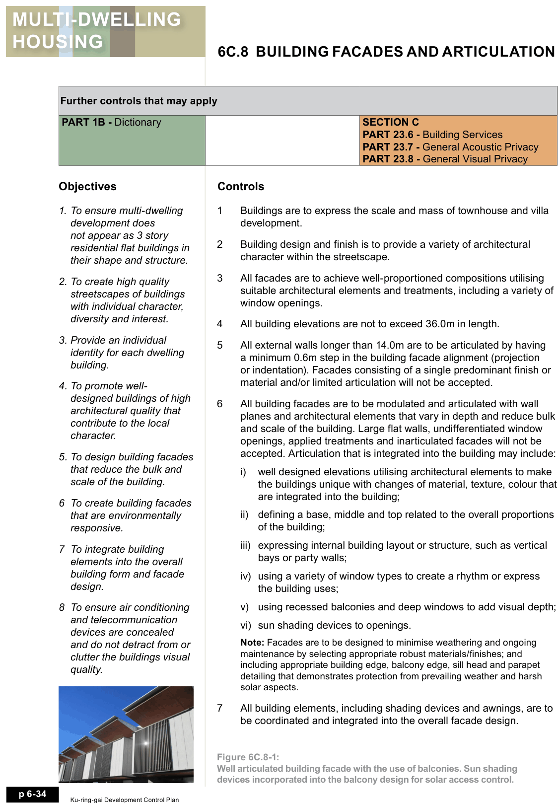

### 6C.7  BUILDING ENTRIES AND INTERNAL

### PATHWAYS

#### Further controls that may apply SECTION A

PART 6A.2 - Site Layout

#### SECTION C

PART 22.1 - Equitable Access

#### Controls

#### Objectives

1 The entry into the multi-dwelling housing development  is to be

directly accessible and visible from the street.

1	 To ensure the site and

building entry is clear and

2 All ground floor entries to dwellings are to be located no more than

1.0m above natural ground level. Any falls in the ground level are to

be accommodated within the design of the dwelling by utilising split

2	 To ensure the building

3 Building entry pathways are to be minimum 1.2m wide and located

within the common area with a minimum dimension of 1.2m on either

side for landscape planting. All other internal pathways are to be

minimum 1.2m wide with a minimum dimension of 0.6m on either

3	 To ensure dwelling entries

are close to and relate

to natural ground line at

street level and within the

4 All paths are to provide extra widths to allow effective turning and to

allow easy passing between pedestrians.

4	 To ensure that a high level

of amenity is provided to

5 Where any path is included in the side setback, then the setback is

to be increased by the width of the path. 6 Provide clear sightlines to the entries of all dwellings. Provide

way-finding signs on large development sites comprising multiple

5	 To ensure the amenity

7 All street and individual dwelling entry areas are to be well lit and

designed to avoid any concealment or entrapment areas. All light

6	 To soften the impact of

8 Individual dwelling entries are to be integrated into the building

facade design and be articulated with awnings, porticos, recesses or

projecting bays for clear identification.

7	 To ensure all pathways

9 All pathways are to be designed to avoid blind corners, dark

alcoves and narrow passageways dominated by internal fencing or

### BUILDING DESIGN AND SUSTAINABILITY

### BUILDING DESIGN AND SUSTAINABILITY

> [Picture on page 34: a map, saved as a picture (images/part-06-multi-dwelling-housing-excluding-terrraces-page-34-1.gif, 150 dpi); the street names and other small labels are on the picture.]
> Words printed on the picture (title and legend, copied from the PDF):
> character within the streetscape.
> 1\. To ensure multi-dwelling
> residential flat buildings in
> their shape and structure.
> streetscapes of buildings
> with individual character,
> diversity and interest.
> 3\. Provide an individual
> identity for each dwelling
> 4\. To promote well-
> designed buildings of high
> architectural quality that
> contribute to the local
> scale of the building.
> of the building;
> that are environmentally
> bays or party walls;
> 7	 To integrate building
> elements into the overall
> building form and facade
> the building uses;
> devices are concealed
> clutter the buildings visual
> Note: Facades are to be designed to minimise weathering and ongoing
> maintenance by selecting appropriate robust materials/finishes; and
> including appropriate building edge, balcony edge, sill head and parapet
> detailing that demonstrates protection from prevailing weather and harsh
> Well articulated building facade with the use of balconies. Sun shading
> devices incorporated into the balcony design for solar access control.

Figure 6C.8-1:
