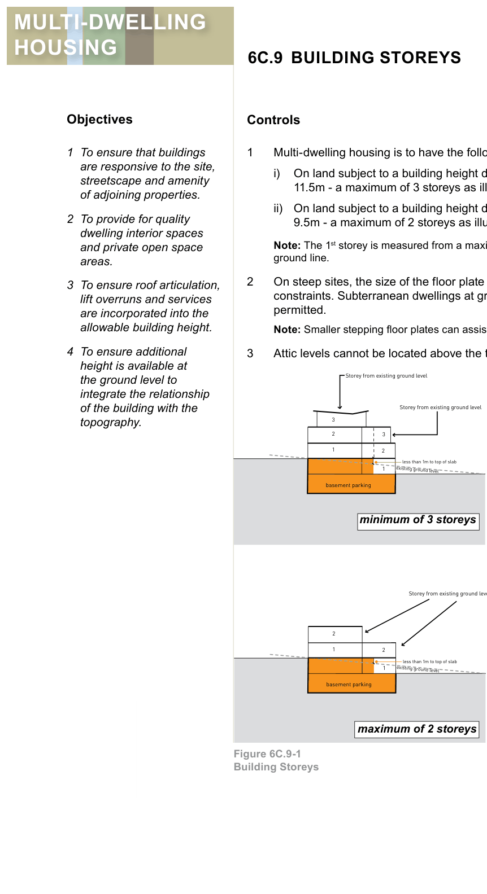

### 6C.8  BUILDING FACADES AND ARTICULATION

#### Further controls that may apply

PART 1B - Dictionary

#### SECTION C

PART 23.6 - Building Services

PART 23.7 - General Acoustic Privacy

PART 23.8 - General Visual Privacy

#### Objectives

#### Controls

1 Buildings are to express the scale and mass of townhouse and villa

2 Building design and finish is to provide a variety of architectural

not appear as 3 story

3 All facades are to achieve well-proportioned compositions utilising

suitable architectural elements and treatments, including a variety of

2\. To create high quality

4 All building elevations are not to exceed 36.0m in length. 5 All external walls longer than 14.0m are to be articulated by having

a minimum 0.6m step in the building facade alignment (projection

or indentation). Facades consisting of a single predominant finish or

material and/or limited articulation will not be accepted. 6 All building facades are to be modulated and articulated with wall

planes and architectural elements that vary in depth and reduce bulk

and scale of the building. Large flat walls, undifferentiated window

openings, applied treatments and inarticulated facades will not be

accepted. Articulation that is integrated into the building may include:

5\. To design building facades

that reduce the bulk and

i) well designed elevations utilising architectural elements to make

the buildings unique with changes of material, texture, colour that

are integrated into the building;

ii) defining a base, middle and top related to the overall proportions

6	 To create building facades

iii) expressing internal building layout or structure, such as vertical

iv) using a variety of window types to create a rhythm or express

v) using recessed balconies and deep windows to add visual depth;

vi) sun shading devices to openings.

8	 To ensure air conditioning

and do not detract from or

7 All building elements, including shading devices and awnings, are to

be coordinated and integrated into the overall facade design.

9	 To provide distinct building

articulation on corner sites

that reinforce the street

intersection.

10	To ensure that building

facade design contributes

to the safety of the public

domain.

#### 6C.8 BUILDING FACADES AND ARTICULATION

#### (continued)

#### Controls

8 Telecommunication structures are to be located within roof

structures or basements and not be visible from any street or public

domain area.

9 Balconies that run the full length of the building facade are not

permitted.

10 Balconies are not to project more than 1.5m from the outermost

wall of the building facade and be integrated into the overall building

design and composition of the elevations.

11 Blade walls are not to be the sole element used to articulate the

facade.

12 Overhead ducts and services at the basement parking entry are to

be concealed and not be visible from the street. 13 Street corners are to be addressed through the use of architectural

elements that give visual prominence to parts of the building facade,

such as a change in building modulation, material, colour, roof

expression or height.

14 Building elevations are not to create snorkel windows to any part of

the building.

Note: Refer to Section A Part 1B Dictionary for definition of snorkel window.

### BUILDING DESIGN AND SUSTAINABILITY

### BUILDING DESIGN AND SUSTAINABILITY

> [Picture on page 36: a map, saved as a picture (images/part-06-multi-dwelling-housing-excluding-terrraces-page-36-1.gif, 150 dpi); the street names and other small labels are on the picture.]
> Words printed on the picture (title and legend, copied from the PDF):
> streetscape and amenity
> of adjoining properties.
> dwelling interior spaces
> and private open space
> lift overruns and services
> are incorporated into the
> allowable building height.
> 4	 To ensure additional
> height is available at
> the ground level to
> integrate the relationship
> Note: The 1st storey is measured from a maximum 1m above the existing
> Note: Smaller stepping floor plates can assist to negotiate the topography.
> Storey from existing ground level
> Storey from existing ground level
> less than 1m to top of slab
> 1 existing ground level
> Storey from existing ground level
> less than 1m to top of slab
> 1 existing ground level

Figure 6C.9-1

#### Objectives

1	 To ensure that buildings

are responsive to the site,

2	 To provide for quality

3	 To ensure roof articulation,

of the building with the
