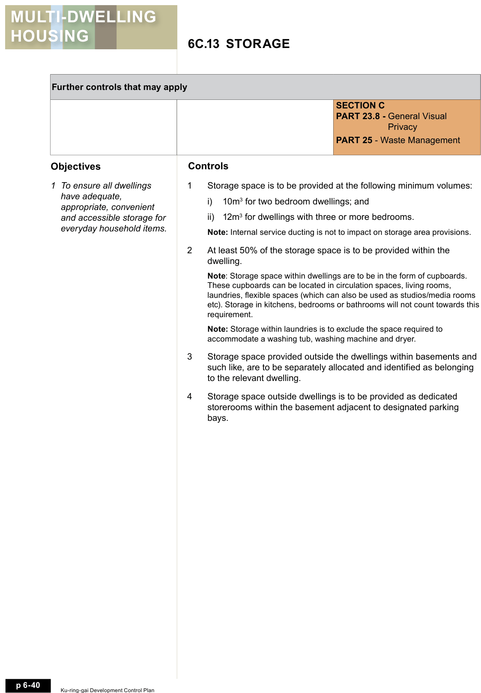

### 6C.12  VISUAL AND ACOUSTIC PRIVACY

#### Further controls that may apply SECTION A

PART 6A.4 - Building

#### SECTION C

PART 23.7 - General Acoustic

Separation

Privacy

PART 23.8 - General Visual

Privacy

#### Objectives

#### Controls

1 Buildings are to be designed to ensure privacy to other onsite

dwellings and to neighbouring properties. In addition to design

options outlined in Part 23.8 and Part 23.9, design measures may

also include:

i) off-setting balconies in relation to adjacent balconies;

ii) using recessed balconies and/or vertical fins between adjacent

private balconies;

1	 To ensure high standards

of visual and acoustic

privacy to habitable

rooms and private

open space both

within the development

and to neighbouring

developments.

iii) using louvres/screen panels to windows and balconies;

iv) incorporating planter boxes into walls or balustrades to increase

the visual separation between areas;

2	 To ensure building

elements are well

designed and integrated

into the overall building

form.

v) utilising pergolas or shading devices to limit overlooking of lower

building levels or common and private open space.

2 Continuous transparent or translucent balustrades to private open

spaces are not permitted to balconies/terraces/courtyards. 3 Screening between dwellings is to be integrated into the overall

building design. 4 Landscaped screening is to be provided to neighbouring properties. 5 Any screens for achieving visual privacy to habitable rooms cannot

be fixed in place and impede their function of the opening to provide

daylight, ventilation or outlook from the internal space. 6 For requirements on noise levels associated with air conditioning,

kitchen, bathroom, laundry ventilation, or other mechanical

ventilation systems and other plant refer to Part 23.8 of this DCP.

### BUILDING DESIGN AND SUSTAINABILITY

### BUILDING DESIGN AND SUSTAINABILITY

> [Picture on page 40: a picture, saved as a picture (images/part-06-multi-dwelling-housing-excluding-terrraces-page-40-1.gif, 150 dpi).]
> Words printed on the picture (title and legend, copied from the PDF):
> Privacy
> have adequate,
> appropriate, convenient
> and accessible storage for
> everyday household items.
> Note: Internal service ducting is not to impact on storage area provisions.
> dwelling.
> Note: Storage space within dwellings are to be in the form of cupboards.
> These cupboards can be located in circulation spaces, living rooms,
> laundries, flexible spaces (which can also be used as studios/media rooms
> etc). Storage in kitchens, bedrooms or bathrooms will not count towards this
> requirement.
> Note: Storage within laundries is to exclude the space required to
> accommodate a washing tub, washing machine and dryer.
> to the relevant dwelling.
> bays.
