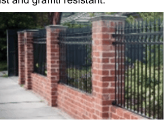
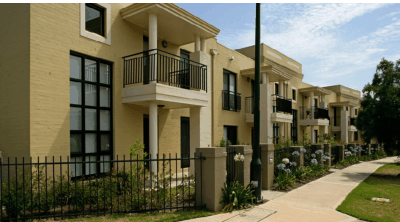
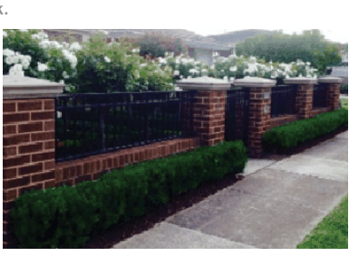
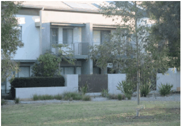

### 6C.15  FENCING

#### Controls

1 Front boundary fences and walls (to a public street/public domain)

and side boundary fences within the street setback are not to be

higher than:

i) 0.9m if of closed construction (such as masonry, lapped and

capped timber or brushwood fences); or

ii) 1.2m if of open construction (such as open paling and picket

fences).

Note: Open fencing includes panels set into a timber frame or between

brick piers, where any solid base is not taller than 0.4m, and panels are

spaced pickets, palings, or lattice.

2 Closed front fences with a maximum height of 1.8m may be

considered where the site fronts a busy road or other sources of

undesirable noise. These fences are to be set back at least 2.0m

from the front boundary and screened by landscaping. Note: Rendered masonry boundary walls are generally inappropriate to the

landscape character of Ku-ring-gai.

3 Fences and walls are to step down and follow the natural contours of

the site.

4 All fencing is to be designed to highlight entrances, and be

compatible with buildings and letterboxes. 5 Fence design fronting a street and/or other public domain is to relate

to the overall building design and materials, connecting design

elements to the street level.

6 Internal fencing is to integrate with the building design, character and

> [Picture on page 42: a picture, saved as a picture (images/part-06-multi-dwelling-housing-excluding-terrraces-page-42-56.gif, 150 dpi).]

material selections.

7 External finishes for fencing is to be robust and graffiti resistant.

> [Picture on page 42: a picture, saved as a picture (images/part-06-multi-dwelling-housing-excluding-terrraces-page-42-59.gif, 150 dpi).]

> [Picture on page 42: a picture, saved as a picture (images/part-06-multi-dwelling-housing-excluding-terrraces-page-42-60.gif, 150 dpi).]

#### Figure 6C.15-1:

#### Open style fencing to maintain visual link.

> [Picture on page 42: a picture, saved as a picture (images/part-06-multi-dwelling-housing-excluding-terrraces-page-42-63.gif, 150 dpi).]

#### Figure 6C.15-2:

#### Use of hedges as fencing.
