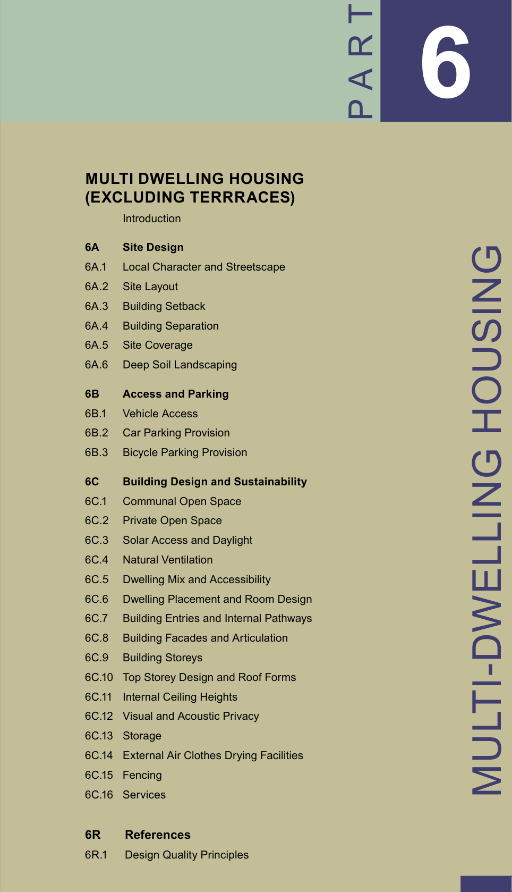

# Ku-ring-gai Development Control Plan - Part 6 Multi Dwelling Housing (excluding Terrraces)

> This chapter is split into 29 section file(s), one per numbered heading, in the order they appear in the PDF.

Source PDF: [kdcp-section-a-part-6-multi-dwelling-housing.pdf](kdcp-section-a-part-6-multi-dwelling-housing.pdf)

> [Picture on page 1: a picture, saved as a picture (images/part-06-multi-dwelling-housing-excluding-terrraces-page-1-1.gif, 150 dpi).]
> Words printed on the picture (title and legend, copied from the PDF):
> Introduction
> 6B.1  	 Vehicle Access
> 6B.2  	 Car Parking Provision
> 6B.3  	 Bicycle Parking Provision
> 6R.1 	 	Design Quality Principles

### PART

### MULTI DWELLING HOUSING

### (EXCLUDING TERRRACES)

#### 6A Site Design

6A.1 Local Character and Streetscape 6A.2  	 Site Layout 6A.3  	 Building Setback 6A.4  	 Building Separation 6A.5  	 Site Coverage 6A.6  	 Deep Soil Landscaping

#### 6B Access and Parking

#### 6C Building Design and Sustainability

6C.1  	 Communal Open Space 6C.2  	 Private Open Space 6C.3  	 Solar Access and Daylight 6C.4  	 Natural Ventilation 6C.5  	 Dwelling Mix and Accessibility 6C.6  	 Dwelling Placement and Room Design 6C.7  	 Building Entries and Internal Pathways 6C.8  	 Building Facades and Articulation 6C.9  	 Building Storeys 6C.10  	Top Storey Design and Roof Forms 6C.11  	Internal Ceiling Heights 6C.12  	Visual and Acoustic Privacy 6C.13  	Storage 6C.14  	External Air Clothes Drying Facilities 6C.15  	Fencing

### MULTI-DWELLING HOUSING

6C.16  	Services

#### 6R 	 	 	References

### INTRODUCTION

This Part provides standards for multi dwelling housing in the form of

detached or attached:

• townhouses or villas. The objectives and controls in this Part guide the medium density

residential development in meeting the aims and objectives within the

KLEP. Multi-dwelling housing includes all residential developments with 3 or

more dwellings on one lot. Where a multi-dwelling housing development involves refurbishment

works or alterations/additions to existing buildings, new elements are to

meet the requirements of this Part. All multi dwelling developments are to achieve the following nine Design

Quality Principles detailed in Part 6R Design Quality Principles at the end

of this Part:

i) Principle 1:  Context and neighbourhood character

ii)	 Principle 2:  Built form and scale

iii)	 Principle 3:  Density

iv)	 Principle 4:  Sustainability

v)	 Principle 5:  Landscape

vi)	 Principle 6:  Amenity

vii)	 Principle 7:  Safety

viii)	Principle 8:  Housing diversity and social interaction

ix)	 Principle 9:  Aesthetics

### INTRODUCTION (continued)

The aims of this Part are to:

i) Ensure that development is in keeping with the garden character

of Ku-ring-gai where the tree canopy dominates the landscape by

making provision for quality deep soil landscaping, including: tall trees

to the streetscape; in-between and to all elevations of buildings on the

development site; inbetween buildings on the development site and on

adjacent sites.

ii) Encourage development which does not dominate, but harmonises

with and contributes to the treed landscape and is sympathetic to the

street and locality in which it is proposed.

iii) Ensure that with each development sufficient landscaping is provided

to contribute to the conservation and replenishment of the tree canopy

of Ku-ring-gai, including locally occurring native tree species suited to

the site.

iv) Protect and minimise the impact of development on adjoining

properties

v) Protect and minimise the impact of development on the natural

environment

vi) Ensure development that minimises the depletion of raw materials and

non-renewable resources

vii) Ensure that development meets the needs of the present without

compromising the ability of future generations to meet their own need.

viii) Encourage housing of the highest possible architectural,

environmental and amenity standards.

ix) Manage residential development in a way that embraces innovative

design and contemporary lifestyles

x) Ensure that there are more certain outcomes for applicants and the

community.

### INTRODUCTION

### THIS PAGE IS INTENTIONALLY BLANK

### 6A

<!-- sections -->
## Sections

1. [6A Site Design](01-6a-site-design.md)
2. [6A.1 LOCAL CHARACTER AND STREETSCAPE](02-6a-1-local-character-and-streetscape.md)
3. [6A.2 SITE LAYOUT](03-6a-2-site-layout.md)
4. [6A.3 BUILDING SETBACK](04-6a-3-building-setback.md)
5. [6A.4 BUILDING SEPARATION](05-6a-4-building-separation.md)
6. [6A.5 SITE COVERAGE](06-6a-5-site-coverage.md)
7. [6A.6 DEEP SOIL LANDSCAPING](07-6a-6-deep-soil-landscaping.md)
8. [6B Access and Parking](08-6b-access-and-parking.md)
9. [6B.1 VEHICLE ACCESS](09-6b-1-vehicle-access.md)
10. [6B.2 CAR PARKING PROVISION](10-6b-2-car-parking-provision.md)
11. [6B.3 BICYCLE PARKING PROVISION](11-6b-3-bicycle-parking-provision.md)
12. [6C Building Design and Sustainability](12-6c-building-design-and-sustainability.md)
13. [6C.1 COMMUNAL OPEN SPACE](13-6c-1-communal-open-space.md)
14. [6C.2 PRIVATE OPEN SPACE](14-6c-2-private-open-space.md)
15. [6C.3 SOLAR ACCESS AND DAYLIGHT](15-6c-3-solar-access-and-daylight.md)
16. [6C.4 NATURAL VENTILATION](16-6c-4-natural-ventilation.md)
17. [6C.5 DWELLING MIX AND ACCESSIBILITY](17-6c-5-dwelling-mix-and-accessibility.md)
18. [6C.6 DWELLING PLACEMENT AND ROOM](18-6c-6-dwelling-placement-and-room.md)
19. [6C.7 BUILDING ENTRIES AND INTERNAL](19-6c-7-building-entries-and-internal.md)
20. [6C.8 BUILDING FACADES AND ARTICULATION](20-6c-8-building-facades-and-articulation.md)
21. [6C.9 BUILDING STOREYS](21-6c-9-building-storeys.md)
22. [6C.10 TOP STOREY DESIGN AND ROOF FORMS](22-6c-10-top-storey-design-and-roof-forms.md)
23. [6C.11 INTERNAL CEILING HEIGHTS](23-6c-11-internal-ceiling-heights.md)
24. [6C.12 VISUAL AND ACOUSTIC PRIVACY](24-6c-12-visual-and-acoustic-privacy.md)
25. [6C.13 STORAGE](25-6c-13-storage.md)
26. [6C.14 EXTERNAL AIR CLOTHES DRYING](26-6c-14-external-air-clothes-drying.md)
27. [6C.15 FENCING](27-6c-15-fencing.md)
28. [6C.16 SERVICES](28-6c-16-services.md)
29. [6R References](29-6r-references.md)
