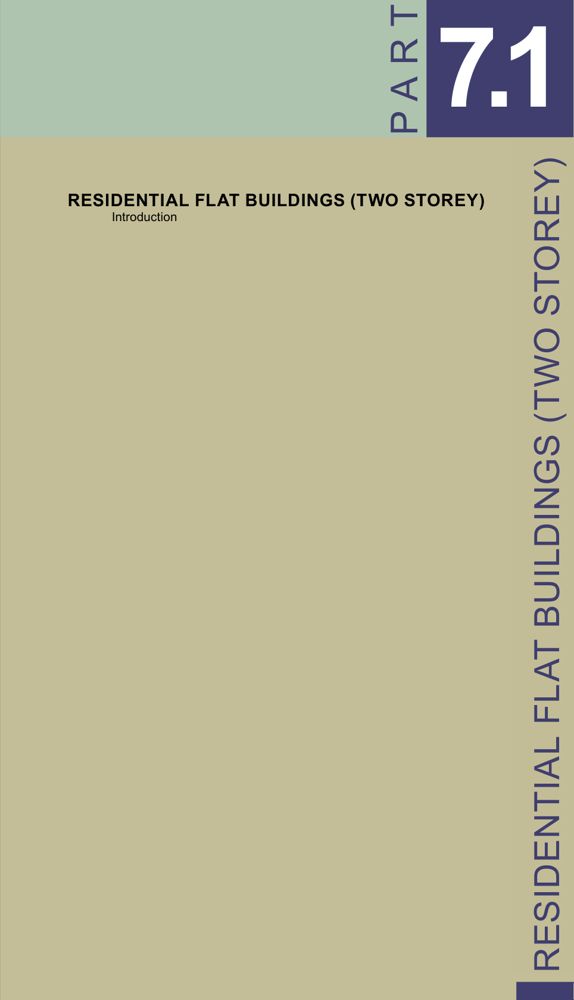

# Ku-ring-gai Development Control Plan - Part 7.1 Residential Flat Buildings (two Storey)

Source PDF: [kdcp-section-a-part-7.1-residential-flat-building-two-storey.pdf](https://planfortomorrow.sharepoint.com/sites/Planfortomorrow/Shared%20Documents/00%20NSW-Planning-Resources/dcp/ku-ring-gai-development-control-plan/part-07-1-residential-flat-buildings-two-storey/kdcp-section-a-part-7.1-residential-flat-building-two-storey.pdf)

> [Picture on page 1: a picture, saved as a picture (images/part-07-1-residential-flat-buildings-two-storey-page-1-1.gif, 150 dpi).]
> Words printed on the picture (title and legend, copied from the PDF):
> Introduction
> p 7-1
> Ku-ring-gai Development Control Plan

### PART

### 7.1

### RESIDENTIAL FLAT BUILDINGS (TWO STOREY)

### RESIDENTIAL FLAT BUILDINGS

### RESIDENTIAL FLAT BUILDINGS (TWO STOREY)

#### RESIDENTIAL FLAT

#### BUILDINGS

### INTRODUCTION

Two storey residential flat buildings are permissible within the NSW

Government low and mid rise areas. These are located in local centres

that have a train station and/or retail and commercial facilities. The objectives and controls in this Part guide residential flat building (two

storey) development in meeting the aims and objectives within the KLEP. Residential flat building (two storey) development will be assessed under

merit utilising the standards of Part 7 Residential Flat Buildings where

relevant. All development applications are to comply with the ‘Low Rise Housing

Diversity Design Guide for Development Applications (Department

of Planning, Housing and Infrastructure)’; and, applications are to be

accompanied by a Design Verification Statement that provides an

assessment against the Low Rise Housing Diversity Design Guide for

Development Applications, 2020. Note: Once prepared, LGA specific controls will be inserted into this Part.

p 7.1-2

p 7-2

Ku-ring-gai Development Control Plan

### 7.1

### THIS PAGE IS INTENTIONALLY LEFT BLANK

p 7-3

Ku-ring-gai Development Control Plan

p 7.1-3
