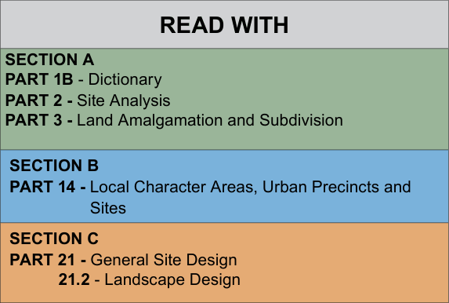
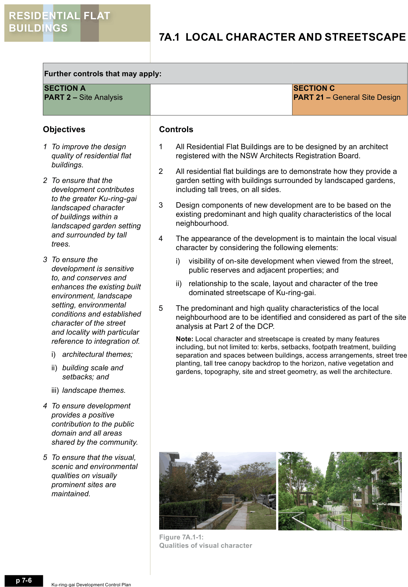

#### 7A	 	 Site Design

7A.1 Local Character and Streetscape 7A.2     Site Layout 7A.3     Building Setback 7A.4 Building Separation 7A.5  	 Site Coverage 7A.6  	 Deep Soil Landscaping

> [Picture on page 5: a picture, saved as a picture (images/part-07-residential-flat-buildings-page-5-9.gif, 150 dpi).]
> Words printed on the picture (title and legend, copied from the PDF):
> PART 1B - Dictionary
> Sites
> 21.2 - Landscape Design

### READ WITH

#### SECTION A

PART 2 - Site Analysis

PART 3 - Land Amalgamation and Subdivision

#### SECTION B

PART 14 - Local Character Areas, Urban Precincts and

#### SECTION C

PART 21 - General Site Design

### REFER TO

### SITE DESIGN

#### LIVABLE HOUSING DESIGN GUIDELINES

> [Picture on page 5: a picture, saved as a picture (images/part-07-residential-flat-buildings-page-5-21.gif, 150 dpi).]

### REFER TO

#### SEPP (HOUSING) 2021 APARTMENT DESIGN GUIDE

> [Picture on page 6: a map, saved as a picture (images/part-07-residential-flat-buildings-page-6-1.gif, 150 dpi); the street names and other small labels are on the picture.]
> Words printed on the picture (title and legend, copied from the PDF):
> quality of residential flat
> to the greater Ku-ring-gai
> of buildings within a
> landscaped garden setting
> and surrounded by tall
> dominated streetscape of Ku-ring-gai.
> 3	 To ensure the
> development is sensitive
> to, and conserves and
> enhances the existing built
> conditions and established
> character of the street
> and locality with particular
> reference to integration of.
> i)	 architectural themes;
> ii)	 building scale and
> Note: Local character and streetscape is created by many features
> including, but not limited to: kerbs, setbacks, footpath treatment, building
> separation and spaces between buildings, access arrangements, street tree
> planting, tall tree canopy backdrop to the horizon, native vegetation and
> gardens, topography, site and street geometry, as well the architecture.
> iii)	 landscape themes.
> 4	 To ensure development
> provides a positive
> contribution to the public
> domain and all areas
> shared by the community.
> scenic and environmental
> qualities on visually
> prominent sites are
> Qualities of visual character

Figure 7A.1-1:
