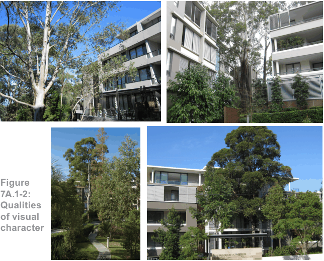
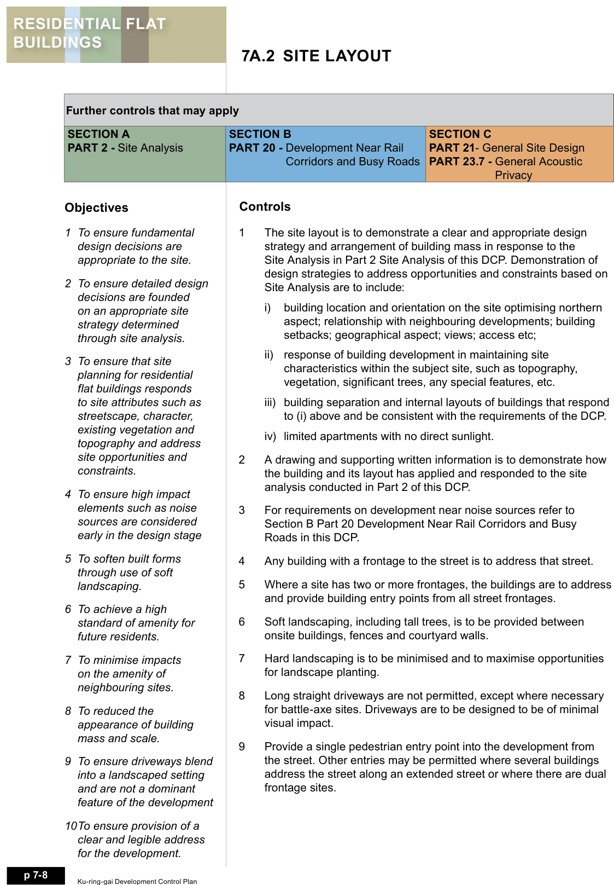

### 7A.1  LOCAL CHARACTER AND STREETSCAPE

#### Further controls that may apply: SECTION A

PART 2 – Site Analysis

#### SECTION C

PART 21 – General Site Design

#### Controls

#### Objectives

1 All Residential Flat Buildings are to be designed by an architect

registered with the NSW Architects Registration Board.

1	 To improve the design

2 All residential flat buildings are to demonstrate how they provide a

garden setting with buildings surrounded by landscaped gardens,

including tall trees, on all sides. 3 Design components of new development are to be based on the

existing predominant and high quality characteristics of the local

2	 To ensure that the

4 The appearance of the development is to maintain the local visual

character by considering the following elements:

i) visibility of on-site development when viewed from the street,

public reserves and adjacent properties; and

ii)	 	relationship to the scale, layout and character of the tree

5 The predominant and high quality characteristics of the local

neighbourhood are to be identified and considered as part of the site

analysis at Part 2 of the DCP.

5	 To ensure that the visual,

### 7A.1 	LOCAL CHARACTER AND STREETSCAPE

### (continued)

#### Controls

6 Development is to integrate with surrounding sites by:

i) being of an appropriate scale retaining consistency with the

surrounds when viewed from the street, public domain or

adjoining development;

ii)	 minimising overshadowing; and

iii)	 integrating built form and soft landscaping (gardens and trees)

within the tree canopy that links the public and private domain

throughout Ku-ring-gai.

#### Visually Prominent Sites

7 Development on visually prominent sites is to:

i) be of high architectural and aesthetic quality;

ii)	 be integrated into the existing landscape through the site

planning process and avoid tall and bulky structures;

iii)	 have a selection of external colours and finishes that are

sensitive to the site and locality;

iv)	 retain significant landscape and vegetation elements;

v)	 consider views to the site as well as those from the site; and

vi)	 soften visual impact by extensive landscaping including tall and

medium trees and shrubs. Note: Refer to Part 1B Dictionary for definition of Visually Prominent Site. 8 Colours of materials used in sites adjoining or in close proximity

to bushland areas and Heritage Conservation Areas are to be in

harmony with the built and natural landscape elements of the area.

> [Picture on page 7: a picture, saved as a picture (images/part-07-residential-flat-buildings-page-7-27.gif, 150 dpi).]
> Words printed on the picture (title and legend, copied from the PDF):
> Figure
> 7A.1-2:
> Qualities
> of visual
> character

### SITE DESIGN

> [Picture on page 8: a map, saved as a picture (images/part-07-residential-flat-buildings-page-8-1.gif, 150 dpi); the street names and other small labels are on the picture.]
> [Picture text on page 8 is stored in the PDF without readable letters (no character map), so it could not be copied; see the original PDF.]
> Words printed on the picture (title and legend, copied from the PDF):
> Corridors and Busy Roads
> 1	 To ensure fundamental
> design decisions are
> appropriate to the site.
> decisions are founded
> on an appropriate site
> through site analysis.
> planning for residential
> flat buildings responds
> existing vegetation and
> topography and address
> site opportunities and
> elements such as noise
> sources are considered
> Roads in this DCP.
> through use of soft
> standard of amenity for
> for landscape planting.
> 7	 To minimise impacts
> on the amenity of
> 8	 To reduced the
> appearance of building
> mass and scale.
> into a landscaped setting
> feature of the development
> clear and legible address
> for the development.
