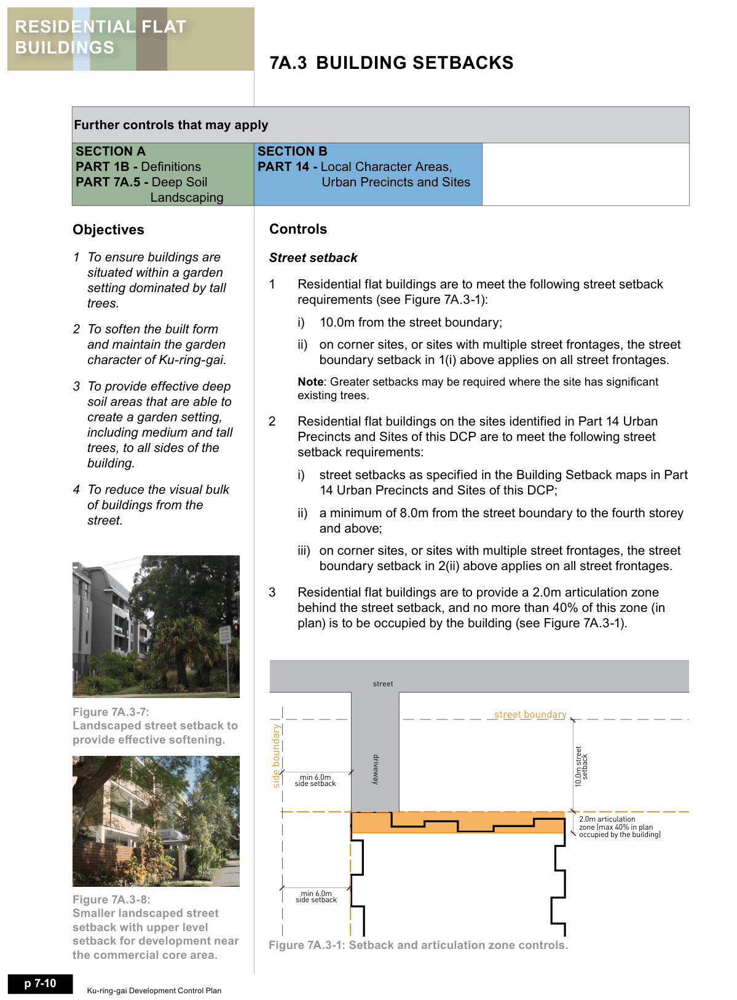

### 7A.2  SITE LAYOUT

#### Further controls that may apply SECTION A

PART 2 - Site Analysis

#### SECTION B

PART 20 - Development Near Rail

#### SECTION C

PART 21- General Site Design

PART 23.7 - General Acoustic

#### Controls

#### Objectives

1 The site layout is to demonstrate a clear and appropriate design

strategy and arrangement of building mass in response to the

Site Analysis in Part 2 Site Analysis of this DCP. Demonstration of

design strategies to address opportunities and constraints based on

Site Analysis are to include:

i) building location and orientation on the site optimising northern

aspect; relationship with neighbouring developments; building

setbacks; geographical aspect; views; access etc;

2	 To ensure detailed design

ii)	 response of building development in maintaining site

characteristics within the subject site, such as topography,

vegetation, significant trees, any special features, etc.

iii)	 building separation and internal layouts of buildings that respond

to (i) above and be consistent with the requirements of the DCP.

iv)	 limited apartments with no direct sunlight.

3	 To ensure that site

to site attributes such as

2 A drawing and supporting written information is to demonstrate how

the building and its layout has applied and responded to the site

analysis conducted in Part 2 of this DCP.

4	 To ensure high impact

early in the design stage

3 For requirements on development near noise sources refer to

Section B Part 20 Development Near Rail Corridors and Busy

4 Any building with a frontage to the street is to address that street.

5	 To soften built forms

5 Where a site has two or more frontages, the buildings are to address

and provide building entry points from all street frontages. 6 Soft landscaping, including tall trees, is to be provided between

onsite buildings, fences and courtyard walls.

6	 To achieve a high

7 Hard landscaping is to be minimised and to maximise opportunities

8 Long straight driveways are not permitted, except where necessary

for battle-axe sites. Driveways are to be designed to be of minimal

9 Provide a single pedestrian entry point into the development from

the street. Other entries may be permitted where several buildings

address the street along an extended street or where there are dual

9	 To ensure driveways blend

and are not a dominant

10	To ensure provision of a

### 7A.2 SITE LAYOUT (continued)

#### Controls

#### Objectives

10 Three hours of direct sunlight between 9am and 3pm on 21st June

is to be maintained to the living rooms, primary private open spaces

and any communal open spaces within:

11	To provide safe and

continuous pathway from

the street to the ground

floor entry point of the

apartment building.

i) existing residential flat buildings and multi-dwelling housing on

adjoining lots;

ii)	 residential development in adjoining lower density zones. Note: Where an adjoining property does not currently receive the required

hours of solar access, the proposed building is to ensure that solar access

to neighbours is not reduced by more than 20%. 11 Overshadowing should not compromise the development potential of

the adjoining yet to be redeveloped sites.

12	To ensure buildings

address the public domain

and give direct access

from all street frontages:

primary, secondary and

any other streets to the

boundary line of the

development.

12 Developments are to allow the retention of a minimum of 4 hours

direct sunlight between 9am to 3pm on 21st June to all existing solar

collectors and solar hot water services on neighbouring buildings.

13	To minimise the negative

impact of overshadowing

on living areas and

private and communal

open space areas of

neighbouring buildings. 14	To minimise the impact of

development on existing

solar collection devices.

### SITE DESIGN

> [Picture on page 10: a map, saved as a picture (images/part-07-residential-flat-buildings-page-10-1.gif, 150 dpi); the street names and other small labels are on the picture.]
> Words printed on the picture (title and legend, copied from the PDF):
> Urban Precincts and Sites
> PART 1B - Definitions
> situated within a garden
> setting dominated by tall
> and maintain the garden
> character of Ku-ring-gai.
> Note: Greater setbacks may be required where the site has significant
> create a garden setting,
> including medium and tall
> of buildings from the
> Landscaped street setback to
> provide effective softening.
> zone (max 40% in plan
> occupied by the building)
> Smaller landscaped street
> setback with upper level
> setback for development near
> the commercial core area.

Figure 7A.3-7:

Figure 7A.3-1: Setback and articulation zone controls.

Figure 7A.3-8:
