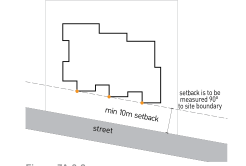
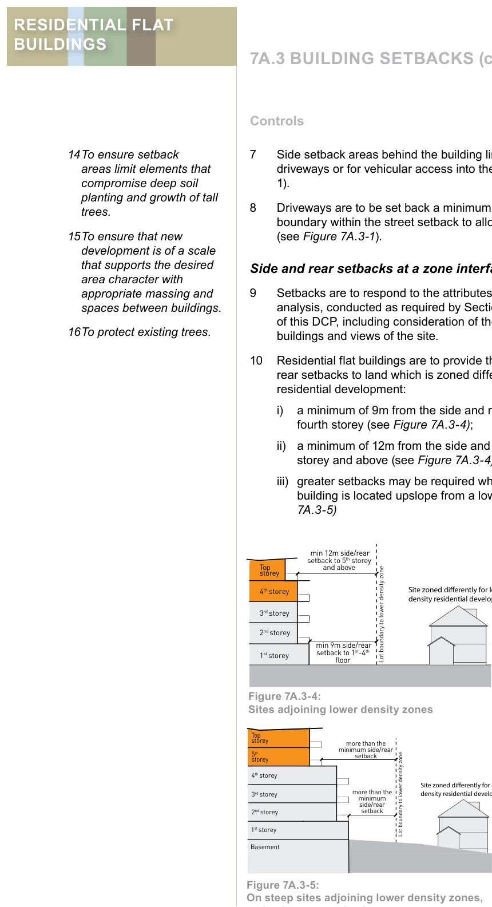
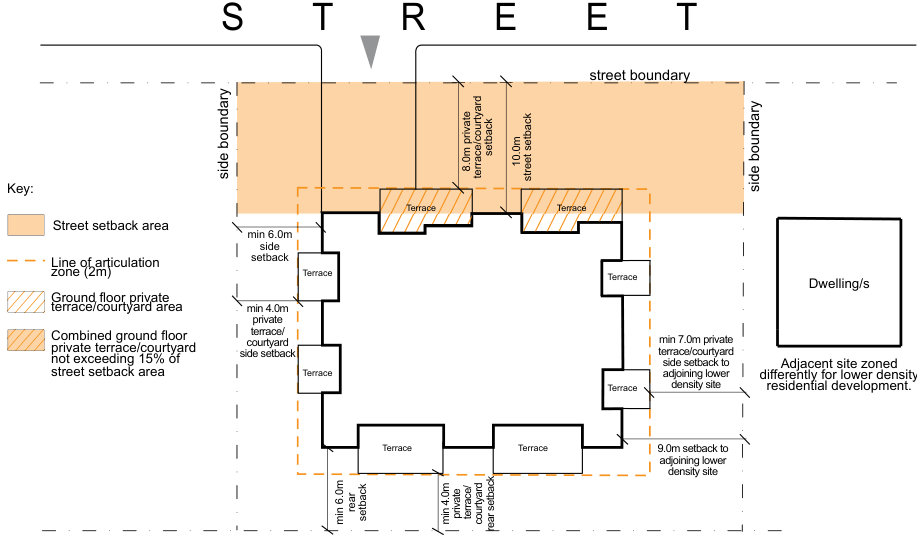
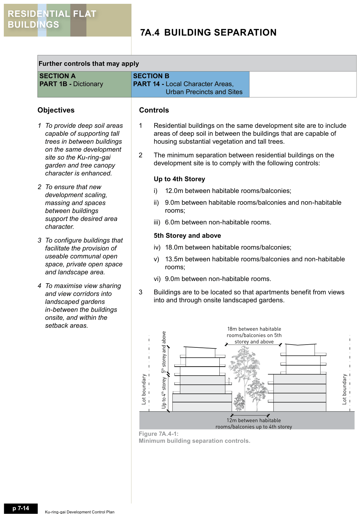

### 7A.3  BUILDING SETBACKS

#### Further controls that may apply

#### SECTION B

PART 14 - Local Character Areas,

#### SECTION A

PART 7A.5 - Deep Soil

#### Objectives

#### Controls

#### Street setback

1 Residential flat buildings are to meet the following street setback

requirements (see Figure 7A.3-1):

1	 To ensure buildings are

i) 10.0m from the street boundary;

ii)	 on corner sites, or sites with multiple street frontages, the street

2	 To soften the built form

boundary setback in 1(i) above applies on all street frontages.

2 Residential flat buildings on the sites identified in Part 14 Urban

Precincts and Sites of this DCP are to meet the following street

setback requirements:

3	 To provide effective deep

soil areas that are able to

trees, to all sides of the

i) street setbacks as specified in the Building Setback maps in Part

14 Urban Precincts and Sites of this DCP;

ii)	 a minimum of 8.0m from the street boundary to the fourth storey

4	 To reduce the visual bulk

iii)	 on corner sites, or sites with multiple street frontages, the street

boundary setback in 2(ii) above applies on all street frontages.

3 Residential flat buildings are to provide a 2.0m articulation zone

behind the street setback, and no more than 40% of this zone (in

plan) is to be occupied by the building (see Figure 7A.3-1).

### 7A.3 BUILDING SETBACKS (continued)

#### Objectives

#### Controls

4 The building line to any street is to be parallel to the prevailing

building line in the streetscape. For angled sites, a stepped façade

may be appropriate (see Figure 7A.3-2).

> [Picture on page 11: a picture, saved as a picture (images/part-07-residential-flat-buildings-page-11-7.gif, 150 dpi).]
> Words printed on the picture (title and legend, copied from the PDF):
> setback is to be
> measured 90°
> to site boundary
> min 10m setback
> street

5	 To maintain the alignment

and rhythm of the built

form on the street. 6	 To ensure driveways

do not compromise the

landscape setting or

neighbouring amenity. 7	 To ensure adequate

separation space between

neighbouring sites to

enable effective deep

soil landscaping and tree

planting which enhances

the Ku-ring-gai landscape

character. 8	 To ensure that building

separation distances are

met on smaller sites.

#### Figure 7A.3-2:

#### Setback controls on angled sites.

#### Side and Rear setbacks

9	 To provide a transition

to adjoining sites zoned

differently for lower

density residential

development.

5 Residential flat buildings are to meet the following side and rear

setback requirements to ensure deep soil, landscaping and tall trees

are accommodated to all sides of the building:

i) a minimum of 6m from the side boundary for all levels up to the

fourth storey (see Figure 7A.3-3);

ii)	 a minimum of 9m to the fifth storey and above (see Figure 7A.3-

10	To ensure building

setbacks at all levels

respond to site conditions,

and the local topography.

### SITE DESIGN

Top

storey

more than the

minimum side/rear

6th storey

min 9m

side/rear setback

5th storey and above

min 9m

side/rear setback

more than 9m

side/rear setback

setback

5th

storey

5th storey

4th storey

min 6m

side/rear setback

4th storey

1st - 4th storey

11	To ensure side and rear

setbacks allow for deep

soil landscaping including

tall and medium trees that

are able to screen blank

facades and facades with

openings to non-habitable

rooms and service areas.

3rd storey

3rd storey min 6m

side/rear

more than the

2nd storey

2nd storey

setback

more than 6m

minimum

2nd storey

side/rear

side/rear

setback

setback

1st storey

Lot boundary to lower density zone

1st storey

Lot boundary

12	To ensure common area is

retained to all boundaries,

and that they are viable for

deep soil landscaping.

Basement

3).

#### Figure 7A.3-3:

#### Setback controls on side & rear.

13	To minimise bulk

and scale impacts

on neighbouring

development.

min 12m side/rear

setback to 5th store

and above

Top

storey

Top

storey

min 9m

side/rear setback

6 For buildings of 3 storeys or less on sites less than 1800m2, a

minimum of 3m from the side boundary may be provided, however

Building Separation requirements are to be met as stated in Part

7A.4. 4th storey

4th storey

Site zoned R2 or R3

3rd storey

3rd storey p 7-11

min 6m

side/rear

setback

2nd storey

2nd storey

min 9m

side/rear setback

4th floor

min 9m side/rea

setback to 1st-4t

1st storey

1st storey

Lot boundary to lower density zone

floor

> [Picture on page 12: a map, saved as a picture (images/part-07-residential-flat-buildings-page-12-1.gif, 150 dpi); the street names and other small labels are on the picture.]
> Words printed on the picture (title and legend, copied from the PDF):
> 14	To ensure setback
> areas limit elements that
> compromise deep soil
> (see Figure 7A.3-1).
> that supports the desired
> area character with
> appropriate massing and
> spaces between buildings.
> more than the
> 5th storey and above
> more than 9m
> 1st - 4th storey
> Site zoned R2 or R3
> Site zoned differently for lower
> density residential development
> more than the
> more than 6m
> Lot boundary to lower density zone
> min 12m side/rear
> setback to 5th storey
> Site zoned R2 or R3
> Site zoned R2 or R3
> Site zoned differently for lower
> density residential development
> side/rear setback to
> min 9m side/rear
> setback to 1st-4th
> Lot boundary to lower density zone
> Lot boundary to lower density zone
> Sites adjoining lower density zones
> more than the
> 5th storey and above
> more than 9m
> 1st - 4th storey
> more than the Site zoned R2 or R3
> Site zoned differently for lower
> density residential development
> more than 6m
> Lot boundary to lower density zone
> min 12m side/rear
> On steep sites adjoining lower density zones,

Figure 7A.3-4:

Figure 7A.3-5:

#### Controls

7 Side setback areas behind the building line are not to be used for

driveways or for vehicular access into the building (see Figure 7A.3-

planting and growth of tall

8 Driveways are to be set back a minimum of 6m from the side

boundary within the street setback to allow for deep soil planting

#### Side and rear setbacks at a zone interface

15	To ensure that new

development is of a scale

16	To protect existing trees.

9m

9 Setbacks are to respond to the attributes identified in the site

analysis, conducted as required by Section A Part 2 Site Analysis

of this DCP, including consideration of the location of adjoining

buildings and views of the site.

6m

10 Residential flat buildings are to provide the following side and

rear setbacks to land which is zoned differently for lower density

residential development:

i) a minimum of 9m from the side and rear boundary up to the

fourth storey (see Figure 7A.3-4);

ii)	 a minimum of 12m from the side and rear boundary for the fifth

storey and above (see Figure 7A.3-4);

iii)	 greater setbacks may be required where the residential flat

building is located upslope from a lower density zone (see Figure

9m 6m 3m

setback to 5th storey

setbacks may need to be more generous.

and above

Top

storey

Top

storey

min 9m

side/rear setback

4th storey

4th storey

Site zoned R2 or R3

Site zoned R2 or R3

Site zoned differently for lower density residential development

3rd storey

3rd storey

min 6m

side/rear y to lower density zone

y to lower density zone

min 9m

setback

#### Controls Encroachments

11 Basements are not to encroach into the street, side and rear

setbacks. 12 Ground floor private terraces/courtyards may encroach into the

setback areas (see Figure 7A.3-6) provided there is a minimum

setback to the terrace edge/courtyard wall of:

i) 8m from the street boundary;

ii)	 4m from the side and rear boundaries;

iii)	 7m from the side and rear boundaries where adjoining land is

zoned differently for lower density residential development.

13 On sites less than 1800m2 no encroachments into the setback areas

is permitted. 14 No encroachments are permitted where minimum setbacks have not

been achieved.

> [Picture on page 13: a map, saved as a picture (images/part-07-residential-flat-buildings-page-13-16.gif, 150 dpi); the street names and other small labels are on the picture.]
> Words printed on the picture (title and legend, copied from the PDF):
> terrace/courtyard street setback
> Street setback area
> Line of articulation
> Ground floor private
> terrace/courtyard area min 4.0m
> min 7.0m private
> side setback to
> Combined ground floor
> not exceeding 15% of
> street setback area
> Adjacent site zoned
> differently for lower density
> 9.0m setback to
> min 4.0m courtyard

### STREET

### SITE DESIGN

rear boundary

#### Figure 7A.3-6:

Setback controls for ground floor private terrace/courtyard and controls for ground floor terrace area

encroachment to the street setback area.

15 No more than 15% of the total area of the street setback area is to

be occupied by private terraces/courtyards (see Figure 7A.2-6). 16 In addition to the above encroachments, the following elements may

encroach into the setback areas where they do not increase the

apparent bulk of the building or create visual clutter:

i) eaves;

ii)	 open pergolas;

iii)	 blades, fins, columns.

> [Picture on page 14: a map, saved as a picture (images/part-07-residential-flat-buildings-page-14-1.gif, 150 dpi); the street names and other small labels are on the picture.]
> Words printed on the picture (title and legend, copied from the PDF):
> PART 1B - Dictionary
> Urban Precincts and Sites
> capable of supporting tall
> trees in between buildings
> on the same development
> site so the Ku-ring-gai
> garden and tree canopy
> character is enhanced.
> massing and spaces
> support the desired area
> facilitate the provision of
> useable communal open
> space, private open space
> and landscape area.
> and view corridors into
> in-between the buildings
> onsite, and within the
> 18m between habitable
> rooms/balconies on 5th
> storey and above
> 5 -7 Storeys
> Up to 4th storey 5th storey and above
> 12m between habitable
> rooms/balconies up to 4th storey
> Minimum building separation controls.

Figure 7A.4-1:
