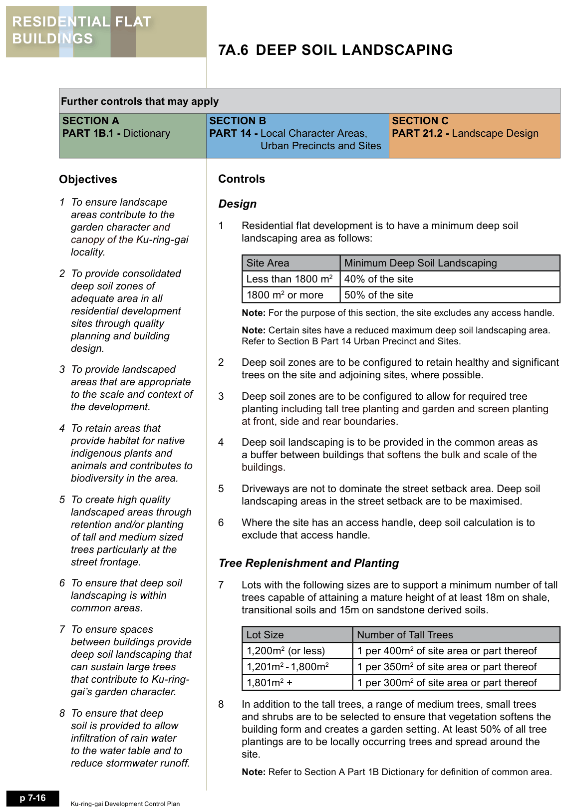

### 7A.5  SITE COVERAGE

#### Further controls that may apply SECTION A

PART 1B - Dictionary

#### SECTION B

PART 14 - Local Character Areas,

Urban Precincts and Sites

#### Objectives

#### Controls

1 The site coverage may be up to a maximum of 30% of the site area,

provided that the deep soil landscaping requirements in Section A

Part 7A.6 Deep Soil Landscaping can be met.

1	 To ensure development is

consistent with the desired

future landscape and built

character of the area.

Note: Site coverage is not the inverse of deep soil landscaping. Refer to

Part 1B Dictionary for clarification of site coverage. Note: Certain sites have reduced maximum site coverage. Refer to Section

B Part 14 Urban Precincts and Sites.

2	 To protect and improve the

tree canopy within Ku-

ring-gai.

2 Where a site incorporates an access handle/s, the site coverage

is not to exceed 30% of the total site area less 30% of the access

handle/s (refer to Figure 7A.5-1). Note: The definition of ‘site coverage’ uses a calculation of the ‘site area’.

‘Site area in KLEP states in part:

3	 To provide viable deep

soil landscaping within

developments and

between residential

developments on

neighbouring sites.

‘...does not include the area of any land on which development is not

permitted to be carried out under this Plan.’

4	 To minimise impervious

surfaces that generate

stormwater runoff. 5	 To provide adequate

spaces between buildings

for common areas that

support quality gardens

around the building.

#### Bm2

#### Am2

street

### SITE DESIGN

Maximum site coverage = [(A+B) x 30%]m2 - (B x 30%)m2 Note: This is equivalent to [A x 30%]m2

#### Figure 7A.5-1:

#### Site coverage controls for Residential Flat Buildings

> [Picture on page 16: a map, saved as a picture (images/part-07-residential-flat-buildings-page-16-1.gif, 150 dpi); the street names and other small labels are on the picture.]
> Words printed on the picture (title and legend, copied from the PDF):
> landscaping area as follows:
> 1	 To ensure landscape
> areas contribute to the
> garden character and
> canopy of the Ku-ring-gai
> Note: For the purpose of this section, the site excludes any access handle.
> Note: Certain sites have a reduced maximum deep soil landscaping area.
> Refer to Section B Part 14 Urban Precinct and Sites.
> 2	 To provide consolidated
> deep soil zones of
> adequate area in all
> sites through quality
> planning and building
> 3	 To provide landscaped
> areas that are appropriate
> provide habitat for native
> indigenous plants and
> animals and contributes to
> biodiversity in the area.
> exclude that access handle.
> landscaped areas through
> retention and/or planting
> trees particularly at the
> landscaping is within
> 7	 To ensure spaces
> between buildings provide
> deep soil landscaping that
> can sustain large trees
> that contribute to Ku-ring-
> gai’s garden character.
> infiltration of rain water
> reduce stormwater runoff.
> Note: Refer to Section A Part 1B Dictionary for definition of common area.
