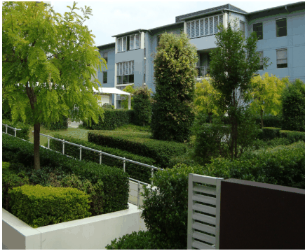

### 7A.6  DEEP SOIL LANDSCAPING

| Further controls that may apply |  |
|---|---|
| SECTION A SECTION B PART 1B.1 - Dictionary PART 14 - Local Character Areas, Urban Precincts and Sites | SECTION C PART 21.2 - Landscape Design |

#### Objectives

#### Controls Design

1 Residential flat development is to have a minimum deep soil

| Site Area | Minimum Deep Soil Landscaping |
|---|---|
| Less than 1800 m2 | 40% of the site |
| 1800 m2 or more | 50% of the site |

2 Deep soil zones are to be configured to retain healthy and significant

trees on the site and adjoining sites, where possible.

to the scale and context of

3 Deep soil zones are to be configured to allow for required tree

planting including tall tree planting and garden and screen planting

at front, side and rear boundaries. 4 Deep soil landscaping is to be provided in the common areas as

a buffer between buildings that softens the bulk and scale of the

4	 To retain areas that

5 Driveways are not to dominate the street setback area. Deep soil

landscaping areas in the street setback are to be maximised. 6 Where the site has an access handle, deep soil calculation is to

5	 To create high quality

of tall and medium sized

#### Tree Replenishment and Planting

6	 To ensure that deep soil

7 Lots with the following sizes are to support a minimum number of tall

trees capable of attaining a mature height of at least 18m on shale,

transitional soils and 15m on sandstone derived soils.

| Lot Size | Number of Tall Trees |
|---|---|
| 1,200m2 (or less) | 1 per 400m2 of site area or part thereof |
| 1,201m2 - 1,800m2 | 1 per 350m2 of site area or part thereof |
| 1,801m2 + | 1 per 300m2 of site area or part thereof |

8 In addition to the tall trees, a range of medium trees, small trees

and shrubs are to be selected to ensure that vegetation softens the

building form and creates a garden setting. At least 50% of all tree

plantings are to be locally occurring trees and spread around the

8	 To ensure that deep

soil is provided to allow

to the water table and to

### 7A.6 DEEP SOIL LANDSCAPING (continued)

#### Controls

9 Trees are to be planted within all setback areas. At least 30% of

the required number of tall trees are to be planted within the front

> [Picture on page 17: a picture, saved as a picture (images/part-07-residential-flat-buildings-page-17-5.gif, 150 dpi).]

setback.

#### Figure 7A.6-1:

Landscape design for the

communal open space area.

### SITE DESIGN

### THIS PAGE IS INTENTIONALLY BLANK

### 7B
