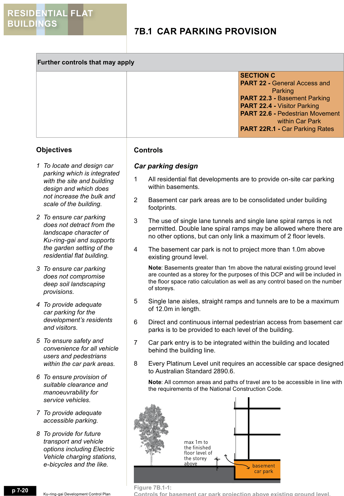

#### 7B	 	 Access and Parking

7B.1  	 Car Parking Provision 7B.2  	 Bicycle Parking Provision

### READ WITH

#### SECTION C

PART 22 - General Access and Parking

22.3: Basement Parking

22.4: Visitor Parking Design

22.6: Pedestrian Movement within Car Parks

22.7: Bicycle Parking and Facilities

22R.1: Car Parking Rates

### REFER TO

#### LIVABLE HOUSING DESIGN GUIDELINES

> [Picture on page 19: a picture, saved as a picture (images/part-07-residential-flat-buildings-page-19-15.gif, 150 dpi).]

### REFER TO

#### SEPP (HOUSING) 2021 APARTMENT DESIGN GUIDE

### ACCESS AND PARKING

> [Picture on page 20: a map, saved as a picture (images/part-07-residential-flat-buildings-page-20-1.gif, 150 dpi); the street names and other small labels are on the picture.]
> Words printed on the picture (title and legend, copied from the PDF):
> within Car Park
> parking which is integrated
> design and which does
> scale of the building.
> landscape character of
> Ku-ring-gai and supports
> residential flat building.
> existing ground level.
> Note: Basements greater than 1m above the natural existing ground level
> are counted as a storey for the purposes of this DCP and will be included in
> the floor space ratio calculation as well as any control based on the number
> does not compromise
> deep soil landscaping
> of 12.0m in length.
> 4	 To provide adequate
> car parking for the
> behind the building line.
> convenience for all vehicle
> users and pedestrians
> to Australian Standard 2890.6.
> Note: All common areas and paths of travel are to be accessible in line with
> the requirements of the National Construction Code.
> suitable clearance and
> 7	 To provide adequate
> transport and vehicle
> options including Electric
> Vehicle charging stations,
> e-bicycles and the like.
> max 1m to
> floor level of
> Controls for basement car park projection above existing ground level.

Figure 7B.1-1:
