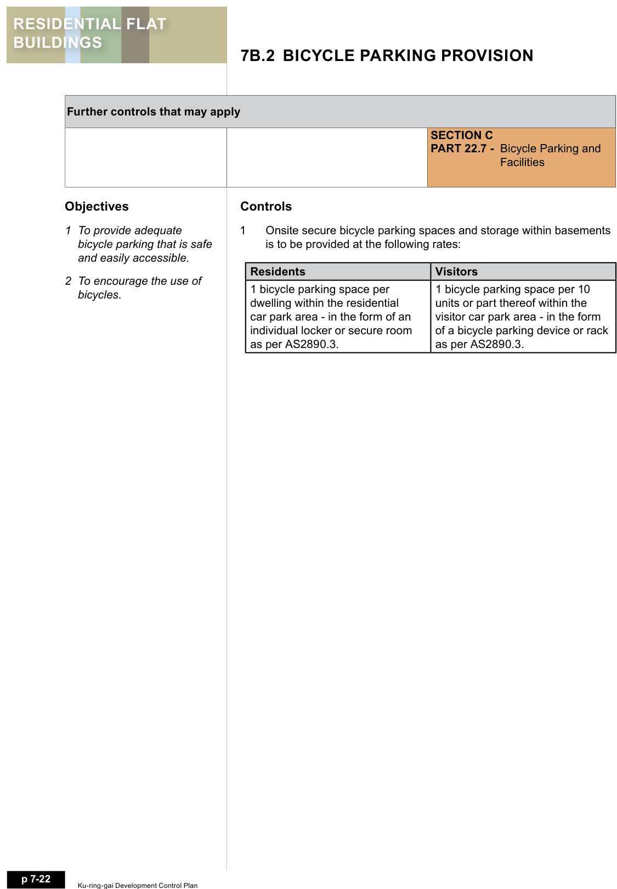

### 7B.1  CAR PARKING PROVISION

#### Further controls that may apply

#### SECTION C

PART 22 - General Access and

PART 22.3 - Basement Parking

PART 22.4 - Visitor Parking

PART 22.6 - Pedestrian Movement

PART 22R.1 - Car Parking Rates

#### Objectives

#### Controls Car parking design

1 All residential flat developments are to provide on-site car parking

1	 To locate and design car

with the site and building

not increase the bulk and

2 Basement car park areas are to be consolidated under building

3 The use of single lane tunnels and single lane spiral ramps is not

permitted. Double lane spiral ramps may be allowed where there are

no other options, but can only link a maximum of 2 floor levels.

2	 To ensure car parking

does not detract from the

the garden setting of the

4 The basement car park is not to project more than 1.0m above

3	 To ensure car parking

5 Single lane aisles, straight ramps and tunnels are to be a maximum

6 Direct and continuous internal pedestrian access from basement car

parks is to be provided to each level of the building. 7 Car park entry is to be integrated within the building and located

5	 To ensure safety and

within the car park areas. 8 Every Platinum Level unit requires an accessible car space designed 6	 To ensure provision of

8	 To provide for future

### 7B

### 7B.1 CAR PARKING PROVISION (continued)

#### Controls Car parking rates

9 The following parking ranges apply to residential flat developments

on sites within 800m walking distance of a railway station entry:

| Apartment Size | Minimum number of parking spaces per dwelling | Maximum number of parking spaces per dwelling |
|---|---|---|
| Studio | 0 spaces | 0.5 spaces |
| One bedroom | 0.6 spaces | 1 space |
| Two bedrooms | 1.0 space | 1.25 spaces |
| Three or more bedrooms | 1.4 spaces | 2 spaces |

Car parking exceeding the requirements of the parking controls in

the above table will not be excluded from the Gross Floor Area as

defined in the KLEP. 10 For all other locations, car parking is to be provided in accordance

with the parking rates in Section C Part 22R.1. Note: A Traffic Impact Assessment is to accompany Development

Applications that seek to vary the parking rates. This includes commercial or strata funded car share schemes in lieu of parking spaces. 11 At least one visitor car space is to be accessible and be provided

within the site for every 6 apartments or part thereof, and is to

comply with the dimensional and locational requirements of

AS2890.6. 12 One visitor parking bay is to be provided with a tap, to make

provision for on-site car washing. 13 A clearly signposted parking bay for temporary parking of service

and removalist vehicles is to be provided. The space is to have the

following standards:

i) a minimum dimension of 3.5m x 6m;

ii)	 a minimum manoeuvring area 7m wide. Note: Where a separate space can not be provided, one of the visitor

spaces may be used as the service/removalist parking spaces provided it

meets the dimensions stated in 13(i) and 13(ii) above. 14 At least one car share space is to be provided in the basement per

90 dwellings, or part thereof.

### ACCESS AND PARKING

Note: any proposed reduction in car parking on the basis of providing car

share space/s is to be justified by the proponent through supporting studies. 15 All parking bays are to be EV ready with design and construction

(provision for conduits, switchboards, electrical capacity etc) to

enable installation of electric vehicle charging points that are linked

to each individual dwelling electricity meter.

> [Picture on page 22: a picture, saved as a picture (images/part-07-residential-flat-buildings-page-22-1.gif, 150 dpi).]
> Words printed on the picture (title and legend, copied from the PDF):
> Facilities
> 1	 To provide adequate
> and easily accessible.
> bicycles.
