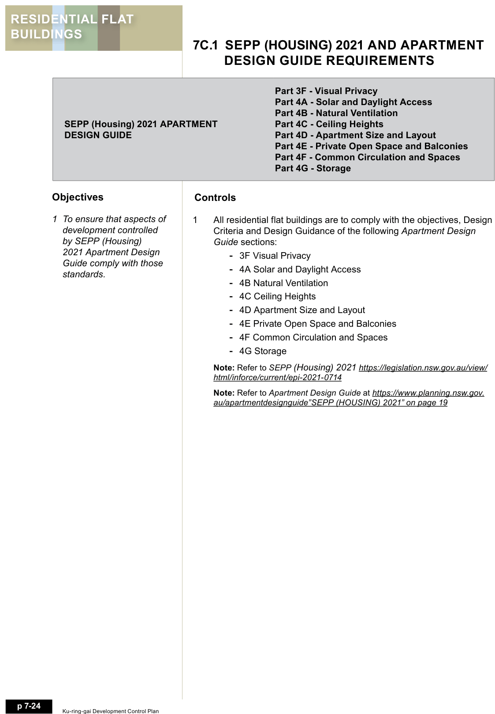

#### 7C	 	 Building Design and Sustainability

7C.1  	 SEPP (Housing) 2021 and Apartment Design

Guide Requirements

7C.2  	 Communal Open Space 7C.3  	 Ground Floor Apartments 7C.4  	 Apartment Mix and Accessibility 7C.5  	 Building Entries 7C.6  	 Building Form and Facades 7C.7  	 Building Storeys 7C.8  	 Top Storey Design and Roof Forms 7C.9  	 Laundry and Air Clothes Drying Facilities 7C.10  	Fencing 7C.11	 Acoustic Privacy 7C.12	 Services

### READ WITH

#### SECTION A

PART 1 - Introduction

1B.1: Dictionary

PART 7 - Residential Flat Buildings

7A.5: Building Separation

PART 12 - Signage and Advertising

#### SECTION C

PART 22 - General Access and Parking

22.1: Equitable Access

PART 23 - General Building Design and Sustainability

23.3: Sustainability of Building Materials

23.4: Materials, Finishes and Colours

23.6: Building Services

23.7: General Acoustic Privacy

23.8: General Visual Privacy

PART 25 - Waste Management

#### REFER TO

#### SEPP (Housing) 2021 APARTMENT DESIGN GUIDE

PART 3F - Visual Privacy

PART 4A - Solar and Daylight Access

PART 4B - Natural Ventilation

PART 4C - Internal Ceiling Heights

PART 4D - Apartment Size and Layout

PART 4E - Private Open Space

PART 4F - Common Circulation and Spaces

PART 4G - Storage

### REFER TO

### BUILDING DESIGN AND SUSTAINABILITY

#### LIVABLE HOUSING DESIGN GUIDELINES

> [Picture on page 24: a picture, saved as a picture (images/part-07-residential-flat-buildings-page-24-1.gif, 150 dpi).]
> Words printed on the picture (title and legend, copied from the PDF):
> Guide sections:
> development controlled
> by SEPP (Housing)
> 2021 Apartment Design
> Guide comply with those
> standards.
> html/inforce/current/epi-2021-0714
> Note: Refer to Apartment Design Guide at https://www.planning.nsw.gov.
> au/apartmentdesignguide”SEPP (HOUSING) 2021” on page 19
