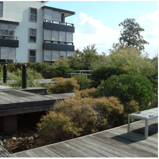
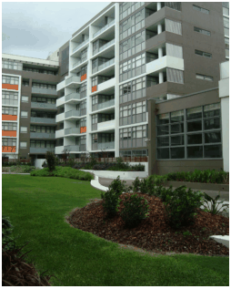
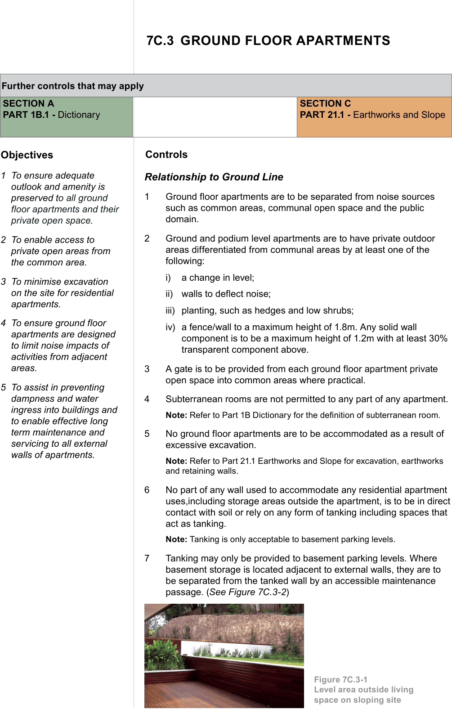

### 7C.2  COMMUNAL OPEN SPACE

#### Further controls that may apply SECTION A

PART 1B - Dictionary

#### Objectives

#### Controls

1 At least 10% of the site area is to be provided as communal open

space. Each parcel of communal open space is to have a minimum

dimension of 5m.

1	 To provide adequate safe,

useable, attractive and

accessible communal

open spaces for residents.

2 At least one single parcel of Primary communal open space is to be

provided with the following requirements:

i) a minimum area of 80m2; and

ii)	 a minimum dimension of 8m.

2	 To provide communal

open space that

adds to the amenity

of the development

and facilitates social

interaction.

3 The Primary communal open space is to be directly accessible from

the internal common circulation areas.

3	 To provide communal

open space that is

responsive to the site and

its context.

4 The Primary communal open space is to be located at or above

finished ground level behind the building line. Roof top Primary

communal open space may be provided where the ground level

cannot meet performance requirements or is undesirable. 5 Secondary communal open spaces are to have a minimum

dimension of 5.0m and may be provided on roof tops.

4	 To ensure high quality

communal open space

that is well integrated

within the development.

6 Access to and within the Primary communal open space is to be

provided for people with a disability Part 2 Section 7 of AS1428.

5	 To provide a Primary

communal open space

that is of a size conducive

to outdoor activities by

families and groups.

7 The location and design of the Primary communal open space is to

optimise opportunities for active and passive social and recreation

activities, solar access and orientation, summer shade, outlook, and

maintain the privacy of residents on adjoining sites zoned differently

for lower density residential development sites. 8 At least 50% of the area of the Primary communal open space and

any Secondary communal open space are to receive direct sunlight

for at least two hours between 9am and 3pm on 21st June.

6	 To ensure that the design

of communal open space

protects the privacy of

onsite and neighbouring

residents.

9 Communal open space is to be integrated with any significant natural

feature(s) of the site and soft landscaping areas.

7	 To ensure occupants have

direct access to sunlight

within areas of communal

open space.

10 The communal open space is to have surveillance from at least two

onsite apartments for safety reasons. 11 Communal open space design is to avoid creation of concealment or

entrapment areas. Note: Communal open space is to be well lit with an energy efficient lighting

system to be used in conjunction with timers or daylight controls. All light

spill is prohibited.

8	 To ensure early

consideration of storage

of equipment, access to

water, ease of rubbish

removal and effective

drainage for garden

maintenance.

### BUILDING DESIGN AND SUSTAINABILITY

### 7C.2 COMMUNAL OPEN SPACE (continued)

#### Controls

#### Objectives

9	 To prevent subterranean

communal open areas.

12 Shared facilities such as barbecue facilities, shade structures,

play equipment and seating, are to be provided within the Primary

communal open space. Note: Selected items within communal open spaces are to be appropriate

to the space and demonstrate consideration of the amenity of nearby apartments. 13 Garden maintenance storage areas, drainage and connections to

water taps are to be provided with the Primary communal open

space. Secondary communal open spaces are to have adequate

connections to water for maintenance purposes. Note: Proposals are to demonstrate entry and access to communal open

spaces and common areas for maintenance purposes. Note: Refer to Section A Part 1B Dictionary for definitions of Communal

> [Picture on page 26: a picture, saved as a picture (images/part-07-residential-flat-buildings-page-26-19.gif, 150 dpi).]

Open Space and Common Area.

> [Picture on page 26: a picture, saved as a picture (images/part-07-residential-flat-buildings-page-26-21.gif, 150 dpi).]

#### Figure 7C.2-2:

#### Well designed communal open

space with lighting and seating.

#### Figure 7C.2-1:

#### Communal open space

overlooked by adjacent

apartments for casual

surveillance.

> [Picture on page 27: a map, saved as a picture (images/part-07-residential-flat-buildings-page-27-1.gif, 150 dpi); the street names and other small labels are on the picture.]
> Words printed on the picture (title and legend, copied from the PDF):
> PART 1B.1 - Dictionary
> 1	 To ensure adequate
> outlook and amenity is
> preserved to all ground
> floor apartments and their
> private open space.
> private open areas from
> the common area.
> 3	 To minimise excavation
> transparent component above.
> apartments are designed
> activities from adjacent
> Note: Refer to Part 1B Dictionary for the definition of subterranean room.
> dampness and water
> ingress into buildings and
> to enable effective long
> term maintenance and
> servicing to all external
> walls of apartments.
> Note: Refer to Part 21.1 Earthworks and Slope for excavation, earthworks
> and retaining walls.
> act as tanking.
> Note: Tanking is only acceptable to basement parking levels.
> passage. (See Figure 7C.3-2)
> Level area outside living
> space on sloping site

Figure 7C.3-1
