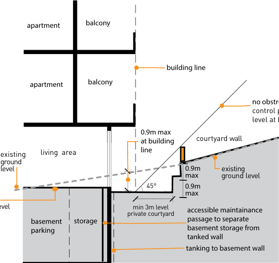

### 7C.3  GROUND FLOOR APARTMENTS

#### Further controls that may apply SECTION A

#### SECTION C

PART 21.1 - Earthworks and Slope

#### Objectives

#### Controls Relationship to Ground Line

1 Ground floor apartments are to be separated from noise sources

such as common areas, communal open space and the public

2 Ground and podium level apartments are to have private outdoor

areas differentiated from communal areas by at least one of the

following:

2	 To enable access to

i) a change in level;

ii)	 walls to deflect noise;

on the site for residential

iii)	 planting, such as hedges and low shrubs;

iv)	 a fence/wall to a maximum height of 1.8m. Any solid wall

component is to be a maximum height of 1.2m with at least 30%

4	 To ensure ground floor

to limit noise impacts of

3 A gate is to be provided from each ground floor apartment private

open space into common areas where practical. 4 Subterranean rooms are not permitted to any part of any apartment.

5 No ground floor apartments are to be accommodated as a result of

5	 To assist in preventing

6 No part of any wall used to accommodate any residential apartment

uses,including storage areas outside the apartment, is to be in direct

contact with soil or rely on any form of tanking including spaces that

7 Tanking may only be provided to basement parking levels. Where

basement storage is located adjacent to external walls, they are to

be separated from the tanked wall by an accessible maintenance

### BUILDING DESIGN AND SUSTAINABILITY

### 7C.3 GROUND FLOOR APARTMENTS

### (continued)

#### Controls

> [Picture on page 28: a map, saved as a picture (images/part-07-residential-flat-buildings-page-28-4.gif, 150 dpi); the street names and other small labels are on the picture.]
> Words printed on the picture (title and legend, copied from the PDF):
> min 3m level
> passage to separate
> basement storage from
> tanking to basement wall

no obstruction within 45° control plane from ground level at building line

finished

ground level

#### Figure 7C.3-2:

#### Ground floor apartments located below ground level

8 The internal finished floor level of any part of a ground floor

apartment and/or private open space is not to be more than 0.9m

below existing ground level at the building line. 9 Where the internal finished floor level of a ground floor apartment

and/or private open space is not more than 0.9m below the existing

ground level at the building line, the ground level adjacent to the

building is to be levelled to the finished floor level for a distance of

3.0m from the building line (see Figure 7C.3-2). Note: A step at the threshold for compliance with waterproofing

requirements is acceptable. Note: Thresholds to the primary private open space are to be accessible for

all Platinum Level dwellings. 10 All obstructions, such as retaining walls or fences, are to be located

below a 45˚ control plane, drawn from the finished ground level at

the building line. Landscaping plants may project beyond the 45˚

control plane (see Figure 7C.3-2).
