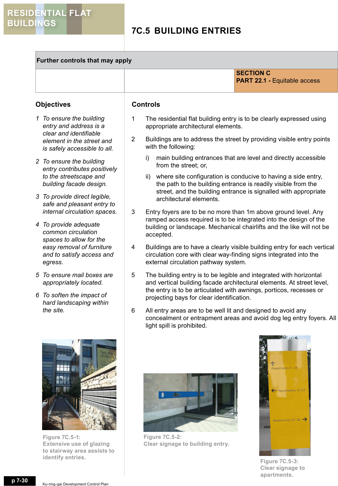

### 7C.4  APARTMENT MIX AND ACCESSIBILITY

#### Further controls that may apply SECTION A

PART 1B.1 - Dictionary

#### SECTION C

PART 22.1 - Equitable access

#### Objectives

#### Controls

1 A range of apartment sizes (one, two, three bedroom) and a mix of

types are to be included within the development. 2 A mix of one, two and three-bedroom apartments are to be located

on the ground level.

1	 To increase housing

diversity and choice

within Ku-ring-gai through

provision of a range of

apartment sizes and

types.

#### Accessible Housing

3 All units in the residential flat building development are to be of Silver

Level, and 15% of those are to be of Platinum Level as indicated in

the Livable Housing Design Guideline.

2	 To increase the housing

choice for seniors, people

with disabilities and for

families.

Note: For details on the Liveable Housing Design Guideline refer to www.

livablehousingaustralia.org.au. 4 All developments are required to meet the KDCP Livable Housing

Design Guideline provisions and National Construction Code

accessibility requirements regardless of steepness of site.

3	 To promote flexible

housing for all community

members and for changing

household requirements

now and in the future

as needs change due to

ageing and disability.

Note: This control applies to development on all sites including those that

are steeper than 1:14. 5 All development is to provide an accessible path of travel:

i) from the street entry to the front door of each dwelling; and

ii)	 from the basement carparking to the dwelling entry; and

iii)	 from the dwelling to the primary communal open space and each

type of room or space for use in common by the residents. Note: Provision is to be made for wheelchair turning circles where required. Note: The control above applies to all development regardless of the

steepness of the site.

4	 To ensure all

developments and

dwellings incorporate

Livable Housing Design

Guide provisions and

National Construction

Code accessibility

requirements, to and

within dwellings,

regardless of the

steepness of a site.

6 Where the internal finished floor level of a ground floor dwelling

and/or private open space is not more than 0.9m below the existing

ground level at the building line, the ground level adjacent to the

building is to be levelled to the finished floor level for a distance of

3.0m from the building line. Note: A step at the threshold for compliance with waterproofing

requirements is acceptable, however thresholds to the primary private open

space are to be accessible for all Platinum Level dwellings. 7 For Platinum level units with more than one level, an internal lift is to

be provided to allow access to all levels. Note: Provision of a lift is not in lieu of accommodating Platinum Level

provisions required at the dwelling entry level.

### BUILDING DESIGN AND SUSTAINABILITY

8 Chair lifts, platform lifts and the like are not permitted on internal

and external communal/shared paths and circulation areas. Where

lifts are required they are to be constructed within lift shafts with full

weather protection for users.

> [Picture on page 30: a map, saved as a picture (images/part-07-residential-flat-buildings-page-30-1.gif, 150 dpi); the street names and other small labels are on the picture.]
> Words printed on the picture (title and legend, copied from the PDF):
> appropriate architectural elements.
> clear and identifiable
> from the street; or,
> entry contributes positively
> to the streetscape and
> building facade design.
> 4	 To provide adequate
> easy removal of furniture
> external circulation pathway system.
> hard landscaping within
> light spill is prohibited.
> Clear signage to building entry.
> Extensive use of glazing
> to stairway area assists to
> Clear signage to

Figure 7C.5-2:

Figure 7C.5-1:

Figure 7C.5-3:
